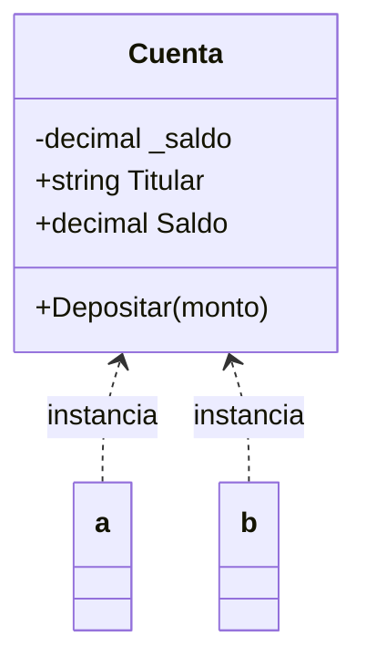

# Clases y objetos

Parte de: [[03-CSharp-DotNet/02 Orientación a objetos/_Índice Orientación a objetos|Orientación a objetos]]

> [!info] Cómo avanzar
> `progreso`: **pendiente** → **viendo** (estudiando) → **visto** (contestaste la autoevaluación sin abrir las respuestas) → **dominado** (hiciste el laboratorio o lo aplicaste de verdad).

## Contenido

### Qué es
Una **clase** es una **definición**: describe qué datos (campos y propiedades) y qué comportamiento (métodos) tendrán sus objetos. Un **objeto** es una **instancia** concreta de esa clase, creada en memoria con `new`, con sus propios valores. La clase es el plano; los objetos son las casas construidas con ese plano. En C# las clases son **tipos de referencia**: las variables guardan una referencia al objeto, no el objeto en sí.

### Cómo funciona
```csharp
public sealed class Cuenta
{
    private decimal _saldo;                       // campo (estado privado)

    public Cuenta(string titular) => Titular = titular;   // constructor

    public string Titular { get; }                // propiedad de solo lectura
    public decimal Saldo => _saldo;               // propiedad calculada

    public void Depositar(decimal monto)          // método (comportamiento)
    {
        if (monto <= 0) throw new ArgumentOutOfRangeException(nameof(monto));
        _saldo += monto;
    }
}

var a = new Cuenta("Ana");     // objeto 1
var b = new Cuenta("Luis");    // objeto 2, con su propio _saldo
a.Depositar(100);
Console.WriteLine(b.Saldo);    // 0: cada objeto tiene su estado
```

1. `new Cuenta("Ana")` reserva memoria en el heap, pone los campos en su valor por defecto y ejecuta el constructor (ver [[Constructores]]).
2. La variable `a` guarda la referencia. Si haces `var c = a;`, `c` y `a` son **el mismo objeto** (ver [[Tipos de valor y de referencia]]).
3. Cuando ya nadie referencia el objeto, el recolector de basura libera su memoria en algún momento.

**Comparar con `==`**: en una clase que no sobrecarga el operador, `==` compara **referencias**: es `true` solo si ambas variables apuntan al mismo objeto, aunque los datos sean idénticos.
```csharp
var x = new Cuenta("Ana");
var y = new Cuenta("Ana");
Console.WriteLine(x == y);          // False: dos objetos distintos
Console.WriteLine(x == x);          // True
```
Si quieres igualdad por datos, usa un `record` o sobrescribe `Equals`/`GetHashCode` (ver [[Igualdad por valor vs por referencia]] y [[record]]).

**Miembros de una clase**: campos, propiedades, métodos, constructores, eventos, indexadores, operadores y tipos anidados. Cada uno con su modificador de acceso (ver [[Propiedades, campos y modificadores de acceso]]).



**`sealed` por defecto**: una clase `sealed` no se puede heredar. Conviene marcar así toda clase que **no fue diseñada para herencia**, que en una API es casi todo: handlers, controllers, validadores, servicios, DTOs. Razones: diseñar para herencia es difícil (hay que decidir qué es `virtual`, qué invariantes deben respetar las derivadas), `sealed` comunica la intención, evita que alguien herede y dependa de detalles internos, y permite al JIT optimizar llamadas (desvirtualización). Si algún día hace falta heredar, quitar `sealed` no rompe a nadie; agregarlo después sí. Ver [[sealed y override]].

### Ejemplo
Una entidad sencilla con identidad para Pochteca.Nomisma, junto con su uso:
```csharp
public sealed class Producto
{
    public Producto(string sku, string nombre, decimal precio)
    {
        ArgumentException.ThrowIfNullOrWhiteSpace(sku);
        ArgumentOutOfRangeException.ThrowIfNegative(precio);
        Id = Guid.CreateVersion7();
        Sku = sku.ToUpperInvariant();
        Nombre = nombre;
        Precio = precio;
    }

    public Guid Id { get; }
    public string Sku { get; }
    public string Nombre { get; private set; }
    public decimal Precio { get; private set; }

    public void CambiarPrecio(decimal nuevo)
    {
        ArgumentOutOfRangeException.ThrowIfNegative(nuevo);
        Precio = nuevo;
    }

    public override string ToString() => $"{Sku} {Nombre} {Precio:C}";
}

var p = new Producto("abc-1", "Taza", 89.90m);
p.CambiarPrecio(99m);
Console.WriteLine(p);   // ABC-1 Taza $99.00
```

### Cuándo usarlo y cuándo no
- **Clase**: objetos con identidad y ciclo de vida (entidades), con comportamiento y estado protegido, servicios y handlers.
- **`record`**: datos inmutables que se comparan por valor (DTOs, comandos, resultados).
- **`struct`**: valores pequeños donde la copia es barata (ver [[struct]]).
- **`static class`**: funciones sin estado (ver [[Clases estáticas y miembros estáticos]]).

### Errores comunes
- **Esperar que `==` compare datos** en clases normales.
- **Clases "anémicas"** con todas las propiedades `public set` y la lógica regada en otros lados: pierdes las garantías del [[Encapsulamiento]].
- **No sellar** clases que no son para herencia.
- **Clases "Dios"** con decenas de responsabilidades: divide por responsabilidad o por slice.

### Para profundizar
- [Clases (fundamentos de C#)](https://learn.microsoft.com/dotnet/csharp/fundamentals/types/classes)
- [Objetos: crear instancias de tipos](https://learn.microsoft.com/dotnet/csharp/fundamentals/object-oriented/objects)
- [Programación orientada a objetos en C#](https://learn.microsoft.com/dotnet/csharp/fundamentals/tutorials/oop)

## Autoevaluación

Contesta primero en voz alta o en papel; luego despliega la respuesta.

> [!question]- ¿Qué diferencia hay entre una clase y un objeto?
> La clase es la definición (estado y comportamiento); el objeto es una instancia concreta creada con `new`, con su propio estado en el heap.

> [!question]- ¿Qué pasa al comparar dos objetos de una clase con `==` sin sobrecargarlo?
> Compara **referencias**: solo es `true` si son el mismo objeto, aunque tengan los mismos datos.

> [!question]- ¿Cuándo una clase debería ser `sealed` por defecto?
> Casi siempre que no fue diseñada para heredarse (handlers, controllers, servicios). Evita herencias accidentales y permite optimizaciones del JIT.

