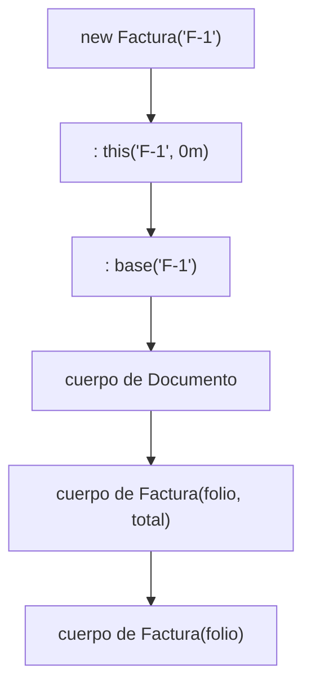

# Constructores

Parte de: [[03-CSharp-DotNet/02 Orientación a objetos/_Índice Orientación a objetos|Orientación a objetos]]

> [!info] Cómo avanzar
> `progreso`: **pendiente** → **viendo** (estudiando) → **visto** (contestaste la autoevaluación sin abrir las respuestas) → **dominado** (hiciste el laboratorio o lo aplicaste de verdad).

## Contenido

### Qué es
Un **constructor** es un método especial que se ejecuta al crear un objeto con `new`. Su trabajo es dejar el objeto en un **estado válido** desde el primer momento: asignar valores obligatorios, validar argumentos y recibir dependencias. Tiene el mismo nombre que la clase y no declara tipo de retorno.

### Cómo funciona
**Constructor clásico**
```csharp
public sealed class Cuenta
{
    private readonly ILogger<Cuenta> _log;

    public Cuenta(string titular, ILogger<Cuenta> log)
    {
        ArgumentException.ThrowIfNullOrWhiteSpace(titular);
        Titular = titular;
        _log = log;
    }

    public string Titular { get; }
}
```
Si no escribes ningún constructor, el compilador genera uno sin parámetros. En cuanto escribes uno con parámetros, ese constructor implícito desaparece.

**Orden de ejecución** al hacer `new Derivada()`:
1. Inicializadores de campos de la derivada.
2. Constructor de la base (`: base(...)`), con sus propios inicializadores primero.
3. Cuerpo del constructor de la derivada.

**Encadenamiento**
- `: this(...)` llama a **otro constructor de la misma clase** antes del cuerpo; evita duplicar validaciones.
- `: base(...)` llama al **constructor de la clase padre**; obligatorio si la base no tiene constructor sin parámetros.
```csharp
public class Documento
{
    protected Documento(string folio) => Folio = folio;
    public string Folio { get; }
}

public sealed class Factura : Documento
{
    public Factura(string folio, decimal total) : base(folio) => Total = total;
    public Factura(string folio) : this(folio, 0m) { }   // reutiliza el anterior
    public decimal Total { get; }
}
```

**Primary constructors (C# 12)**: los parámetros van en la declaración del tipo y quedan disponibles en todo el cuerpo. Es la forma corta de recibir dependencias inyectadas:
```csharp
public sealed class RegistrarEgreso(IRegistrarEgresoSql sql, TimeProvider reloj, ILogger<RegistrarEgreso> log)
{
    public async Task Handle(Comando cmd, CancellationToken ct)
    {
        await sql.EjecutarAsync(new(cmd.Concepto, cmd.Monto, reloj.GetUtcNow()), ct);
        log.LogInformation("Egreso registrado");
    }
}
```

**`class` vs `record` con primary constructor**
| | `class C(int x)` | `record R(int X)` |
|---|---|---|
| ¿Genera propiedades públicas? | **no**, solo parámetros capturados | **sí**, `public int X { get; init; }` |
| ¿Se pueden reasignar? | sí, dentro de la clase (no son `readonly`) | las propiedades son `init` |
| Igualdad, `ToString`, deconstrucción | no | sí |

Si quieres que un parámetro de una clase sea inmutable, asígnalo a un campo: `private readonly IRegistrarEgresoSql _sql = sql;`.



### Ejemplo
Constructor privado más métodos de fábrica para controlar la creación de una entidad (crear vs reconstruir desde la BD):
```csharp
public sealed class Egreso
{
    private Egreso(Guid id, string concepto, decimal monto, EstadoEgreso estado)
    {
        Id = id; Concepto = concepto; Monto = monto; Estado = estado;
    }

    public Guid Id { get; }
    public string Concepto { get; private set; }
    public decimal Monto { get; private set; }
    public EstadoEgreso Estado { get; private set; }

    // Crear: aplica reglas de negocio
    public static Egreso Crear(string concepto, decimal monto)
    {
        ArgumentException.ThrowIfNullOrWhiteSpace(concepto);
        ArgumentOutOfRangeException.ThrowIfNegativeOrZero(monto);
        return new(Guid.CreateVersion7(), concepto.Trim(), monto, EstadoEgreso.Borrador);
    }

    // Reconstruir desde una fila: los datos ya eran válidos
    public static Egreso Rehydrate(Guid id, string concepto, decimal monto, EstadoEgreso estado)
        => new(id, concepto, monto, estado);
}
```

Inicialización asíncrona sin hacer I/O en el constructor:
```csharp
public sealed class CatalogoCuentas
{
    private readonly IReadOnlyDictionary<string, Cuenta> _cuentas;
    private CatalogoCuentas(IReadOnlyDictionary<string, Cuenta> c) => _cuentas = c;

    public static async Task<CatalogoCuentas> CrearAsync(ICuentasSql sql, CancellationToken ct)
    {
        var lista = await sql.ListarAsync(ct);
        return new(lista.ToDictionary(c => c.Codigo));
    }
}
```

### Cuándo usarlo y cuándo no
- **Primary constructor** en handlers, controllers, middleware y servicios que solo reciben dependencias.
- **Constructor clásico** cuando necesitas validar y asignar a propiedades de solo lectura, o varias sobrecargas.
- **Constructor privado + fábricas** (`Crear`, `Rehydrate`) en entidades de dominio con reglas.
- **`required` + `init`** como alternativa para objetos con muchas propiedades (ver [[init y required]]).

### Errores comunes
- **Hacer I/O en el constructor** (consultar la BD, llamar HTTP, leer archivos): los constructores no pueden ser `async`, el contenedor de DI los ejecuta cuando resuelve dependencias (a veces en momentos inesperados), y si fallan dejan errores difíciles de diagnosticar. Usa una fábrica `CrearAsync` o inicializa al arrancar la app.
- **Constructores con demasiados parámetros** (más de 5–6 dependencias): señal de que la clase hace demasiado.
- **Llamar métodos virtuales desde el constructor**: la derivada aún no se inicializó (ver [[Polimorfismo]]).
- **Reasignar sin querer un parámetro de primary constructor** en una clase: no es `readonly`.

### Para profundizar
- [Constructores (guía de programación de C#)](https://learn.microsoft.com/dotnet/csharp/programming-guide/classes-and-structs/constructors)
- [Tutorial: primary constructors](https://learn.microsoft.com/dotnet/csharp/whats-new/tutorials/primary-constructors)
- [Uso de constructores](https://learn.microsoft.com/dotnet/csharp/programming-guide/classes-and-structs/using-constructors)

## Autoevaluación

Contesta primero en voz alta o en papel; luego despliega la respuesta.

> [!question]- ¿Qué es un *primary constructor* en una clase (C# 12)?
> Parámetros en la declaración: `public sealed class Handler(IEgresosSql sql, TimeProvider reloj)`. Están disponibles en toda la clase; es la forma corta de inyectar dependencias.

> [!question]- ¿Qué diferencia hay entre un primary constructor de `class` y uno de `record`?
> En `record` los parámetros se vuelven propiedades públicas. En `class` son solo parámetros capturados (no propiedades) y se pueden reasignar; si quieres inmutabilidad asígnalos a un campo `readonly`.

> [!question]- ¿Para qué sirve encadenar con `: this(...)` o `: base(...)`?
> `this(...)` reutiliza otro constructor de la misma clase; `base(...)` llama al de la clase padre antes de ejecutar el cuerpo.

> [!question]- Error común: un constructor que hace I/O (consultar la BD, llamar HTTP). ¿Por qué evitarlo?
> Los constructores no pueden ser `async`, el contenedor de DI los ejecuta en lugares inesperados y un fallo deja el objeto a medias. Usa un método de fábrica `CrearAsync` o inicializa al arrancar.

## Práctica

- [[Lab 2 - Modelo de dominio con encapsulamiento y records]]

