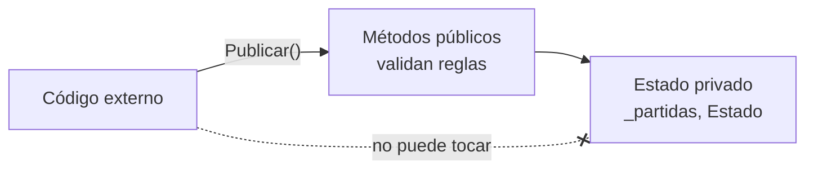

# Encapsulamiento

Parte de: [[03-CSharp-DotNet/02 Orientación a objetos/_Índice Orientación a objetos|Orientación a objetos]]

> [!info] Cómo avanzar
> `progreso`: **pendiente** → **viendo** (estudiando) → **visto** (contestaste la autoevaluación sin abrir las respuestas) → **dominado** (hiciste el laboratorio o lo aplicaste de verdad).

## Contenido

### Qué es
**Encapsular** es ocultar el estado interno de un objeto y exponer solo **operaciones** que mantienen sus reglas (invariantes). Si nadie puede modificar los datos "por fuera", el objeto nunca queda en un estado inválido: un pedido no puede tener total negativo, un egreso publicado no puede volver a borrador sin pasar por la regla que lo permite. Es uno de los pilares de la orientación a objetos y la diferencia entre un **modelo de dominio** y una simple bolsa de datos.

### Cómo funciona
Las herramientas en C#:
- **Modificadores de acceso** (`private`, `internal`, `protected`, `public`): deciden quién ve cada miembro (ver [[Propiedades, campos y modificadores de acceso]]).
- **Propiedades con `private set`** o solo `get`: se leen desde fuera, se cambian solo desde dentro.
- **Métodos con intención**: `Publicar()`, `Archivar()`, `AgregarPartida()` en lugar de `Estado = ...`. Cada método valida antes de cambiar el estado.
- **Colecciones de solo lectura** hacia afuera (`IReadOnlyList<T>`) con la lista real en un campo privado.
- **Constructores privados y fábricas** (`Crear`, `Rehydrate`) para controlar cómo nacen los objetos.



**Setters privados y `Rehydrate`**: con setters privados, la única forma de cambiar el estado es por los métodos de dominio, que validan. Pero al leer de la base de datos necesitas reconstruir el objeto con los valores guardados (por ejemplo, un egreso ya `Publicado`), y no tiene sentido volver a pasar por las reglas de **creación** (que exigirían, por ejemplo, empezar en `Borrador`). `Rehydrate` es una fábrica estática que construye la entidad desde una fila **sin** reaplicar esas reglas, porque los datos ya eran válidos cuando se guardaron. `Crear` sí aplica todas las reglas.

**El problema de `public List<Item> Items { get; }`**: aunque la propiedad no tenga `set`, la **lista** es mutable: cualquiera puede hacer `pedido.Items.Add(...)`, `Clear()` o `Items[0] = ...`, saltándose las validaciones (máximo de partidas, recalcular el total). La solución es guardar la lista en un campo privado y exponer `IReadOnlyList<Item>`, junto con un método `AgregarItem` que valide.

### Ejemplo
Entidad encapsulada (estilo Itzamna.Dionisio):
```csharp
public enum EstadoPedido { Borrador = 0, Confirmado = 1, Cancelado = 2 }

public sealed record Partida(string Sku, int Cantidad, decimal PrecioUnitario)
{
    public decimal Importe => Cantidad * PrecioUnitario;
}

public sealed class Pedido
{
    private const int MaxPartidas = 50;
    private readonly List<Partida> _partidas = [];

    private Pedido(Guid id, EstadoPedido estado) { Id = id; Estado = estado; }

    public Guid Id { get; }
    public EstadoPedido Estado { get; private set; }
    public IReadOnlyList<Partida> Partidas => _partidas;          // vista de solo lectura
    public decimal Total => _partidas.Sum(p => p.Importe);         // siempre consistente

    public static Pedido Crear() => new(Guid.CreateVersion7(), EstadoPedido.Borrador);

    public static Pedido Rehydrate(Guid id, EstadoPedido estado, IEnumerable<Partida> partidas)
    {
        var p = new Pedido(id, estado);
        p._partidas.AddRange(partidas);       // sin reglas de creación
        return p;
    }

    public void AgregarPartida(Partida partida)
    {
        if (Estado != EstadoPedido.Borrador)
            throw new InvalidOperationException("Solo se editan pedidos en borrador.");
        if (_partidas.Count >= MaxPartidas)
            throw new InvalidOperationException($"Máximo {MaxPartidas} partidas.");
        ArgumentOutOfRangeException.ThrowIfNegativeOrZero(partida.Cantidad);
        _partidas.Add(partida);
    }

    public void Confirmar()
    {
        if (_partidas.Count == 0) throw new InvalidOperationException("Pedido vacío.");
        Estado = EstadoPedido.Confirmado;
    }
}

var pedido = Pedido.Crear();
pedido.AgregarPartida(new("TAZA-01", 2, 89.90m));
pedido.Confirmar();
// pedido.Estado = EstadoPedido.Borrador;   → no compila
// pedido.Partidas.Add(...)                 → no compila (IReadOnlyList)
```
Un detalle: `IReadOnlyList<T>` impide modificar a través de esa referencia, pero alguien podría hacer cast a `List<T>`. Si necesitas una garantía fuerte, expón `_partidas.AsReadOnly()` (un `ReadOnlyCollection<T>`) o una copia.

### Cuándo usarlo y cuándo no
- **Entidades de dominio con reglas**: encapsula siempre; el estado se cambia solo por métodos con nombre de negocio.
- **DTOs, comandos y resultados** (`record`): no necesitan encapsulamiento fuerte; son datos inmutables para transportar.
- **Servicios y handlers**: encapsula sus dependencias (`private readonly` o primary constructor) y expón solo el método `Handle`.
- No escribas getters y setters triviales "por costumbre" en todo: encapsular es proteger **reglas**, no esconder datos sin motivo.

### Errores comunes
- **Modelo anémico**: todas las propiedades `public set` y la lógica en servicios externos; las reglas se duplican y se olvidan.
- **Exponer colecciones mutables** (`List<T>` público).
- **Validar solo en el controller**: si otra ruta (un job, una importación) crea el objeto, se salta las reglas. Las invariantes van en la entidad; la validación de formato de entrada, en [[FluentValidation]].
- **`Rehydrate` usado para crear objetos nuevos**: se salta las reglas; úsalo solo al leer de la persistencia.

### Para profundizar
- [Programación orientada a objetos: encapsulamiento](https://learn.microsoft.com/dotnet/csharp/fundamentals/tutorials/oop)
- [Modificadores de acceso](https://learn.microsoft.com/dotnet/csharp/language-reference/keywords/access-modifiers)
- [Diseñar un modelo de dominio de microservicio](https://learn.microsoft.com/dotnet/architecture/microservices/microservice-ddd-cqrs-patterns/microservice-domain-model)

## Autoevaluación

Contesta primero en voz alta o en papel; luego despliega la respuesta.

> [!question]- ¿Qué es encapsular?
> Ocultar el estado interno y exponer solo operaciones que mantienen las reglas: el objeto nunca queda en un estado inválido porque nadie puede modificarlo "por fuera".

> [!question]- ¿Para qué sirven los *setters* privados y una fábrica `Rehydrate` como en Dionisio?
> Los setters privados obligan a cambiar el estado con métodos de dominio que validan (`Publicar()`, `Archivar()`). `Rehydrate` reconstruye la entidad desde una fila de la BD **sin** volver a aplicar las reglas de creación, porque los datos ya eran válidos al guardarlos.

> [!question]- ¿Qué problema tiene exponer `public List<Item> Items { get; }`?
> Cualquiera puede hacer `Items.Add(...)` saltándose las reglas. Expón `IReadOnlyList<Item>` y un método `AgregarItem` que valide.

## Práctica

- [[Lab 2 - Modelo de dominio con encapsulamiento y records]]

