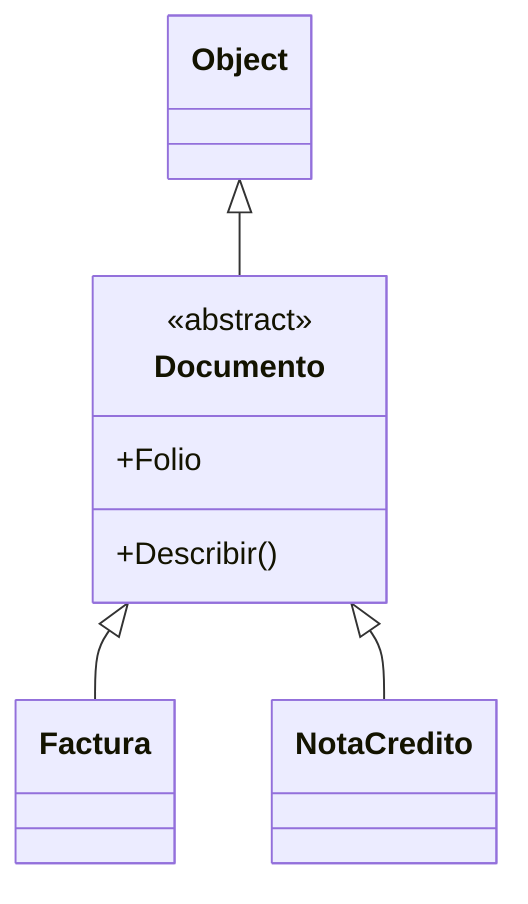

# Herencia

Parte de: [[03-CSharp-DotNet/02 Orientación a objetos/_Índice Orientación a objetos|Orientación a objetos]]

> [!info] Cómo avanzar
> `progreso`: **pendiente** → **viendo** (estudiando) → **visto** (contestaste la autoevaluación sin abrir las respuestas) → **dominado** (hiciste el laboratorio o lo aplicaste de verdad).

## Contenido

### Qué es
La **herencia** permite que una clase (derivada) se base en otra (base) y obtenga sus miembros: `class Factura : Documento`. La derivada **es un** tipo de la base: donde se espera un `Documento` puedes pasar una `Factura`. Sirve para reutilizar código y estado comunes y, sobre todo, para habilitar el [[Polimorfismo]].

En C# una clase puede tener **una sola clase base** (herencia simple). Lo que sí puede es implementar **muchas interfaces**. Todas las clases heredan, en última instancia, de `System.Object`.

### Cómo funciona
```csharp
public abstract class Documento
{
    protected Documento(string folio)
    {
        ArgumentException.ThrowIfNullOrWhiteSpace(folio);
        Folio = folio;
    }

    public string Folio { get; }
    public virtual string Describir() => $"Documento {Folio}";
}

public sealed class Factura : Documento
{
    public Factura(string folio, decimal total) : base(folio) => Total = total;
    public decimal Total { get; }
    public override string Describir() => $"Factura {Folio} por {Total:C}";
}
```
- La derivada hereda los miembros `public`, `protected` e `internal` (si está en el mismo ensamblado). Los `private` existen en el objeto pero la derivada no los ve.
- Solo se pueden sobrescribir miembros marcados `virtual` o `abstract`, usando `override` (ver [[sealed y override]]).
- Una clase `sealed` no se puede heredar.

**Constructores**: **no se heredan**. Cada clase declara los suyos, y el constructor de la derivada **siempre** llama primero a uno de la base: explícitamente con `: base(...)` o, si lo omites, al constructor sin parámetros de la base. Si la base no tiene constructor sin parámetros, estás obligado a escribir `: base(...)`. La base se construye antes que la derivada.



**Composición sobre herencia**: la herencia crea el acoplamiento **más fuerte** que existe entre dos clases. La derivada depende de los detalles de la base; un cambio en la base puede romper a todas las derivadas (el problema de la "clase base frágil"); y como solo hay una base, si heredas para reutilizar un método ya no puedes heredar de otra cosa. La **composición** —tener un colaborador como campo y delegarle trabajo— es más flexible: puedes cambiar el colaborador, inyectarlo, sustituirlo en pruebas y combinar varios.

### Ejemplo
Herencia mal usada para reutilizar código:
```csharp
// "Todos los handlers heredan de HandlerBase para tener el log y la conexión"
public abstract class HandlerBase
{
    protected readonly SqlConnection Conexion;
    protected readonly ILogger Log;
    protected HandlerBase(SqlConnection c, ILogger l) { Conexion = c; Log = l; }
    protected void Auditar(string accion) { /* ... */ }
}
public sealed class CrearEgreso(SqlConnection c, ILogger<CrearEgreso> l) : HandlerBase(c, l) { }
```
Cualquier cambio en `HandlerBase` afecta a todos los handlers, y cada uno arrastra dependencias que quizá no usa.

Con composición:
```csharp
public interface IAuditoria { Task RegistrarAsync(string accion, CancellationToken ct); }

public sealed class CrearEgreso(ICrearEgresoSql sql, IAuditoria auditoria)
{
    public async Task Handle(Comando cmd, CancellationToken ct)
    {
        await sql.EjecutarAsync(new(cmd.Concepto, cmd.Monto), ct);
        await auditoria.RegistrarAsync("egreso.crear", ct);
    }
}
```
Cada handler declara solo lo que usa y en pruebas puedes pasar un `IAuditoria` falso. Para comportamiento transversal (logging, validación, transacciones) también existen filtros, middleware o decoradores.

Herencia **bien** usada: una jerarquía real "es un", con comportamiento que varía:
```csharp
public abstract class ReglaDescuento
{
    public abstract decimal Aplicar(decimal subtotal);
}
public sealed class DescuentoPorcentaje(decimal pct) : ReglaDescuento
{
    public override decimal Aplicar(decimal subtotal) => subtotal * (1 - pct);
}
public sealed class DescuentoFijo(decimal monto) : ReglaDescuento
{
    public override decimal Aplicar(decimal subtotal) => Math.Max(0, subtotal - monto);
}
```
Incluso aquí, una interfaz `IReglaDescuento` funcionaría igual de bien si no hay estado común.

### Cuándo usarlo y cuándo no
- **Usa herencia** cuando la relación "es un" es verdadera y estable, y la base aporta estado o comportamiento común (por ejemplo, `ControllerBase` en ASP.NET Core, `BackgroundService`, `DbContext`, `AbstractValidator<T>` de FluentValidation, excepciones propias que heredan de `Exception`).
- **Usa composición** para reutilizar comportamiento entre clases sin relación "es un".
- **Usa interfaces** cuando solo necesitas un contrato común (ver [[Interfaz vs clase abstracta]]).
- Mantén las jerarquías **poco profundas** (uno o dos niveles).

### Errores comunes
- **Heredar solo para reutilizar un método**: crea acoplamiento innecesario.
- **Clases base "Dios"** (`BaseService`, `BaseRepository`) con utilidades para todos.
- **Violar el principio de sustitución de Liskov**: una derivada que lanza `NotSupportedException` en un método de la base no "es un" de verdad.
- **Olvidar `: base(...)`** cuando la base exige parámetros: error de compilación.
- **No sellar** las clases concretas: alguien heredará de ellas sin que estuvieran diseñadas para eso.

### Para profundizar
- [Herencia en C# y .NET](https://learn.microsoft.com/dotnet/csharp/fundamentals/object-oriented/inheritance)
- [Herencia (fundamentos de C#)](https://learn.microsoft.com/dotnet/csharp/fundamentals/tutorials/inheritance)
- [Diseño para la extensibilidad](https://learn.microsoft.com/dotnet/standard/design-guidelines/designing-for-extensibility)

## Autoevaluación

Contesta primero en voz alta o en papel; luego despliega la respuesta.

> [!question]- ¿Qué es la herencia en C# y cuántas clases base puede tener una clase?
> Una clase deriva de otra con `: Base` y hereda sus miembros. Solo hay herencia simple de clases; de interfaces puede implementar varias.

> [!question]- ¿Por qué se dice "composición sobre herencia"?
> La herencia acopla fuerte: un cambio en la base afecta a todas las derivadas. Componer (recibir colaboradores por constructor) es más flexible y fácil de probar.

> [!question]- ¿Qué pasa con los constructores en la herencia?
> No se heredan. La derivada debe llamar a uno de la base con `: base(...)` (si la base no tiene constructor sin parámetros).

