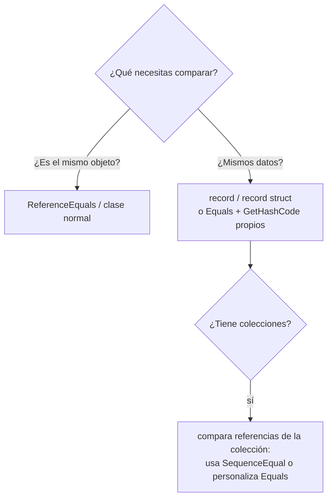

# Igualdad por valor vs por referencia

Parte de: [[03-CSharp-DotNet/02 Orientación a objetos/_Índice Orientación a objetos|Orientación a objetos]]

> [!info] Cómo avanzar
> `progreso`: **pendiente** → **viendo** (estudiando) → **visto** (contestaste la autoevaluación sin abrir las respuestas) → **dominado** (hiciste el laboratorio o lo aplicaste de verdad).

## Contenido

### Qué es
Hay dos preguntas distintas que se pueden hacer sobre dos variables:
- **Igualdad por referencia (identidad)**: ¿apuntan al **mismo objeto** en memoria? Se responde con `ReferenceEquals(a, b)`.
- **Igualdad por valor**: ¿tienen los **mismos datos**, aunque sean objetos distintos? Depende de cómo el tipo implemente `Equals` y `==`.

Saber qué compara cada tipo evita bugs en `Distinct`, `HashSet`, `Dictionary`, pruebas unitarias y comparaciones de DTOs.

### Cómo funciona
| Tipo | `==` por defecto | `Equals` por defecto |
|---|---|---|
| `class` | referencia (salvo que sobrecargue `==`) | referencia |
| `record` (clase) | **valor**: compara todas las propiedades y el tipo | valor |
| `struct` | **no existe** salvo que lo definas | valor, campo por campo (por reflexión, lento) |
| `record struct` | valor | valor (generado, rápido) |
| `string` | **valor** (`==` sobrecargado) | valor |

**`string`**: es una clase, pero sobrecarga `==` para comparar contenido. Con `string a = "hola"; string b = string.Concat("ho", "la");`, `a == b` es **`true`** (mismo contenido), pero `ReferenceEquals(a, b)` es **`false`**: `Concat` crea en ejecución un string nuevo, mientras que `"hola"` es un literal internado. (Si escribieras `"ho" + "la"` con literales, el compilador lo resolvería a una sola constante y sí sería la misma referencia.)

**Records**: el compilador genera `Equals`, `GetHashCode`, `==` y `!=` que comparan cada propiedad usando `EqualityComparer<T>.Default`. Si una propiedad es una `List<T>` (o un array), lo que se compara es la **referencia de la lista**, no su contenido: dos records con listas distintas pero con los mismos elementos **no** son iguales.

**Contrato de igualdad**: si sobrescribes `Equals`, debes sobrescribir también `GetHashCode` de forma consistente (objetos iguales deben dar el mismo hash). Si no, `Dictionary` y `HashSet` dejan de funcionar: guardan por hash y nunca encuentran el objeto "igual". Lo ideal es además implementar `IEquatable<T>` (evita boxing en structs) y sobrecargar `==`/`!=` para que coincidan con `Equals`.



### Ejemplo
```csharp
public sealed class ClienteC { public string Rfc { get; init; } = ""; }
public sealed record ClienteR(string Rfc);

var c1 = new ClienteC { Rfc = "AAA010101AAA" };
var c2 = new ClienteC { Rfc = "AAA010101AAA" };
Console.WriteLine(c1 == c2);                       // False (referencias)

var r1 = new ClienteR("AAA010101AAA");
var r2 = new ClienteR("AAA010101AAA");
Console.WriteLine(r1 == r2);                       // True (valor)
Console.WriteLine(ReferenceEquals(r1, r2));        // False

// Records con listas: trampa
public sealed record Pedido(string Folio, List<string> Skus);
var p1 = new Pedido("F1", ["A", "B"]);
var p2 = new Pedido("F1", ["A", "B"]);
Console.WriteLine(p1 == p2);                       // False: listas distintas
Console.WriteLine(p1.Skus.SequenceEqual(p2.Skus)); // True: mismo contenido
```

Igualdad personalizada en un record con colección:
```csharp
public sealed record Etiquetas(IReadOnlyList<string> Valores)
{
    public bool Equals(Etiquetas? otro) =>
        otro is not null && Valores.SequenceEqual(otro.Valores);

    public override int GetHashCode()
    {
        var hash = new HashCode();
        foreach (var v in Valores) hash.Add(v);
        return hash.ToHashCode();
    }
}
```

Igualdad manual en una clase (por ejemplo, una entidad que se compara por `Id`):
```csharp
public sealed class Producto : IEquatable<Producto>
{
    public required Guid Id { get; init; }
    public bool Equals(Producto? otro) => otro is not null && Id == otro.Id;
    public override bool Equals(object? obj) => Equals(obj as Producto);
    public override int GetHashCode() => Id.GetHashCode();
    public static bool operator ==(Producto? a, Producto? b) => Equals(a, b);
    public static bool operator !=(Producto? a, Producto? b) => !Equals(a, b);
}
```

En pruebas con xUnit, `Assert.Equal(esperado, real)` usa `Equals`: con records basta; con clases normales fallará aunque los datos coincidan.

### Cuándo usarlo y cuándo no
- **Igualdad por valor** para DTOs, comandos, resultados, value objects (dinero, rangos de fechas): usa `record` o `record struct`.
- **Identidad** para entidades con ciclo de vida: dos pedidos con los mismos datos siguen siendo dos pedidos. Si comparas, hazlo por `Id`.
- **Comparadores externos** (`IEqualityComparer<T>`) cuando la igualdad depende del contexto (por ejemplo, comparar clientes por RFC sin mayúsculas en una deduplicación).

### Errores comunes
- **Sobrescribir `Equals` sin `GetHashCode`**: colecciones hash rotas (el compilador avisa con CS0659).
- **Records con `List<T>`** esperando comparación de contenido.
- **Hash basado en propiedades mutables**: el objeto se pierde dentro del `HashSet` si cambian.
- **Usar `==` en structs sin definirlo**: no compila; y `Equals` por defecto en structs es lento (usa reflexión) y hace boxing.

### Para profundizar
- [Comparaciones de igualdad (guía de programación de C#)](https://learn.microsoft.com/dotnet/csharp/programming-guide/statements-expressions-operators/equality-comparisons)
- [Igualdad de valores en records](https://learn.microsoft.com/dotnet/csharp/language-reference/builtin-types/record#value-equality)
- [Cómo definir la igualdad de valores para una clase o struct](https://learn.microsoft.com/dotnet/csharp/programming-guide/statements-expressions-operators/how-to-define-value-equality-for-a-type)

## Ejercicios

Resuélvelos en papel o en la herramienta; la solución está plegada.

> [!question]- `string a = "hola"; string b = string.Concat("ho", "la");` ¿`a == b`? ¿`ReferenceEquals(a, b)`?
> `a == b` es `true` (string compara valor). `ReferenceEquals` es `false`: `Concat` crea otra instancia en tiempo de ejecución.

## Autoevaluación

Contesta primero en voz alta o en papel; luego despliega la respuesta.

> [!question]- ¿Qué compara `==` en clases, records y structs?
> Clases: referencia (salvo sobrecarga). Records: valor de todas las propiedades. Structs: `==` no existe a menos que lo definas; `Equals` compara campo por campo (con reflexión si no lo sobrescribes).

> [!question]- Si sobrescribes `Equals`, ¿qué más debes sobrescribir?
> `GetHashCode` (con `HashCode.Combine`), para que funcione en `Dictionary` y `HashSet`; y normalmente `==`/`!=`. Mejor: usa un record.

> [!question]- ¿Qué pasa al comparar records que contienen una `List<T>`?
> La lista se compara por **referencia**: dos records con listas iguales en contenido pero distintas instancias no son iguales.

## Práctica

- [[Lab 2 - Modelo de dominio con encapsulamiento y records]]

