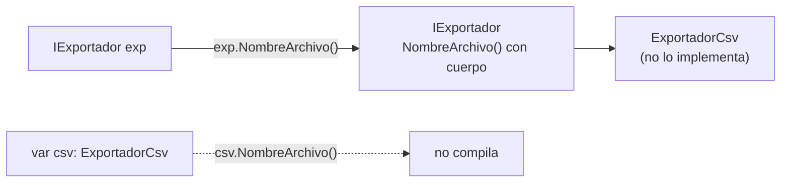

# Implementaciones por defecto en interfaces

Parte de: [[03-CSharp-DotNet/02 Orientación a objetos/_Índice Orientación a objetos|Orientación a objetos]]

> [!info] Cómo avanzar
> `progreso`: **pendiente** → **viendo** (estudiando) → **visto** (contestaste la autoevaluación sin abrir las respuestas) → **dominado** (hiciste el laboratorio o lo aplicaste de verdad).

## Contenido

### Qué es
Las **implementaciones por defecto en interfaces** (*default interface methods*, C# 8 en adelante, .NET Core 3.0 o superior) permiten que una interfaz incluya **el cuerpo** de un método o propiedad. Las clases que implementan la interfaz no están obligadas a escribir ese miembro: si no lo hacen, usan el de la interfaz; si lo escriben, el suyo tiene prioridad.

### Cómo funciona
```csharp
public interface IExportador
{
    string Extension { get; }
    byte[] Exportar(IReadOnlyList<Fila> filas);

    // Miembro con implementación por defecto
    string NombreArchivo(string baseNombre) => $"{baseNombre}.{Extension}";
}

public sealed class ExportadorCsv : IExportador
{
    public string Extension => "csv";
    public byte[] Exportar(IReadOnlyList<Fila> filas) => [];
    // no implementa NombreArchivo: usa el de la interfaz
}
```

**Para qué se pensaron**: para **evolucionar interfaces publicadas sin romper** a quienes ya las implementan. Antes, agregar un método a una interfaz pública obligaba a todas las clases existentes (incluidas las de otros equipos o paquetes NuGet) a implementarlo, o no compilaban. Con un miembro por defecto, las implementaciones viejas siguen funcionando y las nuevas pueden sobrescribirlo. También habilitan algunos patrones tipo "trait" (comportamiento reutilizable sobre otros miembros de la interfaz).

**El punto clave: el miembro pertenece a la interfaz, no a la clase.** La clase **no hereda** el método por defecto; por eso solo se puede llamar a través de una referencia del tipo de la interfaz:
```csharp
var csv = new ExportadorCsv();
// csv.NombreArchivo("ventas");          // error CS1061: ExportadorCsv no contiene NombreArchivo

IExportador exp = csv;
Console.WriteLine(exp.NombreArchivo("ventas"));   // ventas.csv
```
Funciona igual que una [[Implementación explícita de interfaces|implementación explícita]]: invisible desde la clase, visible desde la interfaz.



Otras capacidades desde C# 8: las interfaces pueden tener miembros `static`, modificadores de acceso (`private`, `protected`) para métodos auxiliares y, desde C# 11, miembros `static abstract` (la base de la *generic math*: `INumber<T>`). Lo que **no** pueden tener es **estado de instancia** (campos).

### Ejemplo
Evolucionar el contrato de una biblioteca interna compartida entre Itzamna.Dionisio y Wee.Reporteria:
```csharp
// Versión 1 (ya la implementan 6 clases en dos soluciones)
public interface INotificador
{
    Task EnviarAsync(string destino, string mensaje, CancellationToken ct);
}

// Versión 2: agregamos envío masivo sin romper a nadie
public interface INotificador
{
    Task EnviarAsync(string destino, string mensaje, CancellationToken ct);

    async Task EnviarVariosAsync(IEnumerable<string> destinos, string mensaje, CancellationToken ct)
    {
        foreach (var d in destinos)
            await EnviarAsync(d, mensaje, ct);           // usa el miembro abstracto
    }
}

// Una implementación nueva puede optimizarlo
public sealed class NotificadorCorreo : INotificador
{
    public Task EnviarAsync(string destino, string mensaje, CancellationToken ct) => Task.CompletedTask;

    public Task EnviarVariosAsync(IEnumerable<string> destinos, string mensaje, CancellationToken ct)
        => Task.CompletedTask; // un solo envío con copia oculta, por ejemplo
}
```
Como en DI siempre recibes `INotificador`, la llamada `notificador.EnviarVariosAsync(...)` funciona con cualquiera de las implementaciones.

Si necesitas llamarlo desde la propia clase, convierte: `((INotificador)this).EnviarVariosAsync(...)`.

### Cuándo usarlo y cuándo no
- **Úsalo** para agregar miembros a interfaces ya publicadas (bibliotecas, paquetes NuGet internos) sin romper implementaciones.
- **Úsalo** con moderación para pequeños métodos de conveniencia construidos sobre los miembros abstractos.
- **No lo uses** como sustituto de una clase base: si necesitas estado compartido o mucha lógica común, usa una clase abstracta (ver [[Interfaz vs clase abstracta]]).
- **No lo uses** en interfaces internas de tu propia solución, donde puedes cambiar todas las implementaciones a la vez: ahí es más claro agregar el miembro abstracto o usar un [[Métodos de extensión|método de extensión]].

### Errores comunes
- **Llamar el método por defecto desde una variable de la clase**: error de compilación CS1061. Usa una variable del tipo de la interfaz.
- **Esperar que la clase "herede" el método** para usarlo con `this.Metodo()`: no lo hereda.
- **Problemas de diamante**: si una clase implementa dos interfaces que dan cuerpo al mismo miembro, el compilador exige que la clase lo implemente para desambiguar.
- **Meter lógica de negocio pesada en interfaces**: dificulta entender dónde vive el comportamiento.

### Para profundizar
- [Tutorial: actualizar interfaces con métodos de interfaz predeterminados](https://learn.microsoft.com/dotnet/csharp/advanced-topics/interface-implementation/default-interface-methods-versions)
- [interface (referencia de C#)](https://learn.microsoft.com/dotnet/csharp/language-reference/keywords/interface)
- [Interfaces (fundamentos de C#)](https://learn.microsoft.com/dotnet/csharp/fundamentals/types/interfaces)

## Autoevaluación

Contesta primero en voz alta o en papel; luego despliega la respuesta.

> [!question]- ¿Qué son?
> Desde C# 8 una interfaz puede traer un cuerpo para un método. Las clases que la implementan lo heredan sin escribirlo.

> [!question]- ¿Para qué se pensaron?
> Para agregar miembros a una interfaz publicada sin romper a quienes ya la implementan.

> [!question]- Error común: llamar el método por defecto desde una variable de la clase. ¿Qué pasa?
> No compila: el miembro por defecto solo es accesible a través del tipo de la interfaz (`((IMiInterfaz)obj).Metodo()`), a menos que la clase lo implemente.

