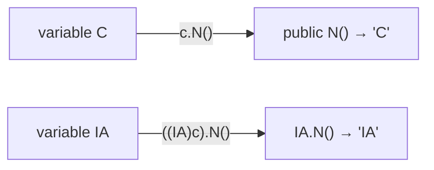

# Implementación explícita de interfaces

Parte de: [[03-CSharp-DotNet/02 Orientación a objetos/_Índice Orientación a objetos|Orientación a objetos]]

> [!info] Cómo avanzar
> `progreso`: **pendiente** → **viendo** (estudiando) → **visto** (contestaste la autoevaluación sin abrir las respuestas) → **dominado** (hiciste el laboratorio o lo aplicaste de verdad).

## Contenido

### Qué es
Implementar una interfaz **explícitamente** significa escribir el miembro con el **nombre de la interfaz como prefijo** (`string IA.N() => ...`) y sin modificador de acceso. Ese miembro **no forma parte de la API pública de la clase**: solo se puede llamar a través de una referencia del tipo de la interfaz. Lo normal (implementación implícita) es declarar el método `public` con el mismo nombre, y entonces sirve para ambos.

### Cómo funciona
```csharp
interface IA { string N(); }

class C : IA
{
    string IA.N() => "IA";      // explícita: solo vía IA
    public string N() => "C";   // método propio de la clase
}

var c = new C();
Console.Write(c.N() + ((IA)c).N());   // "CIA"
```
- Con una variable de tipo `C`, el compilador ve el método público `N()` → `"C"`.
- Al convertir a `IA`, la llamada va a la implementación explícita → `"IA"`.
- Si `C` no tuviera el `public string N()`, `c.N()` **no compilaría**; tendrías que convertir a `IA`.

Reglas:
- El miembro explícito no lleva `public`, `virtual` ni `abstract`.
- No se puede llamar con `this.N()` dentro de la clase sin convertir: `((IA)this).N()`.
- En structs, llamarlo a través de la interfaz provoca boxing (salvo en contextos genéricos con restricción).



**¿Y con `using`?** La instrucción `using` trabaja a través de la interfaz `IDisposable`: el compilador genera algo equivalente a `((IDisposable)x).Dispose()` en el `finally`. Por eso, si una clase implementa `IDisposable.Dispose()` explícitamente, `using var x = new C();` **funciona normal** y llama a `Dispose` al salir del bloque. Lo que no podrás es escribir `x.Dispose()` directamente sin conversión. Algunas clases del framework hacen esto y exponen un método con nombre más natural (por ejemplo `Close()`).

### Ejemplo
**1. Dos interfaces con el mismo miembro y significados distintos**:
```csharp
public interface IExportableCsv  { string Encabezado(); }
public interface IExportableExcel { string Encabezado(); }

public sealed class ReporteEgresos : IExportableCsv, IExportableExcel
{
    string IExportableCsv.Encabezado()  => "Folio,Concepto,Monto";
    string IExportableExcel.Encabezado() => "Reporte de egresos 2026";
}

IExportableCsv csv = new ReporteEgresos();
Console.WriteLine(csv.Encabezado());     // Folio,Concepto,Monto
```

**2. Ocultar miembros que no tienen sentido en la API pública del tipo**. Por ejemplo, una colección de solo lectura que debe implementar `ICollection<T>` para interoperar, pero no quiere exponer `Add`:
```csharp
public sealed class ListaFija<T>(IReadOnlyList<T> datos) : ICollection<T>
{
    public int Count => datos.Count;
    public bool Contains(T item) => datos.Contains(item);
    public IEnumerator<T> GetEnumerator() => datos.GetEnumerator();
    System.Collections.IEnumerator System.Collections.IEnumerable.GetEnumerator() => GetEnumerator();

    // No forman parte de la API pública: solo existen para cumplir el contrato
    bool ICollection<T>.IsReadOnly => true;
    void ICollection<T>.Add(T item) => throw new NotSupportedException();
    void ICollection<T>.Clear() => throw new NotSupportedException();
    bool ICollection<T>.Remove(T item) => throw new NotSupportedException();
    public void CopyTo(T[] array, int index) { foreach (var x in datos) array[index++] = x; }
}
```
Fíjate en `IEnumerable.GetEnumerator()` no genérico: es el uso explícito más común de todos; casi cualquier colección propia lo implementa así.

**3. Dispose explícito**:
```csharp
public sealed class Lector : IDisposable
{
    void IDisposable.Dispose() => Console.WriteLine("Liberado");
}

using (var l = new Lector()) { }   // imprime "Liberado"
```

### Cuándo usarlo y cuándo no
- **Úsalo** para resolver choques de nombres entre interfaces, para implementar la versión no genérica de una interfaz (`IEnumerable`, `IComparable`) y para ocultar miembros que solo existen por compatibilidad.
- **Úsalo** cuando quieres obligar al consumidor a trabajar "a través de la interfaz".
- **No lo uses** como forma general de implementar interfaces: hace que los miembros sean invisibles al usar la clase directamente y confunde a quien lee. Por defecto, implementa de forma implícita y `public`.

### Errores comunes
- **Buscar el método en IntelliSense** y no encontrarlo: está implementado explícitamente; convierte a la interfaz.
- **Creer que `using` no funcionará** con `Dispose` explícito: sí funciona.
- **Llamar el miembro explícito desde dentro de la clase** sin convertir `this`: no compila.
- **Usarlo en structs** en rutas calientes llamando vía la interfaz: boxing en cada llamada.

### Para profundizar
- [Implementación explícita de interfaces](https://learn.microsoft.com/dotnet/csharp/programming-guide/interfaces/explicit-interface-implementation)
- [Interfaces (fundamentos de C#)](https://learn.microsoft.com/dotnet/csharp/fundamentals/types/interfaces)
- [Implementar un método Dispose](https://learn.microsoft.com/dotnet/standard/garbage-collection/implementing-dispose)

## Ejercicios

Resuélvelos en papel o en la herramienta; la solución está plegada.

> [!question]- ¿Qué imprime? `interface IA { string N(); } class C : IA { string IA.N() => "IA"; public string N() => "C"; } var c = new C(); Console.Write(c.N() + ((IA)c).N());`
> `CIA`.

## Autoevaluación

Contesta primero en voz alta o en papel; luego despliega la respuesta.

> [!question]- ¿Qué es?
> Implementar un miembro con el nombre de la interfaz: `void IDisposable.Dispose() { }`. Solo se puede llamar a través de una variable del tipo de la interfaz.

> [!question]- ¿Cuándo se usa?
> Cuando dos interfaces tienen un miembro con la misma firma y distinto significado, o para ocultar un miembro que no quieres en la API pública de la clase.

> [!question]- ¿Qué pasa si una clase implementa explícitamente `IDisposable.Dispose()` y haces `using var x = new C();`?
> Funciona: `using` llama a `Dispose` a través de la interfaz. Lo que no puedes es escribir `x.Dispose()` directamente con una variable de tipo `C`.

