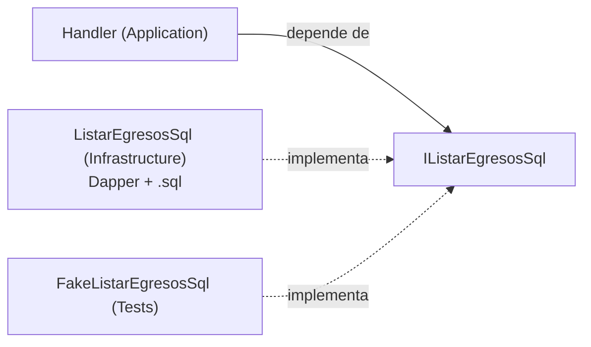

# Interfaces

Parte de: [[03-CSharp-DotNet/02 Orientación a objetos/_Índice Orientación a objetos|Orientación a objetos]]

> [!info] Cómo avanzar
> `progreso`: **pendiente** → **viendo** (estudiando) → **visto** (contestaste la autoevaluación sin abrir las respuestas) → **dominado** (hiciste el laboratorio o lo aplicaste de verdad).

## Contenido

### Qué es
Una **interfaz** es un **contrato**: una lista de miembros (métodos, propiedades, eventos, indexadores) que una clase o struct se compromete a implementar. La interfaz dice **qué** se puede hacer; cada implementación decide **cómo**. No guarda estado de instancia (no tiene campos) y no se puede instanciar. Un tipo puede implementar **varias** interfaces, a diferencia de la herencia de clases, que es simple.

Es la herramienta principal para desacoplar capas, sustituir dependencias en pruebas y trabajar con [[Inyección de dependencias]].

### Cómo funciona
```csharp
public interface IListarEgresosSql
{
    Task<IReadOnlyList<EgresoItem>> EjecutarAsync(ListarEgresosQuery q, CancellationToken ct);
}

public sealed class ListarEgresosSql(IDbConnectionFactory db, ISqlArchivos sql) : IListarEgresosSql
{
    public async Task<IReadOnlyList<EgresoItem>> EjecutarAsync(ListarEgresosQuery q, CancellationToken ct)
    {
        await using var cn = await db.AbrirAsync(ct);
        var filas = await cn.QueryAsync<EgresoItem>(
            new CommandDefinition(sql.Leer("Egresos/ListarEgresos.sql"), q, cancellationToken: ct));
        return filas.AsList();
    }
}
```
- Los miembros de una interfaz son `public` por defecto.
- La clase implementa cada miembro con la misma firma (implícitamente `public`, o de forma [[Implementación explícita de interfaces|explícita]]).
- Desde C# 8 una interfaz puede traer [[Implementaciones por defecto en interfaces]] y miembros estáticos; desde C# 11, miembros `static abstract`.
- Por convención los nombres empiezan con `I`.



**Una interfaz por consulta**: en tu patrón, cada archivo `.sql` tiene su propia interfaz (`IListarEgresosSql`, `ICrearEgresoSql`) en lugar de un `IEgresosRepository` gigante. Ventajas:
- Cada consulta tiene **su contrato propio** de entrada y salida, con tipos exactos.
- Cada handler depende **solo** de las consultas que usa (principio de segregación de interfaces): leyendo el constructor sabes exactamente qué toca en la BD.
- En pruebas creas un fake pequeño por consulta en lugar de simular un repositorio de 30 métodos.
- Agregar una consulta no obliga a modificar una interfaz compartida ni sus implementaciones.
Más detalle en [[SQL en archivos con una interfaz por consulta]].

### Ejemplo
Registro en DI y uso desde el handler:
```csharp
// Program.cs (o un método de extensión AddInfraestructura)
builder.Services.AddScoped<IListarEgresosSql, ListarEgresosSql>();
builder.Services.AddScoped<ListarEgresos.Handler>();

public sealed class Handler(IListarEgresosSql sql)
{
    public Task<IReadOnlyList<EgresoItem>> Handle(ListarEgresosQuery q, CancellationToken ct)
        => sql.EjecutarAsync(q, ct);
}
```
Prueba con un fake escrito a mano:
```csharp
public sealed class FakeListarEgresosSql(params EgresoItem[] datos) : IListarEgresosSql
{
    public ListarEgresosQuery? Recibida { get; private set; }
    public Task<IReadOnlyList<EgresoItem>> EjecutarAsync(ListarEgresosQuery q, CancellationToken ct)
    {
        Recibida = q;
        return Task.FromResult<IReadOnlyList<EgresoItem>>(datos);
    }
}

[Fact]
public async Task Regresa_lo_que_da_la_consulta()
{
    var fake = new FakeListarEgresosSql(new EgresoItem(Guid.NewGuid(), "Luz", 500m));
    var r = await new Handler(fake).Handle(new(EmpresaId: Guid.NewGuid()), CancellationToken.None);
    Assert.Single(r);
}
```

Interfaces del framework que usarás todo el tiempo: `IEnumerable<T>`, `IReadOnlyList<T>`, `IDisposable`/`IAsyncDisposable`, `IComparable<T>`, `IEquatable<T>`, `ILogger<T>`, `IOptions<T>`, `IHttpClientFactory`.

### Cuándo usarlo y cuándo no
Una interfaz **sí vale la pena** cuando:
- **Cruzas una frontera** que quieres poder sustituir: base de datos, HTTP, sistema de archivos, reloj (`TimeProvider`), correo, colas.
- Hay o habrá **más de una implementación** real (varios exportadores, varias pasarelas de pago).
- Otra capa **no debe conocer** la implementación (Application no debe saber de Dapper).

**No** la crees "por si acaso" para cada clase (`IEgresoService` con una sola implementación que nunca se sustituye, `ICalculadoraIva` para una función pura): agrega archivos, saltos de navegación y ceremonia sin beneficio. Una clase concreta `sealed` se puede inyectar igual. Si mañana necesitas la interfaz, extraerla es un refactor de minutos.

### Errores comunes
- **Interfaces "Dios"** (`IRepositorio` con 40 métodos): cada consumidor depende de todo y los fakes son enormes.
- **Interfaces espejo** de cada clase sin motivo: ruido.
- **Filtrar detalles de implementación** en el contrato (`IDbConnection` o `SqlException` en la firma de una interfaz de Application).
- **Romper una interfaz publicada** agregando miembros abstractos: rompe a todos los implementadores; considera un miembro por defecto o una interfaz nueva.

### Para profundizar
- [Interfaces (fundamentos de C#)](https://learn.microsoft.com/dotnet/csharp/fundamentals/types/interfaces)
- [interface (referencia de C#)](https://learn.microsoft.com/dotnet/csharp/language-reference/keywords/interface)
- [Inyección de dependencias en .NET](https://learn.microsoft.com/dotnet/core/extensions/dependency-injection)

## Autoevaluación

Contesta primero en voz alta o en papel; luego despliega la respuesta.

> [!question]- ¿Qué es una interfaz?
> Un contrato: lista de miembros que una clase se compromete a implementar. No guarda estado de instancia.

> [!question]- ¿Por qué en tu patrón hay **una interfaz por consulta** (`IListarEgresosSql`)?
> Cada consulta tiene un contrato propio de entrada y salida; el repositorio depende solo de las que usa y en pruebas puedes crear un fake por consulta.

> [!question]- Error común: crear `IServicio` para cada clase "por si acaso". ¿Cuándo sí vale la pena una interfaz?
> Cuando hay más de una implementación, cuando cruzas una frontera (BD, HTTP, reloj) que quieres sustituir en pruebas, o cuando otra capa no debe conocer la implementación.

## Práctica

- [[Lab 2 - Modelo de dominio con encapsulamiento y records]]
- [[Lab 4 - Registro automático de sentencias SQL por reflexión]]

