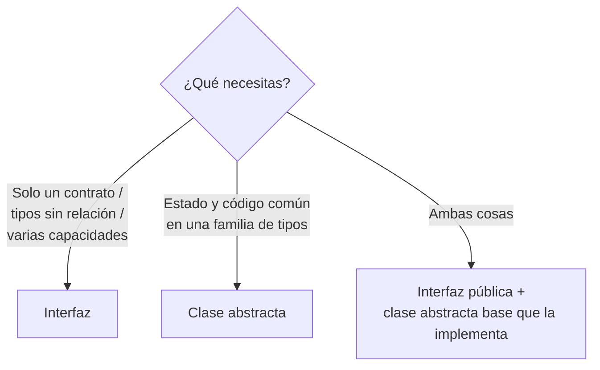

# Interfaz vs clase abstracta

Parte de: [[03-CSharp-DotNet/02 Orientación a objetos/_Índice Orientación a objetos|Orientación a objetos]]

> [!info] Cómo avanzar
> `progreso`: **pendiente** → **viendo** (estudiando) → **visto** (contestaste la autoevaluación sin abrir las respuestas) → **dominado** (hiciste el laboratorio o lo aplicaste de verdad).

## Contenido

### Qué es
Las dos sirven para definir un tipo base que otros implementan, y las dos permiten [[Polimorfismo]]. La diferencia clave:
- Una **interfaz** define **solo un contrato** (qué se puede hacer), sin estado de instancia. Un tipo puede implementar **muchas**, y pueden ser tipos sin ninguna relación entre sí (incluso structs).
- Una **clase abstracta** es una clase incompleta: puede tener **estado** (campos), constructores, código ya implementado y miembros abstractos. Un tipo solo puede heredar de **una**, y la relación es "es un".

### Cómo funciona
| | Interfaz | Clase abstracta |
|---|---|---|
| Estado de instancia (campos) | no | sí |
| Constructores | no | sí (`protected`) |
| Implementación de miembros | opcional (miembros por defecto, C# 8+) | sí, normal |
| Cuántas puede tener un tipo | muchas | una |
| Structs pueden usarla | sí | no |
| Modificadores de acceso en miembros | públicos por defecto | cualquiera (`protected`, `private`…) |
| Relación que expresa | "puede hacer" (capacidad) | "es un" (familia) |
| Agregar un miembro después | rompe implementaciones (salvo miembro por defecto) | puedes agregar un método con cuerpo sin romper |



**Capacidades transversales**: si tipos sin relación (un `Egreso` y un `Usuario`) deben compartir la capacidad "auditable", la respuesta es una **interfaz**. No hay una relación "es un" entre ellos; además, cada uno probablemente ya hereda de otra cosa o no debería heredar de nada. Con una interfaz cualquiera de los dos puede ser "auditable" además de lo que ya sea.

### Ejemplo
Interfaz como capacidad transversal:
```csharp
public interface IAuditable
{
    DateTimeOffset CreadoUtc { get; }
    Guid CreadoPor { get; }
    DateTimeOffset? ModificadoUtc { get; }
}

public sealed class Egreso : IAuditable { /* ... */ public DateTimeOffset CreadoUtc { get; init; } public Guid CreadoPor { get; init; } public DateTimeOffset? ModificadoUtc { get; private set; } }
public sealed class Usuario : IAuditable { /* ... */ public DateTimeOffset CreadoUtc { get; init; } public Guid CreadoPor { get; init; } public DateTimeOffset? ModificadoUtc { get; private set; } }

// Un servicio que trabaja con cualquiera
static string Resumen(IAuditable a) => $"Creado {a.CreadoUtc:yyyy-MM-dd} por {a.CreadoPor}";
```

Las dos juntas: interfaz como contrato público (lo que se inyecta) y clase abstracta como ayuda para implementarla:
```csharp
public interface IExportador
{
    string Formato { get; }
    Task<byte[]> ExportarAsync(IReadOnlyList<Fila> filas, CancellationToken ct);
}

public abstract class ExportadorBase(ILogger log) : IExportador
{
    public abstract string Formato { get; }

    public async Task<byte[]> ExportarAsync(IReadOnlyList<Fila> filas, CancellationToken ct)
    {
        if (filas.Count == 0) return [];
        log.LogInformation("Exportando {Filas} filas a {Formato}", filas.Count, Formato);
        return await GenerarAsync(filas, ct);
    }

    protected abstract Task<byte[]> GenerarAsync(IReadOnlyList<Fila> filas, CancellationToken ct);
}

public sealed class ExportadorCsv(ILogger<ExportadorCsv> log) : ExportadorBase(log)
{
    public override string Formato => "csv";
    protected override Task<byte[]> GenerarAsync(IReadOnlyList<Fila> filas, CancellationToken ct)
        => Task.FromResult<byte[]>([]);
}

// DI: los consumidores solo conocen la interfaz
builder.Services.AddScoped<IExportador, ExportadorCsv>();
```
Quien necesite un exportador muy distinto puede implementar `IExportador` directamente sin heredar de la base. Es el mismo patrón que usa el framework: `IHostedService` + `BackgroundService`, `IValidator<T>` + `AbstractValidator<T>`.

### Cuándo usarlo y cuándo no
- **Interfaz** por defecto para dependencias que se inyectan y para capacidades (`IAuditable`, `IComparable<T>`, `IDisposable`).
- **Clase abstracta** cuando una familia comparte estado y un algoritmo con pasos variables (Template Method), y la relación "es un" es real.
- **Ambas** cuando quieres un contrato flexible y además ahorrar código repetido a las implementaciones habituales.
- Si la clase abstracta solo tiene miembros abstractos y nada de estado, probablemente debería ser una interfaz.

### Errores comunes
- **Usar clase abstracta para tipos sin relación** solo para compartir un método: obliga a una jerarquía falsa y gasta la única base disponible.
- **Inyectar la clase abstracta** en lugar de la interfaz: acopla a los consumidores a la jerarquía.
- **Interfaces con muchos miembros por defecto** que simulan una clase base: confunde dónde vive el comportamiento.
- **Pensar que la interfaz "no puede tener código"**: desde C# 8 puede, pero úsalo para evolucionar contratos, no como regla.

### Para profundizar
- [Interfaces (fundamentos de C#)](https://learn.microsoft.com/dotnet/csharp/fundamentals/types/interfaces)
- [Clases abstractas y selladas](https://learn.microsoft.com/dotnet/csharp/programming-guide/classes-and-structs/abstract-and-sealed-classes-and-class-members)
- [Guía de diseño: clases abstractas](https://learn.microsoft.com/dotnet/standard/design-guidelines/abstract-class)
- [Guía de diseño: interfaces](https://learn.microsoft.com/dotnet/standard/design-guidelines/interface)

## Autoevaluación

Contesta primero en voz alta o en papel; luego despliega la respuesta.

> [!question]- ¿Cuál es la diferencia clave?
> Una clase puede implementar **varias** interfaces pero heredar de **una** sola clase. La abstracta puede tener estado, constructores y campos; la interfaz es contrato (con métodos por defecto opcionales, sin estado de instancia).

> [!question]- ¿Cuándo usarías ambas juntas?
> Interfaz para el contrato público (`IComandoSql<T>`) y clase abstracta para la implementación base reutilizable (`ComandoSql<T>`). Los consumidores dependen de la interfaz.

> [!question]- Necesitas que tipos sin relación (un `Egreso` y un `Usuario`) compartan la capacidad "auditable". ¿Qué eliges?
> Interfaz (`IAuditable`): no comparten jerarquía y una clase puede tener varias capacidades.

