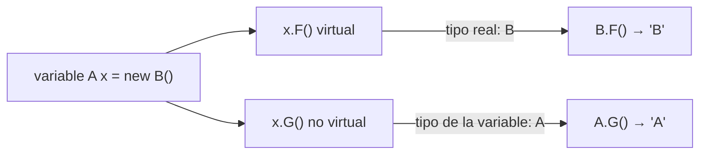

# Polimorfismo

Parte de: [[03-CSharp-DotNet/02 Orientación a objetos/_Índice Orientación a objetos|Orientación a objetos]]

> [!info] Cómo avanzar
> `progreso`: **pendiente** → **viendo** (estudiando) → **visto** (contestaste la autoevaluación sin abrir las respuestas) → **dominado** (hiciste el laboratorio o lo aplicaste de verdad).

## Contenido

### Qué es
**Polimorfismo** significa que el **mismo llamado** se comporta distinto según el **tipo real** del objeto. Tienes una variable de tipo base o interfaz (`MedioPago`, `IExportador`), llamas a un método, y en tiempo de ejecución se ejecuta la versión de la clase concreta (`Tarjeta`, `Transferencia`). Permite escribir código que trabaja con una abstracción y agregar variantes nuevas sin modificar ese código.

### Cómo funciona
En C# el polimorfismo de subtipos se basa en:
- **`virtual`** (en la base): el método tiene una implementación que **se puede** sobrescribir.
- **`abstract`** (en la base): el método **debe** sobrescribirse.
- **`override`** (en la derivada): reemplaza la implementación de la base. La decisión de qué versión ejecutar se toma **en ejecución**, según el tipo real del objeto (despacho dinámico, mediante la tabla de métodos virtuales).
- **Interfaces**: cada implementación da su versión; la llamada vía interfaz también se resuelve en ejecución.

**`override` vs `new`**: `new` no sobrescribe; **oculta** el método de la base con otro que solo tiene el mismo nombre. Qué versión se llama depende entonces del **tipo de la variable** (decisión en compilación), no del objeto.
```csharp
class A { public virtual string F() => "A"; public string G() => "A"; }
class B : A { public override string F() => "B"; public new string G() => "B"; }

A x = new B();
Console.Write(x.F() + x.G());   // "BA"
```
- `x.F()`: `F` es virtual y `B` la sobrescribe → se usa la del objeto real → `"B"`.
- `x.G()`: `G` no es virtual; `B.G` solo la oculta; la variable es de tipo `A` → `"A"`.
Si no pones ni `override` ni `new`, el compilador avisa (CS0108/CS0114) y se comporta como `new`. Casi nunca quieres `new`.



**Métodos virtuales en el constructor de la base**: el constructor de la base corre **antes** que el de la derivada. Si la base llama un método virtual, se ejecuta la versión de la derivada **cuando sus campos aún no se inicializan** (las asignaciones del cuerpo del constructor derivado todavía no corrieron). Resultado: `null`, ceros o `NullReferenceException`. No llames miembros virtuales desde constructores.

### Ejemplo
Reemplazar un `switch (tipoPago)` repetido en varios lugares:
```csharp
// Antes: el mismo switch en el cálculo de comisión, en la validación y en el texto del recibo
decimal Comision(string tipoPago, decimal monto) => tipoPago switch
{
    "tarjeta" => monto * 0.035m,
    "transferencia" => 5m,
    "efectivo" => 0m,
    _ => throw new ArgumentOutOfRangeException(nameof(tipoPago))
};
// ... otro switch en Validar(), otro en TextoRecibo(), otro en el reporte ...
```
Cada medio nuevo obliga a encontrar y modificar todos los `switch`. Con polimorfismo:
```csharp
public abstract class MedioPago
{
    public abstract string Nombre { get; }
    public abstract decimal Comision(decimal monto);
    public virtual bool Permite(decimal monto) => monto > 0;
    public virtual string TextoRecibo(decimal monto) => $"{Nombre}: {monto:C}";
}

public sealed class Tarjeta : MedioPago
{
    public override string Nombre => "Tarjeta";
    public override decimal Comision(decimal monto) => Math.Round(monto * 0.035m, 2);
}

public sealed class Transferencia : MedioPago
{
    public override string Nombre => "Transferencia";
    public override decimal Comision(decimal monto) => 5m;
}

public sealed class Efectivo : MedioPago
{
    public override string Nombre => "Efectivo";
    public override decimal Comision(decimal monto) => 0m;
    public override bool Permite(decimal monto) => monto is > 0 and <= 20_000m;
}

// El código que usa los medios ya no cambia al agregar uno nuevo
static decimal Cobrar(MedioPago medio, decimal monto)
{
    if (!medio.Permite(monto)) throw new InvalidOperationException($"{medio.Nombre} no permite {monto:C}");
    return monto + medio.Comision(monto);
}
```
El `switch` queda en **un solo lugar**: donde conviertes el dato de entrada en el objeto (`"tarjeta" => new Tarjeta()`), o en el registro de DI (con [[Keyed services]] por ejemplo).

El bug del constructor:
```csharp
abstract class Base { protected Base() => Console.WriteLine(Describir()); protected abstract string Describir(); }
sealed class Hija : Base
{
    private readonly string _nombre;
    public Hija() => _nombre = "Ana";          // corre DESPUÉS del constructor de Base
    protected override string Describir() => _nombre.ToUpper();   // NullReferenceException
}
```

### Cuándo usarlo y cuándo no
- **Úsalo** cuando el comportamiento varía por tipo y la decisión aparece en varios lugares, o cuando quieres agregar variantes sin tocar el código existente (principio abierto/cerrado).
- **No lo fuerces** para una decisión que aparece una sola vez o para datos simples: una [[switch expressions|switch expression]] sobre un enum o un record es más clara. Con jerarquías cerradas de records, el *pattern matching* es una buena alternativa.
- Prefiere **interfaces** si no hay estado común (ver [[Interfaz vs clase abstracta]]).

### Errores comunes
- **Usar `new` creyendo que sobrescribe**: el comportamiento depende del tipo de la variable.
- **Olvidar `virtual` en la base**: la derivada no puede hacer `override`.
- **Llamar virtuales desde el constructor de la base**.
- **Derivadas que no respetan el contrato** (lanzan `NotSupportedException` en un método heredado): rompen la sustitución.
- **Jerarquías para todo**: a veces un diccionario de estrategias o un enum con `switch` basta.

### Para profundizar
- [Polimorfismo (C#)](https://learn.microsoft.com/dotnet/csharp/fundamentals/object-oriented/polymorphism)
- [Saber cuándo utilizar las palabras clave override y new](https://learn.microsoft.com/dotnet/csharp/programming-guide/classes-and-structs/knowing-when-to-use-override-and-new-keywords)
- [virtual (referencia de C#)](https://learn.microsoft.com/dotnet/csharp/language-reference/keywords/virtual)

## Ejercicios

Resuélvelos en papel o en la herramienta; la solución está plegada.

> [!question]- ¿Qué imprime? `class A { public virtual string F() => "A"; public string G() => "A"; } class B : A { public override string F() => "B"; public new string G() => "B"; } A x = new B(); Console.Write(x.F() + x.G());`
> `BA`.

> [!question]- Reemplaza un `switch (tipoPago)` repetido en varios lugares con polimorfismo.
> Define `interface IMetodoPago { decimal Comision(decimal monto); }` con una clase por método (`Tarjeta`, `Transferencia`). El código cliente llama `metodo.Comision(m)` sin `switch`; un método nuevo es una clase nueva (con keyed services puedes resolverlo por clave).

## Autoevaluación

Contesta primero en voz alta o en papel; luego despliega la respuesta.

> [!question]- ¿Qué es el polimorfismo?
> Usar objetos de distintos tipos a través de un tipo común (base o interfaz) y que cada uno responda con su propia implementación (`virtual`/`override` o interfaz).

> [!question]- ¿Qué diferencia hay entre `override` y `new` en un método?
> `override` reemplaza el método virtual: se llama la versión derivada aunque la variable sea del tipo base. `new` lo **oculta**: con una variable del tipo base se llama la versión base.

> [!question]- Error común: llamar un método `virtual` desde el constructor de la base. ¿Qué riesgo hay?
> Se ejecuta la versión `override` de la derivada **antes** de que corra el constructor de la derivada, así que puede usar campos aún sin inicializar.

## Práctica

- [[Lab 2 - Modelo de dominio con encapsulamiento y records]]

