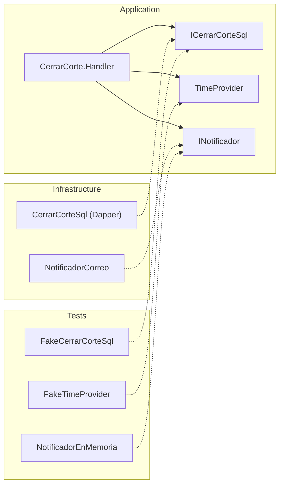

# Programar contra interfaces

Parte de: [[03-CSharp-DotNet/02 Orientación a objetos/_Índice Orientación a objetos|Orientación a objetos]]

> [!info] Cómo avanzar
> `progreso`: **pendiente** → **viendo** (estudiando) → **visto** (contestaste la autoevaluación sin abrir las respuestas) → **dominado** (hiciste el laboratorio o lo aplicaste de verdad).

## Contenido

### Qué es
**Programar contra interfaces** (o contra abstracciones) significa que tu código **depende de lo que algo hace** —un contrato— y no de **cómo lo hace** una clase concreta. Tus parámetros, campos y dependencias se declaran con tipos como `IListarEgresosSql`, `TimeProvider`, `IEnumerable<T>` o `ILogger<T>`, no con `ListarEgresosSql`, `DateTime.Now` o `List<T>`. La implementación concreta se decide en otro lugar (el registro de DI en `Program.cs`, el código de prueba).

Es la aplicación práctica del **principio de inversión de dependencias** (la D de SOLID): los módulos de alto nivel (handlers, reglas) no dependen de los de bajo nivel (Dapper, HTTP); ambos dependen de abstracciones.

### Cómo funciona

1. El handler declara en su constructor las abstracciones que necesita.
2. En producción, el contenedor de [[Inyección de dependencias]] entrega las implementaciones reales.
3. En pruebas, tú le pasas fakes. El handler no se entera ni cambia.

**Qué ganas en las pruebas**: puedes probar la lógica del handler **sin base de datos, sin red y sin reloj real**. Las pruebas son rápidas (milisegundos), deterministas (no dependen de qué datos hay en la BD ni de qué hora es) y puedes simular casos difíciles: que la consulta regrese vacío, que el servicio externo falle, que sea el último día del mes a las 23:59. Ver [[Mocks, stubs y fakes]].

**El mismo principio con colecciones**: acepta el tipo **más general** que te sirva y regresa uno **específico pero de solo lectura**:
- Un método que solo **recorre** elementos debe recibir `IEnumerable<T>`. Así acepta arrays, listas, `HashSet`, resultados de LINQ o de Dapper sin conversiones.
- Si necesitas `Count` o recorrer varias veces, `IReadOnlyCollection<T>`; si necesitas índice, `IReadOnlyList<T>`.
- Regresa `IReadOnlyList<T>` en lugar de `List<T>` para no exponer `Add`.

### Ejemplo
```csharp
public static class CerrarCorte
{
    public sealed record Comando(Guid SucursalId);

    public interface ISql
    {
        Task<decimal> TotalDelDiaAsync(Guid sucursal, DateOnly dia, CancellationToken ct);
        Task GuardarAsync(Guid sucursal, DateOnly dia, decimal total, CancellationToken ct);
    }

    public sealed class Handler(ISql sql, TimeProvider reloj, INotificador notificador)
    {
        public async Task<decimal> Handle(Comando cmd, CancellationToken ct)
        {
            var hoy = DateOnly.FromDateTime(reloj.GetUtcNow().UtcDateTime);
            var total = await sql.TotalDelDiaAsync(cmd.SucursalId, hoy, ct);
            await sql.GuardarAsync(cmd.SucursalId, hoy, total, ct);
            if (total == 0) await notificador.EnviarAsync("gerencia@ejemplo.mx", "Corte en ceros", ct);
            return total;
        }
    }
}

// Prueba: sin BD, sin SMTP, con fecha fija
[Fact]
public async Task Avisa_si_el_corte_es_cero()
{
    var reloj = new FakeTimeProvider(new DateTimeOffset(2026, 11, 30, 23, 59, 0, TimeSpan.Zero));
    var sql = new FakeSql(totalDelDia: 0m);
    var notif = new NotificadorEnMemoria();

    await new CerrarCorte.Handler(sql, reloj, notif).Handle(new(Guid.NewGuid()), CancellationToken.None);

    Assert.Single(notif.Enviados);
}

// Parámetro general: acepta cualquier secuencia
public static decimal Total(IEnumerable<Partida> partidas) => partidas.Sum(p => p.Importe);

Total(new List<Partida>());
Total(Array.Empty<Partida>());
Total(pedido.Partidas);                      // IReadOnlyList
Total(filas.Where(f => f.Activa));           // LINQ
```

### Cuándo usarlo y cuándo no
- **Úsalo** en las fronteras: BD, HTTP, archivos, correo, reloj, generación de ids aleatorios, configuración.
- **Úsalo** en parámetros de colecciones: el tipo más general que necesites.
- **No hace falta** para funciones puras sin dependencias (un cálculo de IVA) ni para DTOs: no hay nada que sustituir.
- No crees interfaces para cada clase "por principio" (ver [[Interfaces]]): la abstracción debe tener un motivo.

### Errores comunes
- **Recibir `List<T>`** cuando solo recorres: obligas al que llama a hacer `ToList()` sin necesidad.
- **Recibir `IEnumerable<T>` y recorrerlo varias veces**: si es una consulta diferida, se ejecuta cada vez. Pide `IReadOnlyCollection<T>` o materializa una vez.
- **Abstracciones con fugas**: una interfaz de Application que regresa `SqlDataReader` o lanza `SqlException` ya no es una abstracción.
- **Hacer `new` de dependencias dentro del handler** (`new SmtpClient()`): imposible de sustituir.
- **Usar estáticos directos** (`DateTime.UtcNow`, `File.ReadAllText`) en lógica que quieres probar.

### Para profundizar
- [Principios de arquitectura: inversión de dependencias](https://learn.microsoft.com/dotnet/architecture/modern-web-apps-azure/architectural-principles#dependency-inversion)
- [Inyección de dependencias en .NET](https://learn.microsoft.com/dotnet/core/extensions/dependency-injection)
- [Procedimientos recomendados para pruebas unitarias](https://learn.microsoft.com/dotnet/core/testing/unit-testing-best-practices)

## Autoevaluación

Contesta primero en voz alta o en papel; luego despliega la respuesta.

> [!question]- ¿Qué significa programar contra interfaces?
> Que tu código dependa del contrato (`IEgresosSql`, `TimeProvider`) y no de la clase concreta; el contenedor de DI decide la implementación.

> [!question]- ¿Qué ganas en las pruebas?
> Puedes pasar un fake o un stub sin base de datos ni red, y probar el handler aislado.

> [!question]- ¿Qué tipo de parámetro conviene aceptar en un método que solo recorre elementos?
> El más general que necesites: `IEnumerable<T>` para recorrer, `IReadOnlyCollection<T>` si necesitas `Count`. Regresa el más específico que te comprometas a mantener.

## Práctica

- [[Lab 2 - Modelo de dominio con encapsulamiento y records]]

