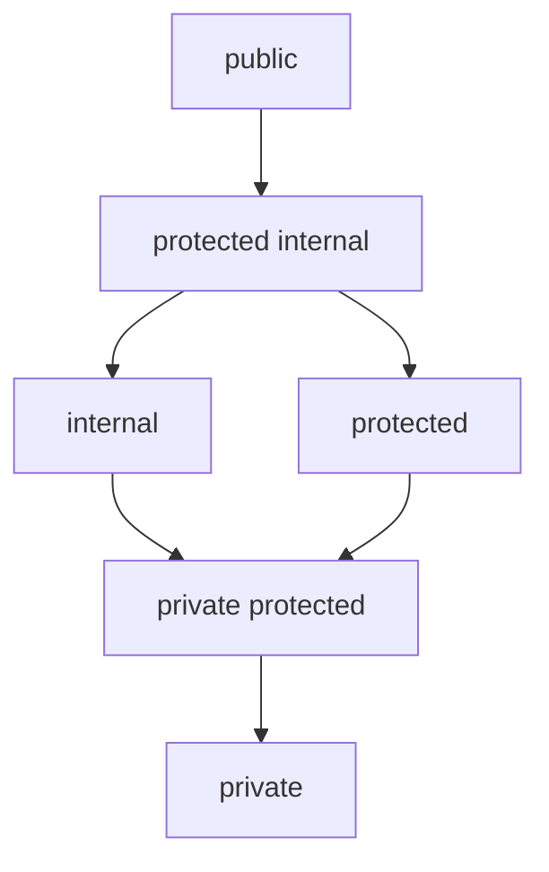

# Propiedades, campos y modificadores de acceso

Parte de: [[03-CSharp-DotNet/02 Orientación a objetos/_Índice Orientación a objetos|Orientación a objetos]]

> [!info] Cómo avanzar
> `progreso`: **pendiente** → **viendo** (estudiando) → **visto** (contestaste la autoevaluación sin abrir las respuestas) → **dominado** (hiciste el laboratorio o lo aplicaste de verdad).

## Contenido

### Qué es
- Un **campo** es una variable que pertenece a la clase o al objeto (`private decimal _saldo;`). Guarda el dato directamente.
- Una **propiedad** expone un valor mediante *accessors* `get` y `set` (o `init`). Desde fuera se usa como un campo (`cuenta.Saldo`), pero por dentro son métodos: puedes validar, calcular, notificar o restringir la escritura.
- Los **modificadores de acceso** deciden **quién puede ver** cada tipo y cada miembro.

### Cómo funciona
**Propiedades**
```csharp
public sealed class Producto
{
    private decimal _precio;                          // campo de respaldo

    public string Sku { get; }                        // solo lectura (se asigna en constructor)
    public string Nombre { get; set; } = "";          // auto-propiedad
    public int Existencias { get; private set; }      // lectura pública, escritura interna
    public DateOnly Alta { get; init; }               // solo al inicializar

    public decimal Precio                             // con validación
    {
        get => _precio;
        set => _precio = value >= 0 ? value : throw new ArgumentOutOfRangeException(nameof(value));
    }

    public decimal PrecioConIva => Math.Round(Precio * 1.16m, 2);   // calculada

    public Producto(string sku) => Sku = sku;
}
```
Las **auto-propiedades** (`{ get; set; }`) hacen que el compilador cree el campo de respaldo por ti.

**La palabra clave `field` (C# 14)**: antes, si querías agregar lógica a una sola parte de una auto-propiedad (por ejemplo, recortar espacios en el `set`), tenías que declarar el campo de respaldo a mano. Con `field` te refieres al campo que genera el compilador:
```csharp
public string Nombre
{
    get;
    set => field = value?.Trim() ?? throw new ArgumentNullException(nameof(value));
}
```

**Campo vs propiedad**: expón **propiedades**, nunca campos públicos. Cambiar un campo público por una propiedad después rompe la compatibilidad binaria, y los campos no participan en *data binding*, serialización por defecto de System.Text.Json ni interfaces. Los campos se quedan `private` (normalmente `private readonly` para dependencias).

**Modificadores de acceso**
| Modificador | Quién puede acceder |
|---|---|
| `public` | cualquiera |
| `internal` | solo el **mismo ensamblado** (proyecto) |
| `protected` | la clase y sus **derivadas** (en cualquier ensamblado) |
| `protected internal` | mismo ensamblado **o** derivadas |
| `private protected` | derivadas **dentro del mismo ensamblado** |
| `private` | solo la propia clase |
| `file` (C# 11, solo tipos) | solo el archivo donde se declara |

Valores por defecto: los tipos de nivel superior son `internal`; los miembros de una clase, `private`.



**`InternalsVisibleTo`**: permite que otro ensamblado vea tus miembros `internal`. El caso típico: el proyecto de pruebas necesita probar clases `internal` de Infrastructure sin hacerlas públicas:
```xml
<!-- en el .csproj del proyecto que se prueba -->
<ItemGroup>
  <InternalsVisibleTo Include="Itzamna.Dionisio.Tests" />
</ItemGroup>
```
También se usa para que bibliotecas de mocks (Moq, NSubstitute, que generan clases en `DynamicProxyGenAssembly2`) puedan simular tipos `internal`.

### Ejemplo
Ocultar la implementación de infraestructura y exponer solo el contrato y el registro:
```csharp
// Itzamna.Dionisio.Infrastructure
public interface IListarEgresosSql { /* contrato (en Application realmente) */ }

internal sealed class ListarEgresosSql(IDbConnectionFactory db) : IListarEgresosSql
{
    // nadie fuera de Infrastructure puede hacer new de esta clase
}

public static class DependencyInjection
{
    public static IServiceCollection AddInfraestructura(this IServiceCollection s)
    {
        s.AddScoped<IListarEgresosSql, ListarEgresosSql>();
        return s;
    }
}
```
Con `internal` por defecto en las implementaciones, la API pública del proyecto queda mínima: solo lo que otros deben usar.

### Cuándo usarlo y cuándo no
- **El acceso más restrictivo posible**: empieza en `private`/`internal` y abre solo lo necesario.
- **`internal sealed`** para implementaciones de infraestructura.
- **`private set`** o métodos de dominio para estado que tiene reglas (ver [[Encapsulamiento]]).
- **`init`** para objetos inmutables (ver [[init y required]]).
- **Propiedades calculadas** (`=>`) para valores derivados que siempre deben ser consistentes.
- No pongas lógica pesada (I/O, consultas) en un `get`: quien lee `x.Total` espera algo barato.

### Errores comunes
- **Campos públicos**: sin control y difíciles de cambiar después.
- **Todo `public` por defecto**: la API de tu proyecto crece sin querer y cualquier cambio rompe a alguien.
- **Getters con efectos secundarios o costosos**: el depurador los evalúa al inspeccionar y causa comportamientos raros.
- **Confundir `protected internal` con `private protected`**: el primero es "o", el segundo es "y".
- **Abusar de `InternalsVisibleTo`** para probar detalles privados: prueba el comportamiento público cuando puedas.

### Para profundizar
- [Propiedades (guía de programación de C#)](https://learn.microsoft.com/dotnet/csharp/programming-guide/classes-and-structs/properties)
- [Modificadores de acceso](https://learn.microsoft.com/dotnet/csharp/language-reference/keywords/access-modifiers)
- [Palabra clave field](https://learn.microsoft.com/dotnet/csharp/language-reference/keywords/field)
- [InternalsVisibleToAttribute](https://learn.microsoft.com/dotnet/api/system.runtime.compilerservices.internalsvisibletoattribute)

## Autoevaluación

Contesta primero en voz alta o en papel; luego despliega la respuesta.

> [!question]- ¿Qué diferencia hay entre un campo y una propiedad?
> Un campo es una variable de la clase. Una propiedad expone acceso mediante `get`/`set`, donde puedes validar, calcular o restringir la escritura (`private set`, `init`).

> [!question]- ¿Qué significan `public`, `internal`, `protected`, `private` y `private protected`?
> `public`: cualquiera. `internal`: solo el mismo ensamblado. `protected`: la clase y sus derivadas. `private`: solo la clase. `private protected`: derivadas dentro del mismo ensamblado. `protected internal`: mismo ensamblado **o** derivadas.

> [!question]- ¿Para qué sirve `InternalsVisibleTo`?
> Permite que otro ensamblado (típicamente el de pruebas) vea los miembros `internal`. Se declara en el `.csproj` con `<InternalsVisibleTo Include="Mi.Tests" />`.

> [!question]- ¿Qué aporta la palabra clave `field` de C# 14?
> Permite agregar lógica al `set` de una propiedad automática sin declarar el campo de respaldo: `public string Nombre { get; set => field = value.Trim(); }`.

