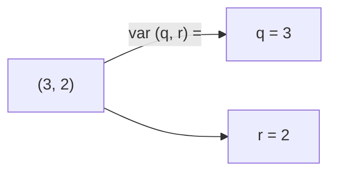

# Tuplas y deconstrucción

Parte de: [[03-CSharp-DotNet/02 Orientación a objetos/_Índice Orientación a objetos|Orientación a objetos]]

> [!info] Cómo avanzar
> `progreso`: **pendiente** → **viendo** (estudiando) → **visto** (contestaste la autoevaluación sin abrir las respuestas) → **dominado** (hiciste el laboratorio o lo aplicaste de verdad).

## Contenido

### Qué es
- Una **tupla** agrupa varios valores en uno solo sin declarar un tipo: `(int Cantidad, decimal Total)`. En C# moderno son **`ValueTuple`**: structs ligeros con elementos que pueden tener nombre.
- La **deconstrucción** separa un valor compuesto en variables individuales: `var (cantidad, total) = Calcular();`. Funciona con tuplas, records posicionales, `KeyValuePair` y cualquier tipo que tenga un método `Deconstruct`.

### Cómo funciona
```csharp
(int Cantidad, decimal Total) Resumen(IEnumerable<decimal> montos)
{
    var lista = montos.ToList();
    return (lista.Count, lista.Sum());
}

var r = Resumen([100m, 250m]);
Console.WriteLine($"{r.Cantidad} {r.Total}");     // nombres de elementos
var (n, t) = Resumen([100m, 250m]);                // deconstrucción
var (_, soloTotal) = Resumen([5m]);                // _ descarta un valor
```
- Los nombres (`Cantidad`, `Total`) son **solo de compilación**: en ejecución los campos se llaman `Item1`, `Item2`. Por eso no aparecen al serializar con System.Text.Json ni por reflexión.
- Las tuplas tienen **igualdad por valor** y soportan `==` (C# 7.3).

**Intercambiar sin variable temporal**:
```csharp
(a, b) = (b, a);
```
El lado derecho crea una tupla con los valores actuales y luego se deconstruye en las variables.

**Evaluación**: en `var (q, r) = (17 / 5, 17 % 5);` se calcula `17 / 5 = 3` (división entera) y `17 % 5 = 2`, así que `q = 3` y `r = 2`.

**`ValueTuple` vs `Tuple`**
| | `(int, string)` = `ValueTuple<int, string>` | `Tuple<int, string>` |
|---|---|---|
| Tipo | **struct** (valor) | **clase** (referencia, va al heap) |
| Nombres de elementos | sí (`(int Id, string Nombre)`) | no, solo `Item1`, `Item2` |
| Mutabilidad | campos mutables | inmutable |
| Sintaxis del lenguaje | sí (literales, deconstrucción) | no |
| Uso hoy | el normal | código antiguo |

**Deconstruir tus propios tipos**: agrega un método `Deconstruct` con parámetros `out`:
```csharp
public sealed class Rango(DateOnly desde, DateOnly hasta)
{
    public DateOnly Desde { get; } = desde;
    public DateOnly Hasta { get; } = hasta;

    public void Deconstruct(out DateOnly desde, out DateOnly hasta)
    {
        desde = Desde;
        hasta = Hasta;
    }
}

var (inicio, fin) = new Rango(new(2026, 1, 1), new(2026, 1, 31));
```
Los records posicionales generan `Deconstruct` automáticamente. También puedes escribir `Deconstruct` como [[Métodos de extensión|método de extensión]] para tipos que no son tuyos, y tener varias sobrecargas con distinto número de parámetros.

**Deconstrucción en otros lugares**: además de `var (a, b) = ...`, funciona en `foreach` (`foreach (var (clave, valor) in diccionario)`), en asignaciones a variables ya existentes (`(x, y) = (y, x)`), en *pattern matching* posicional (`if (punto is (0, 0))`) y con descartes `_` para ignorar los valores que no te interesan. Los descartes también sirven con `out _` cuando un método te obliga a recibir un valor que no usarás.



### Ejemplo
```csharp
// Recorrer un diccionario deconstruyendo KeyValuePair
foreach (var (cuenta, total) in totalesPorCuenta)
    Console.WriteLine($"{cuenta}: {total:C}");

// Método privado que regresa dos valores relacionados
private static (bool Ok, string? Error) ValidarArchivo(IFormFile archivo) =>
    archivo.Length switch
    {
        0 => (false, "Archivo vacío"),
        > 10 * 1024 * 1024 => (false, "Máximo 10 MB"),
        _ => (true, null)
    };

var (ok, error) = ValidarArchivo(archivo);
if (!ok) return BadRequest(error);

// Pattern matching con tuplas: decidir por dos valores
string Etiqueta(bool pagado, bool enviado) => (pagado, enviado) switch
{
    (true, true)   => "Completado",
    (true, false)  => "Por enviar",
    (false, _)     => "Pendiente de pago",
};

// Agrupar por dos claves en LINQ
var porMesYCuenta = egresos.GroupBy(e => (e.Fecha.Month, e.Cuenta));
```

### Cuándo usarlo y cuándo no
- **Tupla**: resultados **locales o privados** de corta vida (un método `private` que regresa dos cosas, claves compuestas en LINQ o en un diccionario, un `switch` sobre varios valores).
- **Record**: cuando el valor **cruza fronteras** (es parte de una API pública, se serializa a JSON, se pasa entre capas), cuando tiene más de 2–3 elementos o cuando merece un nombre en el dominio (`Totales`, `RangoFechas`). Un record tiene nombre propio, se documenta, se serializa con nombres reales y se puede extender.
- **`out`**: el patrón `TryXxx`; para el resto, prefiere tupla o record (ver [[Métodos y parámetros (ref, out, in, params)]]).

### Errores comunes
- **Regresar tuplas desde controllers o DTOs**: el JSON sale con `item1`, `item2` o vacío. Usa records.
- **Tuplas con muchos elementos** (`(int, string, decimal, bool, DateTime)`): ilegibles; es un tipo pidiendo nacer.
- **Confiar en los nombres en reflexión**: en ejecución son `Item1…`.
- **Olvidar que `ValueTuple` es mutable**: `t.Item1 = 5` es válido; no la uses como clave de diccionario si la vas a modificar.

### Para profundizar
- [Tipos de tupla (referencia de C#)](https://learn.microsoft.com/dotnet/csharp/language-reference/builtin-types/value-tuples)
- [Deconstrucción de tuplas y otros tipos](https://learn.microsoft.com/dotnet/csharp/fundamentals/functional/deconstruct)
- [Descartes](https://learn.microsoft.com/dotnet/csharp/fundamentals/functional/discards)

## Ejercicios

Resuélvelos en papel o en la herramienta; la solución está plegada.

> [!question]- ¿Cómo intercambias `a` y `b` sin variable temporal?
> `(a, b) = (b, a);`

> [!question]- `var (q, r) = (17 / 5, 17 % 5);` ¿Valores?
> `q = 3`, `r = 2`.

## Autoevaluación

Contesta primero en voz alta o en papel; luego despliega la respuesta.

> [!question]- ¿Qué diferencia hay entre `ValueTuple` (`(int, string)`) y `Tuple<int,string>`?
> `ValueTuple` es struct, admite nombres de elementos y deconstrucción; `Tuple` es clase con `Item1`, `Item2` inmutables. Usa la sintaxis `(a, b)`.

> [!question]- ¿Cuándo una tupla y cuándo un record?
> Tupla: resultados internos y de vida corta (un método privado). Record: cuando el dato cruza capas o APIs públicas, porque tiene nombre y se documenta.

> [!question]- ¿Cómo haces que tu clase se pueda deconstruir?
> Agregando `public void Deconstruct(out T1 a, out T2 b)`. Los records posicionales ya lo traen.

