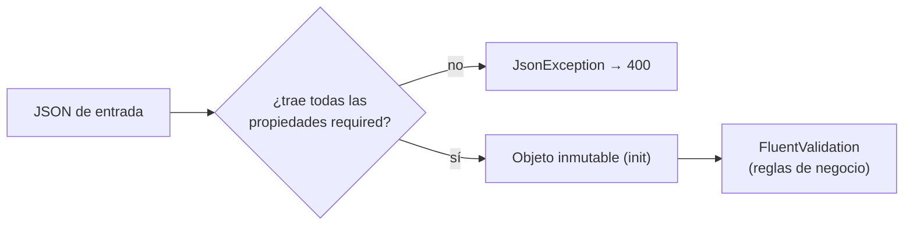

# init y required

Parte de: [[03-CSharp-DotNet/02 Orientación a objetos/_Índice Orientación a objetos|Orientación a objetos]]

> [!info] Cómo avanzar
> `progreso`: **pendiente** → **viendo** (estudiando) → **visto** (contestaste la autoevaluación sin abrir las respuestas) → **dominado** (hiciste el laboratorio o lo aplicaste de verdad).

## Contenido

### Qué es
- **`init`** (C# 9) es un tipo de *accessor* que permite asignar una propiedad **solo durante la inicialización** del objeto: en el constructor o en un inicializador de objeto `new X { Prop = ... }`. Después, la propiedad es de solo lectura. Da inmutabilidad sin obligarte a escribir constructores largos.
- **`required`** (C# 11) obliga a quien crea el objeto a **asignar** esa propiedad (o campo) en el inicializador. Si la omite, el código **no compila**.

Juntos dan objetos inmutables, con propiedades obligatorias verificadas por el compilador y con la sintaxis legible de inicializadores.

### Cómo funciona
```csharp
public sealed class ConfiguracionCorreo
{
    public required string Servidor { get; init; }
    public required int Puerto { get; init; }
    public bool UsarTls { get; init; } = true;    // opcional, con valor por defecto
}

var cfg = new ConfiguracionCorreo { Servidor = "smtp.ejemplo.mx", Puerto = 587 };
// cfg.Puerto = 25;                                // error: init solo en inicialización
// var mal = new ConfiguracionCorreo { Puerto = 587 };   // error CS9035: falta Servidor
```
- `init` también se combina con `with` en records: `var otra = cfg2 with { Puerto = 465 };` (solo records y structs).
- `required` se puede usar con `set` o con `init`, y en campos.
- Los records posicionales ya generan propiedades `init`.

**`[SetsRequiredMembers]`**: si escribes un constructor que asigna todas las propiedades `required`, el compilador no lo sabe y seguiría exigiendo el inicializador. Marcar el constructor con `[SetsRequiredMembers]` (de `System.Diagnostics.CodeAnalysis`) le dice "este constructor ya se encarga de todas": quien lo use no necesita el inicializador. Es una promesa tuya, el compilador **no la verifica**; si te equivocas, una propiedad puede quedar sin valor.
```csharp
public sealed class Cliente
{
    public required string Rfc { get; init; }
    public required string Nombre { get; init; }

    public Cliente() { }

    [SetsRequiredMembers]
    public Cliente(string rfc, string nombre) { Rfc = rfc; Nombre = nombre; }
}

var a = new Cliente { Rfc = "AAA010101AAA", Nombre = "Ana" };   // vía inicializador
var b = new Cliente("BBB010101BBB", "Beto");                    // vía constructor marcado
```

**System.Text.Json y `required`**: desde .NET 7, al **deserializar**, si el JSON no trae una propiedad marcada `required`, el serializador lanza `JsonException`. No es una validación de negocio: una propiedad presente con `null` o `""` sí pasa (si el tipo lo admite). Esa validación sigue siendo trabajo de [[FluentValidation]].



### Ejemplo
DTO de entrada de una API y configuración con Options:
```csharp
public sealed class CrearEgresoRequest
{
    public required string Concepto { get; init; }
    public required decimal Monto { get; init; }
    public DateOnly? Fecha { get; init; }            // opcional
}

// Options pattern: required documenta qué es obligatorio en appsettings
public sealed class JwtOptions
{
    public const string Seccion = "Jwt";
    public required string Emisor { get; init; }
    public required string Audiencia { get; init; }
    public int MinutosVigencia { get; init; } = 15;
}

builder.Services.AddOptions<JwtOptions>()
    .BindConfiguration(JwtOptions.Seccion)
    .Validate(o => !string.IsNullOrWhiteSpace(o.Emisor), "Falta Jwt:Emisor")
    .Validate(o => !string.IsNullOrWhiteSpace(o.Audiencia), "Falta Jwt:Audiencia")
    .ValidateOnStart();
```
Ojo: `required` es una verificación del **compilador** sobre el código que escribe `new JwtOptions { ... }`. El *binder* de configuración crea el objeto por su cuenta a partir de `appsettings`, así que no te apoyes en `required` para detectar una clave faltante: valida explícitamente al arranque (`ValidateOnStart`) para que la app no arranque con una configuración incompleta (ver [[Options pattern]]).

Comparado con un constructor de 8 parámetros, el inicializador con `required` deja claro qué valor va en cada propiedad:
```csharp
var req = new CrearEgresoRequest { Concepto = "Papelería", Monto = 350m };
```

### Cuándo usarlo y cuándo no
- **`init`**: DTOs, opciones, comandos y cualquier objeto que no deba cambiar después de creado.
- **`required`**: propiedades sin un valor por defecto razonable que el creador debe proporcionar; evita advertencias de nullable (CS8618) sin inventar valores.
- **Records posicionales** cuando el objeto es pequeño (2–4 propiedades) y te gusta la sintaxis `new X(a, b)`.
- **Constructor con validación** cuando necesitas reglas (rango, formato) al crear: `required` solo garantiza que se asignó, no que el valor sea válido.

### Errores comunes
- **Creer que `required` valida el contenido**: solo exige que se asigne; `""` o `null!` pasan.
- **Usar `[SetsRequiredMembers]` en un constructor que no asigna todo**: el compilador te cree y quedan propiedades sin valor.
- **Esperar que `init` haga inmutable el contenido**: una propiedad `init` de tipo `List<T>` sigue permitiendo `Add`.
- **Confiar en `required` para la configuración**: es una verificación de compilación; para `appsettings` valida al arrancar.

### Para profundizar
- [init (referencia de C#)](https://learn.microsoft.com/dotnet/csharp/language-reference/keywords/init)
- [required (referencia de C#)](https://learn.microsoft.com/dotnet/csharp/language-reference/keywords/required)
- [Propiedades requeridas en System.Text.Json](https://learn.microsoft.com/dotnet/standard/serialization/system-text-json/required-properties)

## Autoevaluación

Contesta primero en voz alta o en papel; luego despliega la respuesta.

> [!question]- ¿Qué hace `init`?
> La propiedad solo se puede asignar al construir el objeto (constructor o inicializador `{ }`); después es de solo lectura.

> [!question]- ¿Qué hace `required`?
> Obliga a quien crea el objeto a asignar esa propiedad en el inicializador; si no, no compila.

> [!question]- ¿Qué es `[SetsRequiredMembers]`?
> Un atributo en un constructor que le dice al compilador que ese constructor ya asigna los miembros `required`, para no exigirlos en el inicializador.

> [!question]- ¿Qué hace System.Text.Json con `required` al deserializar?
> Desde .NET 7 respeta `required`: si falta la propiedad en el JSON lanza `JsonException`.

## Práctica

- [[Lab 2 - Modelo de dominio con encapsulamiento y records]]

