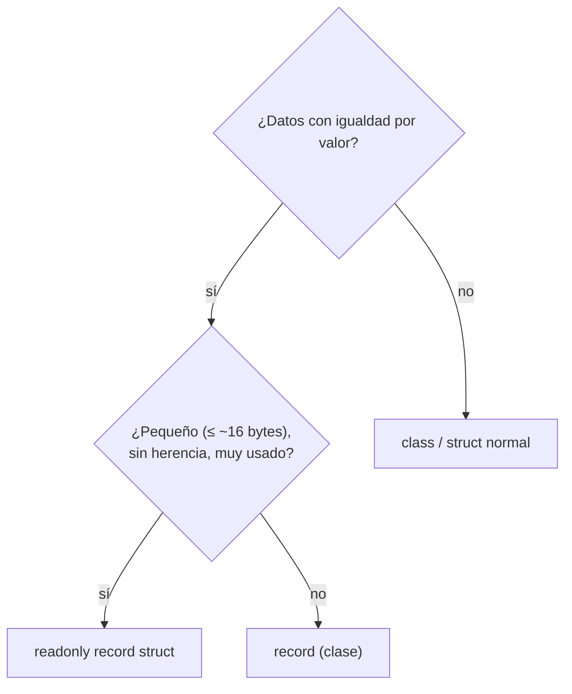

# record struct

Parte de: [[03-CSharp-DotNet/02 Orientación a objetos/_Índice Orientación a objetos|Orientación a objetos]]

> [!info] Cómo avanzar
> `progreso`: **pendiente** → **viendo** (estudiando) → **visto** (contestaste la autoevaluación sin abrir las respuestas) → **dominado** (hiciste el laboratorio o lo aplicaste de verdad).

## Contenido

### Qué es
Un **`record struct`** (C# 10) combina dos cosas: es un **struct** (tipo de valor, se copia al asignar, no requiere asignación en el heap) y tiene las comodidades de un **record** (igualdad por valor generada, `ToString` legible, deconstrucción, `with`). Sirve para **valores pequeños** que se comparan por su contenido: dinero, coordenadas, rangos, ids fuertemente tipados.

### Cómo funciona
**`record` vs `record struct`**
| | `record` (`record class`) | `record struct` |
|---|---|---|
| Categoría | referencia (heap) | **valor** (se copia) |
| Puede ser `null` | sí | no (salvo `T?`) |
| Herencia | sí, entre records | no (los structs no heredan) |
| Propiedades posicionales | `init` (inmutables) | **`set` (mutables)** |
| `readonly` | no aplica | `readonly record struct` → `init` |
| Igualdad, `ToString`, `with`, `Deconstruct` | generados | generados |

**¿Es inmutable un `record struct` posicional?** **No.** Por compatibilidad con cómo suelen usarse los structs, en `record struct Punto(int X, int Y)` las propiedades generadas son `{ get; set; }`: puedes hacer `p.X = 5`. Si quieres inmutabilidad, declara **`readonly record struct`**: las propiedades pasan a ser `{ get; init; }` y el compilador impide modificar el estado después de crear el valor.
```csharp
public record struct PuntoMutable(int X, int Y);
var m = new PuntoMutable(1, 2);
m.X = 10;                       // permitido

public readonly record struct Punto(int X, int Y);
var p = new Punto(1, 2);
// p.X = 10;                    // error: init-only
var q = p with { X = 10 };      // copia con cambio
```

**Igualdad eficiente**: a diferencia de un `struct` normal (cuyo `Equals` por defecto usa reflexión y hace boxing), el `record struct` genera `Equals(T)` fuertemente tipado, `GetHashCode` y `==`/`!=`, todo rápido y sin boxing. Por eso funciona bien como clave de `Dictionary` o elemento de `HashSet`.



### Ejemplo
Ids fuertemente tipados para que el compilador impida mezclar un `EmpresaId` con un `UsuarioId`:
```csharp
public readonly record struct EmpresaId(Guid Valor)
{
    public static EmpresaId Nuevo() => new(Guid.CreateVersion7());
    public override string ToString() => Valor.ToString();
}

public readonly record struct UsuarioId(Guid Valor);

public sealed record ListarEgresosQuery(EmpresaId Empresa, int Pagina = 1);

// void Asignar(UsuarioId u, EmpresaId e) ...
// Asignar(empresa, usuario);    → no compila: tipos distintos aunque ambos envuelvan Guid
```
(Para usarlos con Dapper o System.Text.Json necesitas un `TypeHandler` o un `JsonConverter` que los convierta a `Guid`.)

Dinero como *value object* sin asignación en el heap:
```csharp
public readonly record struct Dinero(decimal Monto, string Moneda)
{
    public static Dinero Mxn(decimal monto) => new(monto, "MXN");

    public static Dinero operator +(Dinero a, Dinero b) =>
        a.Moneda == b.Moneda
            ? a with { Monto = a.Monto + b.Monto }
            : throw new InvalidOperationException("No se pueden sumar monedas distintas.");
}

var total = Dinero.Mxn(100m) + Dinero.Mxn(50.5m);
Console.WriteLine(total);                     // Dinero { Monto = 150.5, Moneda = MXN }
Console.WriteLine(total == Dinero.Mxn(150.5m));   // True
```

Clave compuesta de diccionario:
```csharp
public readonly record struct Periodo(int Anio, int Mes);
var totales = new Dictionary<Periodo, decimal>();
totales[new(2026, 11)] = 12_500m;
```

El tipo `Unit` de algunas bibliotecas (un "vacío" para resultados genéricos) también se suele declarar como `readonly record struct Unit;`.

### Cuándo usarlo y cuándo no
- **Úsalo** (como `readonly record struct`) para valores pequeños, inmutables y muy frecuentes: ids tipados, dinero, coordenadas, periodos, claves compuestas.
- **No lo uses** para datos grandes (muchos campos o strings largos): cada asignación y cada paso a un método copia todo el valor.
- **No lo uses** si necesitas herencia o `null` como estado normal: usa `record`.
- Para DTOs de API normalmente basta un `record` de clase; la diferencia de rendimiento no se nota.

### Errores comunes
- **Suponer que es inmutable sin `readonly`**: el posicional genera `set`.
- **Modificar una copia**: `lista[0].X = 5` sobre un `record struct` en una `List<T>` no compila (CS1612), y en una variable copiada el cambio no afecta al original.
- **Structs grandes**: copiar 64 bytes en cada llamada cuesta más que una referencia.
- **Olvidar el valor `default`**: `default(EmpresaId)` envuelve `Guid.Empty`; valida que no lleguen ids vacíos.

### Para profundizar
- [Registros (incluye record struct)](https://learn.microsoft.com/dotnet/csharp/language-reference/builtin-types/record)
- [Tipos de estructura (struct)](https://learn.microsoft.com/dotnet/csharp/language-reference/builtin-types/struct)
- [Elegir entre clase y estructura](https://learn.microsoft.com/dotnet/standard/design-guidelines/choosing-between-class-and-struct)

## Autoevaluación

Contesta primero en voz alta o en papel; luego despliega la respuesta.

> [!question]- ¿Qué diferencia hay entre `record` y `record struct`?
> `record` (o `record class`) es tipo de referencia. `record struct` es tipo de valor con las mismas facilidades (igualdad, `with`, `ToString`).

> [!question]- ¿Es inmutable un `record struct` posicional?
> No por defecto: sus propiedades posicionales tienen `set`. Usa `readonly record struct` para que sean `init`.

> [!question]- ¿Cuándo lo usarías?
> Para ids fuertemente tipados o valores pequeños: `public readonly record struct EgresoId(long Valor);` evita confundir un id con otro sin costo de heap.

## Práctica

- [[Lab 2 - Modelo de dominio con encapsulamiento y records]]

