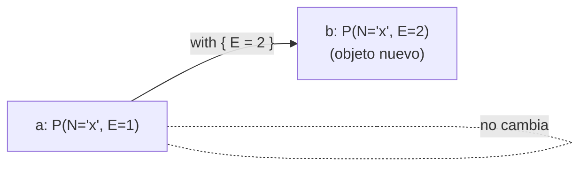

# record

Parte de: [[03-CSharp-DotNet/02 Orientación a objetos/_Índice Orientación a objetos|Orientación a objetos]]

> [!info] Cómo avanzar
> `progreso`: **pendiente** → **viendo** (estudiando) → **visto** (contestaste la autoevaluación sin abrir las respuestas) → **dominado** (hiciste el laboratorio o lo aplicaste de verdad).

## Contenido

### Qué es
Un **`record`** (C# 9) es un tipo pensado para **datos**: el compilador genera por ti la igualdad por valor, un `ToString` legible, la deconstrucción y las expresiones `with` para copiar cambiando algunas propiedades. `record` (o `record class`) es un tipo de **referencia**; su variante de valor es [[record struct]]. Es la forma natural de escribir DTOs, comandos, consultas, resultados y *value objects*.

### Cómo funciona
**Sintaxis posicional**:
```csharp
public sealed record Campos(string Codigo, long Fecha);
```
El compilador genera:
- Un constructor con esos parámetros y propiedades públicas `{ get; init; }`.
- `Equals`, `GetHashCode`, `==` y `!=` que comparan **todas** las propiedades (y el tipo exacto).
- `ToString()` → `Campos { Codigo = A1, Fecha = 20260101 }`.
- `Deconstruct` → `var (codigo, fecha) = campos;`.
- Soporte para `with`: crea una **copia nueva** con las propiedades indicadas cambiadas; el original no se toca.

También puedes declararlos con propiedades normales (`public sealed record Cliente { public required string Rfc { get; init; } }`) y agregar métodos, validaciones o propiedades calculadas.

Razonando el ejemplo de la autoevaluación:
```csharp
record P(string N, int E);
var a = new P("x", 1);
var b = a with { E = 2 };                   // copia con E = 2
Console.Write($"{a == b} {a == new P("x", 1)} {b.E}");
// False True 2
```
- `a == b`: difieren en `E` → `False`.
- `a == new P("x", 1)`: objetos distintos con los mismos datos → `True` (igualdad por valor).
- `b.E` → `2`, y `a.E` sigue en 1.



**Herencia**: un record puede heredar de otro record (no de una clase normal). La igualdad toma en cuenta el tipo real (`EqualityContract`), así que un `Aprobado` nunca es igual a un `Rechazado` aunque coincidan sus propiedades. Esto permite jerarquías cerradas de resultados con `abstract record`.

**Limitación importante**: la igualdad compara cada propiedad con su `Equals`. Si una propiedad es `List<T>` o un array, se compara la **referencia** de la colección, no su contenido (ver [[Igualdad por valor vs por referencia]]).

### Ejemplo
Por qué tus Command, Result y "Campos" de SQL son records:
```csharp
// Command de un slice: datos inmutables de entrada
public sealed record RegistrarEgreso(Guid EmpresaId, string Concepto, decimal Monto);

// Result: salida que se compara fácil en pruebas
public sealed record Resultado(bool Ok, string? Codigo = null, string? Mensaje = null)
{
    public static Resultado Exito() => new(true);
    public static Resultado Falla(string codigo, string mensaje) => new(false, codigo, mensaje);
}

// "Campos": parámetros que se pasan a Dapper para el .sql
public sealed record RegistrarEgresoCampos(Guid Id, Guid EmpresaId, string Concepto, decimal Monto, DateTime CreadoUtc);

await conexion.ExecuteAsync(
    new CommandDefinition(sql.Texto, new RegistrarEgresoCampos(id, cmd.EmpresaId, cmd.Concepto, cmd.Monto, ahora),
        cancellationToken: ct));
// Dapper toma @Id, @EmpresaId, @Concepto... de las propiedades del record
```
Son datos que no deben cambiar después de crearse, se comparan por valor y se crean en una línea:
```csharp
[Fact]
public async Task Rechaza_monto_cero()
{
    var r = await handler.Handle(new RegistrarEgreso(empresa, "Luz", 0m), ct);
    Assert.Equal(Resultado.Falla("MONTO_INVALIDO", "El monto debe ser mayor a cero."), r);   // compara por valor
}
```

Copiar con cambios, útil en pruebas y en transformaciones:
```csharp
var base_ = new RegistrarEgreso(empresa, "Luz", 500m);
var sinConcepto = base_ with { Concepto = "" };
```

Jerarquía cerrada consumida con pattern matching:
```csharp
public abstract record ResultadoPago;
public sealed record Aprobado(string Autorizacion) : ResultadoPago;
public sealed record Rechazado(string Motivo) : ResultadoPago;

IActionResult Respuesta(ResultadoPago r) => r switch
{
    Aprobado a  => Ok(a),
    Rechazado x => UnprocessableEntity(new { codigo = "PAGO_RECHAZADO", x.Motivo }),
    _ => throw new UnreachableException()
};
```

### Cuándo usarlo y cuándo no
- **Úsalo** para DTOs de entrada y salida, comandos, consultas, resultados, eventos y *value objects* (`Dinero`, `RangoFechas`): datos inmutables con igualdad por valor.
- **No** lo uses para **entidades de dominio con identidad**: dos pedidos distintos con los mismos datos serían "iguales", `with` crea copias que rompen la noción de "el mismo pedido" y las propiedades `init` dificultan el encapsulamiento con métodos de negocio. Las entidades son clases con [[Encapsulamiento]] y se comparan por `Id`.
- **No** lo uses para servicios o handlers (no son datos).
- Si es pequeño y muy usado en rutas calientes, considera `readonly record struct`.

### Errores comunes
- **Records con `List<T>`** esperando igualdad por contenido.
- **Usar records como entidades** de EF Core o del dominio: igualdad y `with` no encajan con la identidad.
- **Creer que `with` hace copia profunda**: copia superficial; las colecciones internas se comparten entre original y copia.
- **Propiedades `set` en records**: rompen la inmutabilidad y el hash puede cambiar si el record está en un `HashSet`.

### Para profundizar
- [Registros (referencia de C#)](https://learn.microsoft.com/dotnet/csharp/language-reference/builtin-types/record)
- [Tutorial: crear tipos de registro](https://learn.microsoft.com/dotnet/csharp/whats-new/tutorials/records)
- [Expresión with](https://learn.microsoft.com/dotnet/csharp/language-reference/operators/with-expression)

## Ejercicios

Resuélvelos en papel o en la herramienta; la solución está plegada.

> [!question]- ¿Qué imprime? `record P(string N, int E); var a = new P("x", 1); var b = a with { E = 2 }; Console.Write($"{a == b} {a == new P("x", 1)} {b.E}");`
> `False True 2`.

## Autoevaluación

Contesta primero en voz alta o en papel; luego despliega la respuesta.

> [!question]- ¿Qué te da un `record` frente a una clase normal?
> Igualdad por valor, `ToString` con sus propiedades, deconstrucción y expresiones `with` para copiar cambiando algunos campos. Con sintaxis posicional: `public sealed record Campos(string Codigo, long Fecha);`.

> [!question]- ¿Por qué tus Command, Result y "Campos" de SQL son records?
> Son datos inmutables que se comparan por valor: fáciles de crear en pruebas, de comparar en asserts y de mapear a parámetros de Dapper.

> [!question]- Error común: usar un record como entidad de dominio con identidad. ¿Por qué no encaja?
> Dos entidades con los mismos datos pero distinto ciclo de vida serían "iguales" y `with` crea copias que rompen la identidad. Las entidades suelen ser clases con encapsulamiento.

## Práctica

- [[Lab 2 - Modelo de dominio con encapsulamiento y records]]

