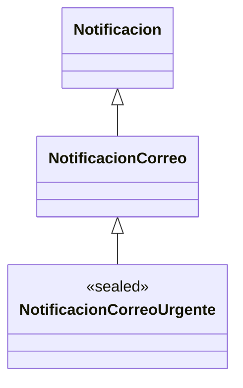

# sealed y override

Parte de: [[03-CSharp-DotNet/02 Orientación a objetos/_Índice Orientación a objetos|Orientación a objetos]]

> [!info] Cómo avanzar
> `progreso`: **pendiente** → **viendo** (estudiando) → **visto** (contestaste la autoevaluación sin abrir las respuestas) → **dominado** (hiciste el laboratorio o lo aplicaste de verdad).

## Contenido

### Qué es
- **`override`** reemplaza en una clase derivada la implementación de un miembro `virtual`, `abstract` u `override` de la base. Es el mecanismo del [[Polimorfismo]].
- **`sealed`** cierra la puerta a la herencia:
  - En una **clase**: nadie puede heredar de ella.
  - En un **miembro `override`** (`sealed override`): las derivadas siguientes ya no pueden volver a sobrescribirlo.

### Cómo funciona
**Requisitos de `override`**
1. El miembro de la base debe ser `virtual`, `abstract` u `override` (y no `sealed`).
2. La firma debe coincidir: mismo nombre, mismos parámetros y mismo modificador de acceso. El tipo de retorno debe ser el mismo o, desde C# 9, uno más derivado (*covariant returns*).
3. No puedes sobrescribir miembros `static` ni no virtuales (para esos solo existe ocultar con `new`, que casi nunca es lo que quieres).
4. Puedes llamar a la versión de la base con `base.Metodo()`.

```csharp
public abstract class Notificacion
{
    public abstract string Canal { get; }                         // obligatorio
    public virtual string Formatear(string msg) => msg.Trim();    // opcional
}

public class NotificacionCorreo : Notificacion
{
    public override string Canal => "correo";
    public override string Formatear(string msg) => $"<p>{base.Formatear(msg)}</p>";
}

public sealed class NotificacionCorreoUrgente : NotificacionCorreo
{
    public sealed override string Formatear(string msg) => "[URGENTE] " + base.Formatear(msg);
    // (en una clase sealed, el sealed del método es redundante; se muestra para ilustrar la sintaxis)
}
```

**`sealed` en clase vs en método**

- `sealed class`: termina la jerarquía.
- `sealed override` en una clase no sellada: la clase todavía se puede heredar, pero ese método queda fijo. Útil cuando la base define un paso que las derivadas no deben alterar.

**Rendimiento**: cuando el JIT sabe que un tipo es `sealed`, puede convertir llamadas virtuales en llamadas directas (desvirtualización) e incluso hacer *inlining*; también acelera comprobaciones de tipo (`is`, casts). La ganancia individual es pequeña, pero en código muy usado suma. Existe el analizador CA1852 que sugiere sellar tipos internos que nadie hereda.

### Ejemplo
Por qué marcar tus handlers y controllers como `sealed`:
```csharp
[ApiController]
[Route("api/egresos")]
public sealed class EgresosController(ListarEgresos.Handler listar) : ControllerBase
{
    [HttpGet]
    public async Task<IActionResult> Get([FromQuery] ListarEgresos.Query q, CancellationToken ct)
        => Ok(await listar.Handle(q, ct));
}

public static class ListarEgresos
{
    public sealed record Query(Guid EmpresaId, int Pagina = 1);
    public sealed class Handler(IListarEgresosSql sql) { /* ... */ }
}
```
1. **Intención**: no fueron diseñados para heredarse; `sealed` lo dice explícitamente.
2. **Seguridad del diseño**: nadie crea `EgresosControllerV2 : EgresosController` dependiendo de detalles internos que mañana cambian.
3. **Rendimiento**: el JIT puede optimizar.
4. **Reversible**: quitar `sealed` después no rompe a nadie; agregarlo cuando ya hay derivadas sí.

`ToString`, `Equals` y `GetHashCode` son los `override` más comunes de todos:
```csharp
public sealed class Folio(string serie, int numero)
{
    public override string ToString() => $"{serie}-{numero:D6}";
}
Console.WriteLine(new Folio("F", 120));   // F-000120
```

Retorno covariante (C# 9):
```csharp
public abstract class Exportador { public abstract Exportador Clonar(); }
public sealed class ExportadorCsv : Exportador
{
    public override ExportadorCsv Clonar() => new();   // tipo más específico permitido
}
```

### Cuándo usarlo y cuándo no
- **`sealed` por defecto** en clases concretas de aplicación: handlers, controllers, validadores, servicios, DTOs, records. Muchos equipos lo fijan como convención (y en algunas soluciones se hace cumplir con analizadores).
- **No selles** clases pensadas como base de una jerarquía (por ejemplo `ExportadorBase`) ni tipos de bibliotecas públicas cuyos usuarios necesitan extenderlos.
- **`override`** cuando necesitas cambiar el comportamiento heredado; llama a `base` si quieres ampliar en lugar de reemplazar.
- **`sealed override`** cuando un paso de un algoritmo heredado no debe volver a cambiar.

### Errores comunes
- **Olvidar `virtual` en la base** y luego intentar `override`: error CS0506.
- **Usar `new` en lugar de `override`**: el comportamiento depende del tipo de la variable.
- **Cambiar el acceso al sobrescribir** (`protected` en la base, `public` en la derivada): error de compilación.
- **No llamar a `base`** cuando la base hacía trabajo necesario (por ejemplo, en `Dispose(bool)` o en `ExecuteAsync`).

### Para profundizar
- [sealed (referencia de C#)](https://learn.microsoft.com/dotnet/csharp/language-reference/keywords/sealed)
- [override (referencia de C#)](https://learn.microsoft.com/dotnet/csharp/language-reference/keywords/override)
- [CA1852: sellar tipos internos](https://learn.microsoft.com/dotnet/fundamentals/code-analysis/quality-rules/ca1852)

## Autoevaluación

Contesta primero en voz alta o en papel; luego despliega la respuesta.

> [!question]- ¿Qué hace `sealed` en una clase y en un método?
> En una clase impide heredarla. En un método `sealed override` impide que las derivadas lo vuelvan a sobrescribir.

> [!question]- ¿Qué requisitos tiene `override`?
> El método base debe ser `virtual`, `abstract` u `override`, con la misma firma y accesibilidad.

> [!question]- ¿Por qué marcar tus handlers y controllers como `sealed`?
> Expresa que no se diseñaron para heredarse y el JIT puede desvirtualizar llamadas. Hay un analizador (CA1852) que lo sugiere.

## Práctica

- [[Lab 2 - Modelo de dominio con encapsulamiento y records]]

