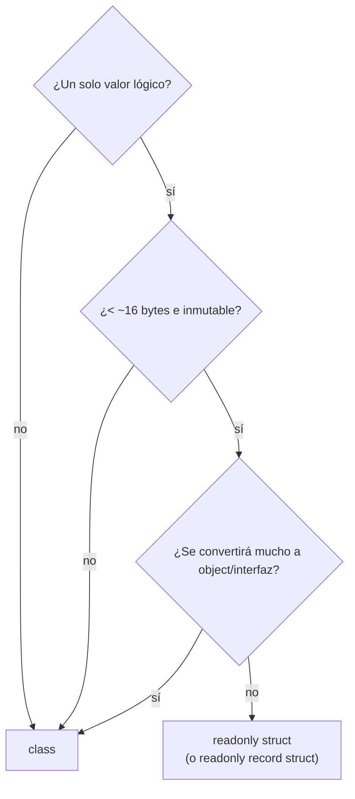

# struct

Parte de: [[03-CSharp-DotNet/02 Orientación a objetos/_Índice Orientación a objetos|Orientación a objetos]]

> [!info] Cómo avanzar
> `progreso`: **pendiente** → **viendo** (estudiando) → **visto** (contestaste la autoevaluación sin abrir las respuestas) → **dominado** (hiciste el laboratorio o lo aplicaste de verdad).

## Contenido

### Qué es
Un **`struct`** define un **tipo de valor**: las variables contienen directamente los datos, y asignar o pasar a un método **copia** el valor completo. Los tipos numéricos, `bool`, `char`, `DateTime`, `Guid`, `TimeSpan` y `KeyValuePair` son structs. Sirven para valores pequeños que representan "una cantidad" o "una medida", donde la copia es barata y evitar asignaciones en el heap mejora el rendimiento.

### Cómo funciona
```csharp
public struct Coordenada
{
    public double Lat;
    public double Lng;
}

var a = new Coordenada { Lat = 19.43, Lng = -99.13 };
var b = a;          // copia completa
b.Lat = 0;
Console.WriteLine(a.Lat);   // 19.43
```
Características:
- No pueden heredar de otra clase o struct (heredan implícitamente de `ValueType`), pero **sí implementan interfaces**.
- Siempre existe el valor `default` (todos los campos en cero/null), aunque declares constructores.
- Se pueden declarar constructores sin parámetros e inicializadores de campos (C# 10+).
- Viven donde vive su contenedor: como variable local, normalmente en el stack; como campo de una clase o elemento de un array, dentro de ese objeto en el heap (ver [[Tipos de valor y de referencia]]).
- Al convertirlos a `object` o a una interfaz se hace **boxing** (asignación en el heap).

**¿Cuándo `struct` en vez de `class`?** La guía de diseño de .NET sugiere un struct solo si se cumplen **todas** (o casi todas) estas condiciones:
1. Representa lógicamente **un solo valor** (como un número o una coordenada).
2. Es **pequeño**: el tamaño de la instancia es menor a unos 16 bytes.
3. Es **inmutable**.
4. No se va a convertir a `object`/interfaces con frecuencia (para evitar boxing).

**`readonly struct`**: marca el struct como inmutable; el compilador obliga a que todos los campos sean `readonly` y las propiedades sin `set`. Ventajas:
- Evitas el bug de "modifiqué una copia".
- El compilador **no necesita copias defensivas** al llamar métodos sobre un struct en un campo `readonly` o en un parámetro `in`: sin `readonly`, como no sabe si el método modifica el estado, hace una copia antes de llamarlo para proteger el original.
- Comunica la intención.



### Ejemplo
```csharp
public readonly struct Porcentaje
{
    public Porcentaje(decimal valor)
    {
        if (valor is < 0 or > 100) throw new ArgumentOutOfRangeException(nameof(valor));
        Valor = valor;
    }

    public decimal Valor { get; }
    public decimal Aplicar(decimal monto) => Math.Round(monto * Valor / 100m, 2);
    public override string ToString() => $"{Valor}%";
}

var iva = new Porcentaje(16);
Console.WriteLine(iva.Aplicar(1000m));    // 160.00
```

**El riesgo de modificar structs dentro de colecciones**:
```csharp
public struct Contador { public int Valor; }    // mutable (mala idea)

var lista = new List<Contador> { new() };
// lista[0].Valor++;           // error CS1612: el indexador regresa una COPIA
var c = lista[0];
c.Valor++;                     // modifica la copia local
Console.WriteLine(lista[0].Valor);   // 0: el elemento de la lista no cambió
lista[0] = c;                  // hay que reasignar el valor completo

var arreglo = new Contador[1];
arreglo[0].Valor++;            // en arrays sí funciona: el acceso es directo al elemento
```
Con un struct **grande** (por ejemplo, 10 campos `decimal`, unos 160 bytes) además cada lectura de `lista[i]` copia todo el bloque, lo que cuesta más que usar una clase. Si necesitas modificar elementos, usa una clase, un `readonly struct` con `with`/reemplazo, o en código muy optimizado `CollectionsMarshal.AsSpan(lista)` para obtener referencias directas.

### Cuándo usarlo y cuándo no
- **Úsalo** (como `readonly struct` o `readonly record struct`) para valores pequeños e inmutables: dinero, porcentajes, coordenadas, ids tipados, rangos.
- **Úsalo** en código de alto rendimiento para reducir asignaciones (tipos auxiliares en parsers, enumeradores).
- **No lo uses** para entidades, DTOs con muchas propiedades o cualquier cosa con identidad o ciclo de vida: usa `class` o `record`.
- **No lo uses mutable** salvo casos muy específicos y controlados.
- Si además quieres igualdad por valor generada, usa [[record struct]].

### Errores comunes
- **Structs mutables**: modificaciones que "no se guardan" porque se aplicaron a una copia.
- **Structs grandes**: copias costosas en cada asignación y llamada.
- **Boxing frecuente**: guardarlos en `object`, `ArrayList` o interfaces no genéricas anula la ventaja.
- **Olvidar `default`**: un `Porcentaje` sin inicializar vale 0, aunque el constructor valide; no puedes impedir que exista.
- **`Equals` por defecto lento**: implementa `IEquatable<T>` o usa `record struct`.

### Para profundizar
- [Tipos de estructura (referencia de C#)](https://learn.microsoft.com/dotnet/csharp/language-reference/builtin-types/struct)
- [Elegir entre clase y estructura](https://learn.microsoft.com/dotnet/standard/design-guidelines/choosing-between-class-and-struct)
- [Escribir código C# seguro y eficiente](https://learn.microsoft.com/dotnet/csharp/advanced-topics/performance/)

## Autoevaluación

Contesta primero en voz alta o en papel; luego despliega la respuesta.

> [!question]- ¿Cuándo usar `struct` en vez de `class`?
> Para valores pequeños e inmutables que se comportan como un dato (coordenada, dinero, id fuerte), normalmente de pocos bytes. Evitas una asignación en el heap.

> [!question]- ¿Por qué conviene `readonly struct`?
> Garantiza inmutabilidad y evita copias defensivas cuando se pasa con `in` o se llama un método.

> [!question]- ¿Qué riesgo hay al guardar un struct grande en una `List<T>` y modificarlo?
> `lista[0].X = 1` no compila porque el indexador regresa una **copia**; y copiar structs grandes en cada acceso cuesta.

