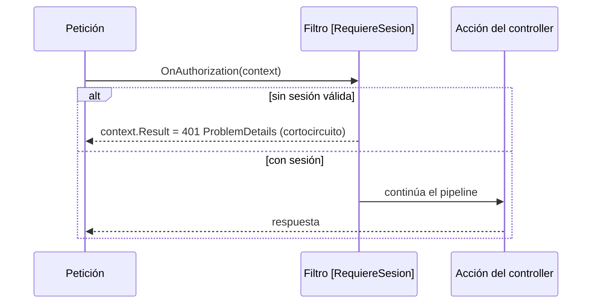

# Atributos

Parte de: [[03-CSharp-DotNet/03 Intermedio/_Índice Intermedio|Intermedio]]

> [!info] Cómo avanzar
> `progreso`: **pendiente** → **viendo** (estudiando) → **visto** (contestaste la autoevaluación sin abrir las respuestas) → **dominado** (hiciste el laboratorio o lo aplicaste de verdad).

## Contenido

### Qué es
Un **atributo** es **metadato declarativo** que se pega a un elemento del código (clase, método, propiedad, parámetro, ensamblado) entre corchetes: `[HttpGet]`, `[Authorize]`, `[Required]`, `[JsonPropertyName("rfc")]`. Por sí mismo **no ejecuta nada**: queda guardado en el ensamblado, y alguien (el compilador, el runtime, un framework o tu propio código vía [[Reflexión]]) lo lee y actúa en consecuencia.

### Cómo funciona
1. **Un atributo es una clase** que hereda de `System.Attribute`. Por convención su nombre termina en `Attribute`, y al usarlo puedes omitir el sufijo: `[Obsolete]` es `ObsoleteAttribute`.
2. **`[AttributeUsage]`** en la clase del atributo define dónde se puede aplicar (`AttributeTargets.Method | AttributeTargets.Class`), si se puede repetir (`AllowMultiple`) y si se hereda (`Inherited`).
3. **Argumentos**: los del constructor son posicionales (`[Obsolete("usa otro")]`) y las propiedades públicas se asignan por nombre (`[Route("api/x", Name = "x")]`). Solo admiten **constantes de compilación**: literales, `typeof`, enums, `nameof`, arreglos de esos.
4. **Lectura**: `typeof(MiClase).GetCustomAttribute<MiAtributo>()` o `GetCustomAttributes(...)`. El framework lo hace por ti al arrancar.

Quién consume atributos, de forma típica:
- **El compilador**: `[Obsolete]`, `[CallerMemberName]`, `[GeneratedRegex]` (un *source generator*), `[SetsRequiredMembers]`.
- **ASP.NET Core**: `[ApiController]`, `[HttpPost]`, `[FromBody]`, `[Authorize]`, y los **filtros**.
- **Serializadores y validadores**: `[JsonPropertyName]`, `[JsonIgnore]`, `[Required]`, `[Range]`.
- **Pruebas**: `[Fact]`, `[Theory]`, `[InlineData]` de xUnit.

**Cómo funciona un filtro de MVC como `[RequiereSesion]`**: ASP.NET Core, al construir la descripción de cada acción, recorre los atributos del controller y de la acción. Si un atributo implementa alguna interfaz de filtro (`IAuthorizationFilter`, `IActionFilter`, `IAsyncActionFilter`, `IResourceFilter`...), lo **agrega al pipeline de filtros** de esa acción. En cada petición, antes (y/o después) de ejecutar la acción, llama a sus métodos; si el filtro asigna `context.Result`, la acción ni siquiera se ejecuta (cortocircuito). Ver [[Filtros]].



### Ejemplo
```csharp
using Microsoft.AspNetCore.Mvc;
using Microsoft.AspNetCore.Mvc.Filters;

// 1) Atributo de filtro: se aplica a controllers o acciones
[AttributeUsage(AttributeTargets.Class | AttributeTargets.Method, AllowMultiple = false)]
public sealed class RequiereSesionAttribute : Attribute, IAuthorizationFilter
{
    public string? Rol { get; init; }            // argumento con nombre

    public void OnAuthorization(AuthorizationFilterContext context)
    {
        var usuario = context.HttpContext.User;
        if (usuario.Identity?.IsAuthenticated != true)
        {
            context.Result = Problema(401, "sin_sesion", "Debes iniciar sesión.");
            return;
        }
        if (Rol is not null && !usuario.IsInRole(Rol))
            context.Result = Problema(403, "sin_permiso", "No tienes permiso.");
    }

    private static ObjectResult Problema(int status, string codigo, string titulo)
    {
        var pd = new ProblemDetails { Status = status, Title = titulo };
        pd.Extensions["codigo"] = codigo;
        return new ObjectResult(pd) { StatusCode = status };
    }
}

[ApiController, Route("api/pedidos")]
[RequiereSesion]                                  // toda la clase
public sealed class PedidosController : ControllerBase
{
    [HttpDelete("{id:int}")]
    [RequiereSesion(Rol = "Admin")]               // más estricto en esta acción
    public IActionResult Borrar(int id) => NoContent();
}

// 2) Atributo propio de metadatos, leído por reflexión
[AttributeUsage(AttributeTargets.Interface)]
public sealed class ArchivoSqlAttribute(string ruta) : Attribute
{
    public string Ruta { get; } = ruta;
}

[ArchivoSql("Pedidos/PorCliente.sql")]
public interface IConsultaPedidosPorCliente { }

// Lectura:
// var ruta = typeof(IConsultaPedidosPorCliente)
//     .GetCustomAttributes(typeof(ArchivoSqlAttribute), false)
//     .OfType<ArchivoSqlAttribute>().Single().Ruta;
```

Si el filtro necesita servicios de DI (un repositorio de sesiones, `ILogger`), un atributo no puede recibirlos por constructor (sus argumentos son constantes). Usa `[TypeFilter(typeof(MiFiltro))]`, `[ServiceFilter(typeof(MiFiltro))]` o un atributo que implemente `IFilterFactory`.

### Cuándo usarlo y cuándo no
- **Úsalos** para configuración declarativa que un framework ya sabe leer: rutas, validación, serialización, autorización, pruebas.
- **Crea los tuyos** para metadatos estables que tu infraestructura consume (marcar consultas, permisos, auditoría) o para filtros transversales.
- **No** metas lógica de negocio en atributos ni dependas de leerlos por reflexión en cada petición: léelos una vez al arrancar y guarda el resultado.
- **Alternativas**: en ASP.NET Core, *policies* de autorización (`[Authorize(Policy = "...")]`) suelen ser mejores que un atributo de seguridad propio; para metadatos de Minimal APIs, `.WithMetadata(...)` y *endpoint filters*.

### Errores comunes
1. **Esperar que un atributo "haga algo" por sí solo**: si nadie lo lee, no tiene efecto.
2. **Querer inyectar dependencias en el constructor del atributo**: usa `TypeFilter`/`ServiceFilter`.
3. **Olvidar `AttributeUsage`** y aplicarlo donde no tiene sentido, o repetirlo sin `AllowMultiple`.
4. **Estado mutable en atributos de filtro**: la misma instancia se reutiliza entre peticiones; no guardes datos de la petición en campos.

### Para profundizar
- [Atributos en C# (Microsoft Learn)](https://learn.microsoft.com/dotnet/csharp/advanced-topics/reflection-and-attributes/)
- [Crear atributos personalizados](https://learn.microsoft.com/dotnet/csharp/advanced-topics/reflection-and-attributes/attribute-tutorial)
- [Filtros en ASP.NET Core](https://learn.microsoft.com/aspnet/core/mvc/controllers/filters)

## Autoevaluación

Contesta primero en voz alta o en papel; luego despliega la respuesta.

> [!question]- ¿Qué es un atributo?
> Metadatos que se adjuntan a tipos, miembros o parámetros (`[HttpGet]`, `[Required]`) y que se leen por reflexión o los usa el compilador/un generador.

> [!question]- ¿Cómo se crea uno propio?
> ```csharp
> [AttributeUsage(AttributeTargets.Class)]
> public sealed class SqlArchivoAttribute(string ruta) : Attribute { public string Ruta { get; } = ruta; }
> ```

> [!question]- ¿Cómo funciona un filtro de MVC como `[RequiereSesion]`?
> Es un atributo que implementa `IAuthorizationFilter`; MVC lo detecta en el controller o la acción y ejecuta `OnAuthorization` antes del binding.

## Práctica

- [[Lab 4 - Registro automático de sentencias SQL por reflexión]]

