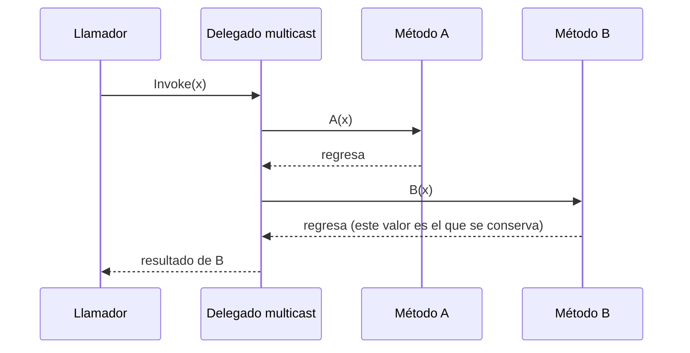

# Delegates

Parte de: [[03-CSharp-DotNet/03 Intermedio/_Índice Intermedio|Intermedio]]

> [!info] Cómo avanzar
> `progreso`: **pendiente** → **viendo** (estudiando) → **visto** (contestaste la autoevaluación sin abrir las respuestas) → **dominado** (hiciste el laboratorio o lo aplicaste de verdad).

## Contenido

### Qué es
Un **delegado** es un tipo que representa una **referencia a un método** con una firma concreta (parámetros y tipo de retorno). Es la forma de .NET de tratar "un pedazo de comportamiento" como valor: guardarlo en una variable, pasarlo como argumento o invocarlo después. Es la base de las [[Expresiones lambda]], de los [[Events]] y de LINQ.

### Cómo funciona
1. **Declaras el tipo**: `delegate decimal CalculoImpuesto(decimal monto);`. El compilador genera una clase sellada que hereda de `MulticastDelegate`.
2. **Creas una instancia** apuntando a un método compatible (método estático, de instancia o lambda): `CalculoImpuesto iva = m => m * 0.16m;`.
3. **Invocas**: `iva(100m)` (equivale a `iva.Invoke(100m)`). Si el delegado apunta a un método de instancia, guarda también la referencia al objeto (`Target`), lo que mantiene vivo ese objeto.

**Multicast**: un delegado puede contener una *lista de invocación* con varios métodos. Con `+=` agregas y con `-=` quitas. Al invocarlo se ejecutan **en orden**, de forma síncrona. Si la firma regresa un valor, solo obtienes el del **último** método; si uno lanza excepción, los siguientes no se ejecutan. Por eso el multicast se usa casi siempre con `void` (notificaciones).



**¿Por qué casi no se declaran delegados propios?** Porque .NET trae tipos genéricos que cubren casi cualquier firma: `Func<...>` (regresa valor), `Action<...>` (no regresa) y `Predicate<T>` (regresa `bool`). Ver [[Func, Action y Predicate]]. Además, dos delegados con la misma firma pero distinto nombre **no son intercambiables**, lo cual estorba más de lo que ayuda. Declarar uno propio solo vale la pena cuando necesitas parámetros `ref`/`out`/`in`, quieres un nombre muy expresivo en una API pública, o lo exige un evento.

### Ejemplo
```csharp
// Delegado propio: firma con nombre de dominio
public delegate decimal CalculoImpuesto(decimal monto);

public static class Impuestos
{
    public static decimal Iva(decimal m) => m * 0.16m;
    public static decimal IvaFronterizo(decimal m) => m * 0.08m;
}

CalculoImpuesto calc = Impuestos.Iva;         // grupo de métodos -> delegado
Console.WriteLine(calc(1_000m));              // 160.00

calc = Impuestos.IvaFronterizo;               // se puede reasignar
Console.WriteLine(calc(1_000m));              // 80.00

// Equivalente con Func: no hace falta declarar nada
Func<decimal, decimal> calc2 = Impuestos.Iva;

// Multicast con Action (void)
Action<string> bitacora = m => Console.WriteLine($"[consola] {m}");
bitacora += m => File.AppendAllText("bitacora.txt", m + Environment.NewLine);
bitacora("Pedido 15 creado");                 // se ejecutan ambos, en orden

// Multicast con valor: solo cuenta el último
Func<int> f = () => 1;
f += () => 2;
Console.WriteLine(f());                       // 2

// Recorrer la lista de invocación para obtener todos los resultados
foreach (Func<int> paso in f.GetInvocationList().Cast<Func<int>>())
    Console.WriteLine(paso());                // 1 y 2
```

En tus APIs aparecen todo el tiempo sin que los declares: `services.AddScoped<IReloj>(sp => new RelojSistema())` recibe un `Func<IServiceProvider, IReloj>`; `app.Use(async (ctx, next) => ...)` recibe un delegado de middleware; `RuleFor(x => x.Correo)` de FluentValidation recibe una expresión basada en un delegado.

### Cuándo usarlo y cuándo no
- **Úsalos** para inyectar comportamiento pequeño: estrategias de cálculo, *callbacks*, fábricas, filtros.
- **Prefiere `Func`/`Action`** sobre delegados propios salvo las excepciones de arriba.
- **Cuando el comportamiento crece** (varios métodos relacionados, estado, dependencias), una **interfaz** es más clara y fácil de probar que pasar varios delegados.
- **Para notificaciones de muchos suscriptores** usa `event` en lugar de exponer el delegado público.

### Errores comunes
1. **Invocar un delegado nulo**: si nadie se suscribió, `d(x)` lanza `NullReferenceException`; usa `d?.Invoke(x)`.
2. **Confiar en el valor de retorno de un multicast**: solo obtienes el último.
3. **Fugas de memoria**: un delegado a un método de instancia retiene el objeto destino; si el delegado vive en un singleton, el objeto nunca se libera.
4. **Asumir que el multicast es asíncrono o paralelo**: se ejecuta uno tras otro en el mismo hilo.

### Para profundizar
- [Delegados (guía de programación de C#)](https://learn.microsoft.com/dotnet/csharp/programming-guide/delegates/)
- [Delegados y eventos en .NET](https://learn.microsoft.com/dotnet/csharp/delegates-overview)
- [Clase MulticastDelegate](https://learn.microsoft.com/dotnet/api/system.multicastdelegate)

## Autoevaluación

Contesta primero en voz alta o en papel; luego despliega la respuesta.

> [!question]- ¿Qué es un delegado?
> Un tipo que representa una referencia a un método con cierta firma; se puede guardar, pasar como parámetro e invocar.

> [!question]- ¿Qué es un delegado *multicast*?
> Uno que tiene varios métodos encadenados con `+=`; al invocarlo se ejecutan todos en orden y el valor de retorno es el del último.

> [!question]- ¿Por qué hoy casi no se declaran delegados propios?
> `Func<>` y `Action<>` cubren casi todos los casos. Un delegado propio se justifica si necesitas parámetros `ref`/`out` o un nombre que documente.

