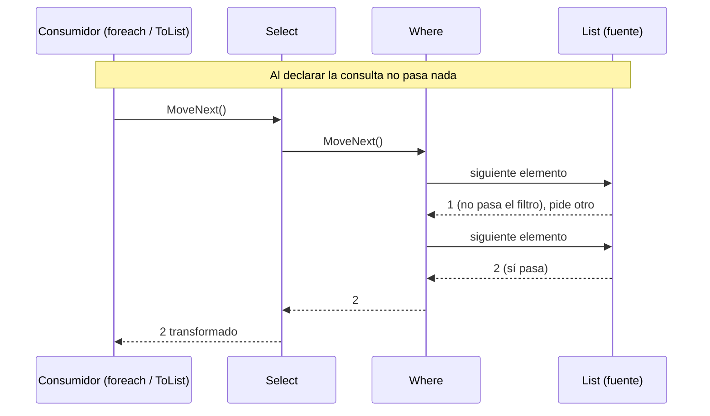

# Ejecución diferida en LINQ

Parte de: [[03-CSharp-DotNet/03 Intermedio/_Índice Intermedio|Intermedio]]

> [!info] Cómo avanzar
> `progreso`: **pendiente** → **viendo** (estudiando) → **visto** (contestaste la autoevaluación sin abrir las respuestas) → **dominado** (hiciste el laboratorio o lo aplicaste de verdad).

## Contenido

### Qué es
La **ejecución diferida** (*deferred execution*) significa que una consulta LINQ como `lista.Where(x => x > 1)` **no hace nada** cuando la escribes: solo construye una "receta". El trabajo ocurre cuando alguien **enumera** el resultado (`foreach`, `ToList()`, `Count()`, `First()`...). Y si lo enumeras dos veces, el trabajo se hace **dos veces**, sobre los datos tal como estén en ese momento.

### Cómo funciona
`Where`, `Select`, `OrderBy`, `Skip`, `Take` y compañía regresan un objeto iterador que guarda la fuente y la lambda. Internamente están hechos con la misma idea que [[yield]]: cada vez que el consumidor pide el siguiente elemento (`MoveNext`), el iterador lee de la fuente, aplica el filtro y entrega uno. Se encadenan como tubería: cada operador jala del anterior.



Hay dos grupos de operadores:
- **Diferidos**: `Where`, `Select`, `SelectMany`, `OrderBy`, `GroupBy`, `Join`, `Skip`, `Take`, `Distinct`, `Concat`, `Zip`. (Algunos, como `OrderBy` o `GroupBy`, son diferidos pero cuando arrancan necesitan leer **toda** la fuente.)
- **Inmediatos** (fuerzan la ejecución): los que materializan (`ToList`, `ToArray`, `ToDictionary`, `ToHashSet`, `ToLookup`) y los que regresan un solo valor (`Count`, `Sum`, `Average`, `Min`, `Max`, `Aggregate`, `First`, `Single`, `Any`, `All`, `Contains`, `ElementAt`). Un `foreach` también la fuerza.

### Ejemplo
Las tres situaciones típicas de examen:

```csharp
// 1) La consulta ve los cambios hechos a la fuente ANTES de enumerar
var l = new List<int> { 1, 2 };
var q = l.Where(x => x > 1);   // aún no filtra nada
l.Add(3);
Console.Write(q.Count());      // 2  -> evalúa ahora sobre {1, 2, 3}: pasan 2 y 3

// 2) Con ToList se toma una "foto" en ese momento
var l2 = new List<int> { 1, 2 };
var q2 = l2.Where(x => x > 1).ToList();  // se ejecuta aquí: [2]
l2.Add(3);
Console.Write(q2.Count);                  // 1

// 3) Enumerar dos veces = ejecutar dos veces (con sus efectos)
int n = 0;
var q3 = new[] { 1, 2, 3 }.Select(x => { n++; return x; });
var a = q3.Count();   // recorre 3 elementos: n = 3
var b = q3.Count();   // vuelve a recorrer:   n = 6
Console.Write(n);     // 6
```

El caso peligroso en una API: un repositorio que regresa la consulta **sin materializar** y cierra la conexión.

```csharp
using Dapper;
using Microsoft.Data.SqlClient;

public sealed class RepositorioPedidos(string cadena)
{
    // MAL: regresa un IEnumerable diferido ligado a una conexión que se cierra al salir
    public IEnumerable<Pedido> PorClienteMal(int clienteId)
    {
        using var cn = new SqlConnection(cadena);
        return cn.Query<Pedido>("dbo.Pedidos_PorCliente", new { clienteId },
                                commandType: System.Data.CommandType.StoredProcedure,
                                buffered: false); // sin buffer: lee mientras enumeras
        // Al enumerar fuera, la conexión ya se cerró -> InvalidOperationException
    }

    // BIEN: materializa dentro del alcance de la conexión
    public async Task<IReadOnlyList<Pedido>> PorClienteAsync(int clienteId, CancellationToken ct)
    {
        await using var cn = new SqlConnection(cadena);
        var filas = await cn.QueryAsync<Pedido>(new CommandDefinition(
            "dbo.Pedidos_PorCliente", new { clienteId },
            commandType: System.Data.CommandType.StoredProcedure, cancellationToken: ct));
        return filas.AsList();
    }
}

public sealed record Pedido(int Id, decimal Total);
```

Con EF Core pasa lo mismo de forma más sutil: regresar `IQueryable` desde un repositorio y enumerarlo después de que el `DbContext` se desechó lanza `ObjectDisposedException`, o lanza varias consultas a la BD si se enumera varias veces.

### Cuándo usarlo y cuándo no
- **Aprovéchala** para componer consultas por pasos (agregar filtros opcionales) y para procesar secuencias grandes o infinitas sin cargarlo todo.
- **Materializa** (`ToList`, `AsList`, `ToArray`) cuando: vas a enumerar más de una vez, la fuente depende de un recurso que se va a cerrar (conexión, `DbContext`, archivo), o necesitas una "foto" estable.
- En las fronteras de capa (repositorio → handler → controller), regresa colecciones materializadas (`IReadOnlyList<T>`), no consultas vivas.

### Errores comunes
1. **Enumeración múltiple**: `if (q.Any()) foreach (var x in q)` ejecuta la consulta dos veces; con BD son dos viajes. Los analizadores (CA1851) lo detectan.
2. **Efectos secundarios dentro de `Select`** (contadores, logs, escrituras): se repiten por cada enumeración, o nunca ocurren si nadie enumera.
3. **Capturar una variable y modificarla** antes de enumerar: la consulta usa el valor nuevo.
4. **Regresar consultas diferidas ligadas a una conexión** o contexto ya desechado.
5. **Modificar la colección mientras se enumera**: `InvalidOperationException` ("Collection was modified").

### Para profundizar
- [Introducción a las consultas LINQ: ejecución diferida](https://learn.microsoft.com/dotnet/csharp/linq/get-started/introduction-to-linq-queries)
- [Clasificación de operadores por modo de ejecución](https://learn.microsoft.com/dotnet/csharp/linq/get-started/introduction-to-linq-queries#classification-of-standard-query-operators-by-manner-of-execution)
- [CA1851: posibles enumeraciones múltiples](https://learn.microsoft.com/dotnet/fundamentals/code-analysis/quality-rules/ca1851)

## Ejercicios

Resuélvelos en papel o en la herramienta; la solución está plegada.

> [!question]- ¿Qué imprime? `var l = new List<int> { 1, 2 }; var q = l.Where(x => x > 1); l.Add(3); Console.Write(q.Count());`
> `2`: la consulta se evalúa al llamar `Count`, cuando ya existe el 3.

> [!question]- Mismo código pero `var q = l.Where(x => x > 1).ToList();`
> `1`: se materializó antes del `Add`.

> [!question]- ¿Cuánto vale `n`? `int n = 0; var q = new[] { 1, 2, 3 }.Select(x => { n++; return x; }); var a = q.Count(); var b = q.Count();`
> `6`: la secuencia se recorre dos veces.

## Autoevaluación

Contesta primero en voz alta o en papel; luego despliega la respuesta.

> [!question]- ¿Qué es la ejecución diferida?
> Operadores como `Where` y `Select` no ejecutan nada al llamarse: construyen la consulta y se ejecuta al enumerarla (`foreach`, `ToList`, `Count`).

> [!question]- ¿Qué operadores fuerzan la ejecución?
> `ToList`, `ToArray`, `ToDictionary`, `Count`, `Sum`, `First`, `Any`, etc. `OrderBy` y `GroupBy` son diferidos pero, al enumerarse, leen toda la fuente.

> [!question]- ¿Por qué regresar `IEnumerable` diferido desde un repositorio que usa una conexión es peligroso?
> La consulta puede ejecutarse cuando la conexión ya se cerró o varias veces. Materializa antes de salir.

## Práctica

- [[Lab 3 - Consola con LINQ y genéricos]]

