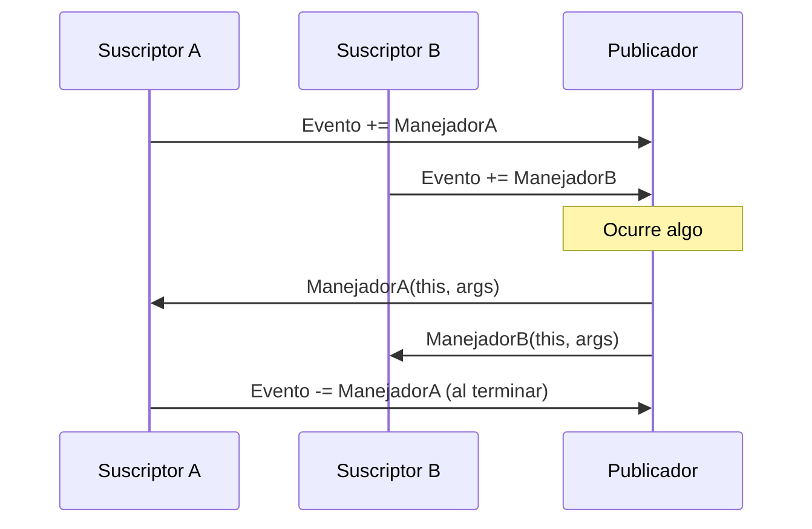

# Events

Parte de: [[03-CSharp-DotNet/03 Intermedio/_Índice Intermedio|Intermedio]]

> [!info] Cómo avanzar
> `progreso`: **pendiente** → **viendo** (estudiando) → **visto** (contestaste la autoevaluación sin abrir las respuestas) → **dominado** (hiciste el laboratorio o lo aplicaste de verdad).

## Contenido

### Qué es
Un **evento** (`event`) es un miembro de clase que permite a otros objetos **suscribirse** para ser notificados cuando algo ocurre (patrón publicador/suscriptor). Internamente es un [[Delegates|delegado]] multicast, pero envuelto con reglas que protegen al publicador.

### Cómo funciona
Si expones un **campo delegado público** (`public Action<Pedido>? Creado;`), cualquiera puede:
- reemplazar a todos los suscriptores con `=` (borrando los de otros),
- invocarlo desde fuera, fingiendo que el evento ocurrió,
- ponerlo en `null`.

Al declararlo como `event`, el compilador genera métodos `add` y `remove` y **desde fuera solo se permite `+=` y `-=`**. Únicamente la clase que declara el evento puede invocarlo o asignarlo. Esa es la diferencia clave: encapsulamiento del delegado.

**Firma convencional** en .NET: `EventHandler` o `EventHandler<TEventArgs>`, es decir `void (object? sender, TEventArgs e)`. `sender` es quien lanzó el evento y `e` lleva los datos (antes se exigía heredar de `EventArgs`; hoy puede ser cualquier tipo, aunque la convención se mantiene). Se suele lanzar desde un método `protected virtual void OnAlgo(...)` para que las clases derivadas puedan intervenir.



**La fuga de memoria clásica**: el publicador guarda una referencia a cada suscriptor (a través del `Target` del delegado). Si el publicador vive mucho (un singleton, un objeto estático, una ventana principal) y el suscriptor vive poco pero **nunca se desuscribe**, el [[Recolector de basura]] no puede liberarlo: sigue alcanzable desde el publicador. Con el tiempo se acumulan miles de suscriptores "muertos" que además siguen recibiendo eventos.

### Ejemplo
```csharp
public sealed record PedidoCreadoArgs(int PedidoId, decimal Total);

public sealed class ServicioPedidos
{
    // Desde fuera solo se puede += y -=
    public event EventHandler<PedidoCreadoArgs>? PedidoCreado;

    public void Crear(int id, decimal total)
    {
        // ... guardar en BD ...
        OnPedidoCreado(new PedidoCreadoArgs(id, total));
    }

    private void OnPedidoCreado(PedidoCreadoArgs e)
        => PedidoCreado?.Invoke(this, e); // ?. evita NullReferenceException si no hay suscriptores
}

public sealed class Notificador : IDisposable
{
    private readonly ServicioPedidos _servicio;

    public Notificador(ServicioPedidos servicio)
    {
        _servicio = servicio;
        _servicio.PedidoCreado += AlCrearPedido;     // suscribir
    }

    private void AlCrearPedido(object? sender, PedidoCreadoArgs e)
        => Console.WriteLine($"Pedido {e.PedidoId} por {e.Total:C}");

    // Desuscribir evita la fuga si ServicioPedidos vive más que este objeto
    public void Dispose() => _servicio.PedidoCreado -= AlCrearPedido;
}

// Uso
var servicio = new ServicioPedidos();
using (var notif = new Notificador(servicio))
{
    servicio.Crear(1, 250m);   // imprime
}
servicio.Crear(2, 90m);        // ya no imprime: se desuscribió
// servicio.PedidoCreado = null;          // CS0070: no compila desde fuera
// servicio.PedidoCreado?.Invoke(...);    // CS0070: no compila desde fuera
```

### Cuándo usarlo y cuándo no
- **Úsalos** en componentes de proceso local con varios interesados: UI (WinForms, WPF, MAUI), SDKs de dispositivos, `FileSystemWatcher`, notificaciones dentro de una librería.
- **En una API ASP.NET Core** casi nunca los necesitas: para reaccionar a algo de dominio es más claro llamar explícitamente a servicios, usar un mediador o una cola como [[System.Threading.Channels]].
- **Entre procesos o servicios** no sirven: usa mensajería (Azure Service Bus, colas) o el [[Patrón Outbox]].
- Los manejadores son `void`; si necesitas trabajo asíncrono, un evento obliga a `async void` (ver [[async void y por qué evitarlo]]), lo cual es otra razón para preferir otras opciones en backend.

### Errores comunes
1. **No desuscribirse** cuando el suscriptor vive menos que el publicador: fuga de memoria y manejadores ejecutándose de más. Implementa `IDisposable` y haz `-=`.
2. **Desuscribir una lambda distinta**: `e += x => ...; e -= x => ...;` no quita nada porque son dos delegados diferentes. Guarda el manejador en un método o variable.
3. **Invocar sin `?.`** y explotar cuando no hay suscriptores.
4. **Excepciones en un suscriptor** cortan a los demás; si importa, recorre `GetInvocationList()` con `try/catch` por suscriptor.

### Para profundizar
- [Eventos (guía de programación de C#)](https://learn.microsoft.com/dotnet/csharp/programming-guide/events/)
- [Manejo y generación de eventos en .NET](https://learn.microsoft.com/dotnet/standard/events/)
- [Patrón de eventos estándar de .NET](https://learn.microsoft.com/dotnet/csharp/event-pattern)

## Autoevaluación

Contesta primero en voz alta o en papel; luego despliega la respuesta.

> [!question]- ¿Qué agrega `event` sobre un campo delegado?
> Desde fuera solo se puede suscribir (`+=`) y desuscribir (`-=`); solo la clase que lo declara puede dispararlo o reemplazarlo.

> [!question]- ¿Cuál es la firma convencional?
> `public event EventHandler<MiEventArgs>? Cambio;` y se dispara con `Cambio?.Invoke(this, args);`.

> [!question]- ¿Qué fuga de memoria clásica causan los eventos?
> Un objeto de vida larga (singleton) mantiene referencias a los suscriptores; si no se desuscriben, nunca se liberan.

