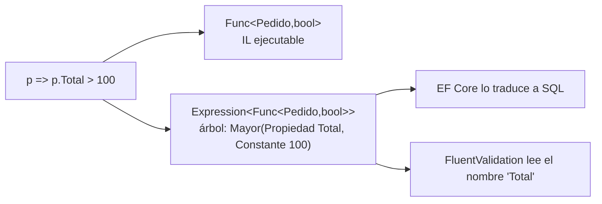

# Expresiones lambda

Parte de: [[03-CSharp-DotNet/03 Intermedio/_Índice Intermedio|Intermedio]]

> [!info] Cómo avanzar
> `progreso`: **pendiente** → **viendo** (estudiando) → **visto** (contestaste la autoevaluación sin abrir las respuestas) → **dominado** (hiciste el laboratorio o lo aplicaste de verdad).

## Contenido

### Qué es
Una **expresión lambda** es una función anónima escrita en línea: `x => x * 2`, `(a, b) => a + b`, `() => DateTime.UtcNow`. Se convierte a un tipo de delegado ([[Func, Action y Predicate]]) o a un **árbol de expresión** (`Expression<Func<...>>`). Es la sintaxis que hace posible LINQ, las fábricas de DI, el middleware de ASP.NET Core y las reglas de FluentValidation.

### Cómo funciona
**Formas**:
- Lambda de expresión: `x => x.Total > 100`.
- Lambda de bloque: `x => { var iva = x * 0.16m; return x + iva; }`.
- Con tipos explícitos o atributos: `(decimal x) => x * 2`, `[Pure] (int x) => x`.
- Parámetros por defecto (C# 12): `(int n = 1) => n * 2`.
- Desde C# 14 puedes poner modificadores (`ref`, `out`, `in`, `scoped`) sin escribir el tipo: `(out v) => ...` cuando el delegado destino ya lo define.

**Closures (cierres)**: una lambda puede usar variables del método donde se declara. El compilador "captura" esas variables moviéndolas a una clase oculta (*display class*) que comparten el método y la lambda. Lo importante: se captura **la variable**, no su valor del momento. Si la variable cambia después, la lambda ve el valor nuevo.

Por eso este código imprime `3,3,3`:
```csharp
var fs = new List<Func<int>>();
for (int i = 0; i < 3; i++) fs.Add(() => i);    // las tres capturan la MISMA i
Console.Write(string.Join(",", fs.Select(f => f()))); // 3,3,3
```
El `for` declara **una sola** `i` para todo el ciclo; al terminar vale 3 y las tres lambdas la leen. Con `foreach` (desde C# 5) cada iteración tiene su propia variable, así que daría `0,1,2`. En un `for`, copia a una variable local dentro del cuerpo: `var copia = i; fs.Add(() => copia);`.

**`static` en lambdas (C# 9)**: `static x => x * 2` prohíbe capturar variables o `this`. Si por error usas una variable externa, no compila. Sirve para garantizar que la lambda no genere una *closure* (y su asignación en el heap) en código caliente.

**`Func<>` frente a `Expression<Func<>>`**:
- `Func<Pedido, bool>` es **código compilado**: solo se puede ejecutar.
- `Expression<Func<Pedido, bool>>` es un **árbol de datos** que describe la lambda (parámetro, propiedad `Total`, operador `>`, constante `100`). Un proveedor puede recorrerlo y **traducirlo**: EF Core lo convierte en `WHERE Total > 100`. También puedes compilarlo con `.Compile()` para obtener el `Func`.



### Ejemplo
```csharp
using System.Linq.Expressions;

public sealed record Pedido(int Id, string Cliente, decimal Total);

List<Pedido> pedidos = [new(1, "Ana", 80m), new(2, "Luis", 150m), new(3, "Ana", 300m)];

// Lambda como Func: se ejecuta en memoria
Func<Pedido, bool> esGrande = p => p.Total > 100m;
var grandes = pedidos.Where(esGrande).ToList();         // 2 y 3

// Closure: captura 'minimo' (la variable, no el valor)
decimal minimo = 100m;
var filtro = pedidos.Where(p => p.Total > minimo);
minimo = 200m;                                          // cambia antes de enumerar
Console.WriteLine(filtro.Count());                      // 1 (solo el 300)

// Lambda static: no puede capturar nada
Func<decimal, decimal> conIva = static t => t * 1.16m;

// Árbol de expresión: se puede inspeccionar
Expression<Func<Pedido, decimal>> selector = p => p.Total;
var miembro = (MemberExpression)selector.Body;
Console.WriteLine(miembro.Member.Name);                 // "Total"

// Así es como FluentValidation sabe el nombre de la propiedad:
// RuleFor(x => x.Total).GreaterThan(0);  -> mensaje "'Total' debe ser mayor que 0"
```

### Cuándo usarlo y cuándo no
- **Úsalas** para comportamiento corto e inmediato: filtros y proyecciones LINQ, `services.AddScoped(sp => ...)`, `app.MapGet(...)`, reglas de validación.
- **Extrae a un método con nombre** cuando la lambda pasa de unas pocas líneas o se repite; se lee mejor en *stack traces* y se puede probar.
- **Marca `static`** en lambdas de rutas calientes que no necesitan capturar.
- **Usa `Expression<>`** solo cuando alguien necesita leer o traducir la lambda (ORMs, validadores, *builders*); para todo lo demás, `Func`.

### Errores comunes
1. **Capturar la variable del `for`** y obtener el último valor en todas las lambdas.
2. **Capturar `this` o un objeto grande sin querer**, extendiendo su vida (por ejemplo, una lambda guardada en un singleton que usa un campo de un servicio scoped).
3. **Modificar una variable capturada** después de crear una consulta diferida y no entender por qué cambia el resultado (ver [[Ejecución diferida en LINQ]]).
4. **Usar en `Expression<>` cosas que el proveedor no traduce** (métodos propios, `ToString` con formato): EF Core lanza error o evalúa en el cliente.

### Para profundizar
- [Expresiones lambda (referencia de C#)](https://learn.microsoft.com/dotnet/csharp/language-reference/operators/lambda-expressions)
- [Árboles de expresión](https://learn.microsoft.com/dotnet/csharp/advanced-topics/expression-trees/)
- [Funciones anónimas estáticas (propuesta C# 9)](https://learn.microsoft.com/dotnet/csharp/language-reference/proposals/csharp-9.0/static-anonymous-functions)

## Ejercicios

Resuélvelos en papel o en la herramienta; la solución está plegada.

> [!question]- ¿Qué imprime? `var fs = new List<Func<int>>(); for (int i = 0; i < 3; i++) fs.Add(() => i); Console.Write(string.Join(",", fs.Select(f => f())));`
> `3,3,3`: todas capturan la misma `i`. Con `foreach` (o copiando `var j = i;`) da `0,1,2`.

## Autoevaluación

Contesta primero en voz alta o en papel; luego despliega la respuesta.

> [!question]- ¿Qué es una *closure*?
> Una lambda que captura variables del entorno. Captura la **variable**, no su valor del momento: si la variable cambia, la lambda ve el cambio.

> [!question]- ¿Para qué sirve `static` en una lambda (`static x => x * 2`)?
> Impide capturar variables por accidente; así no se crea un objeto para la closure.

> [!question]- ¿Qué diferencia hay entre una lambda como `Func<>` y como `Expression<Func<>>`?
> `Func` es código compilado. `Expression` es un árbol de datos que un proveedor (EF Core) puede leer y traducir a SQL.

## Práctica

- [[Lab 3 - Consola con LINQ y genéricos]]

