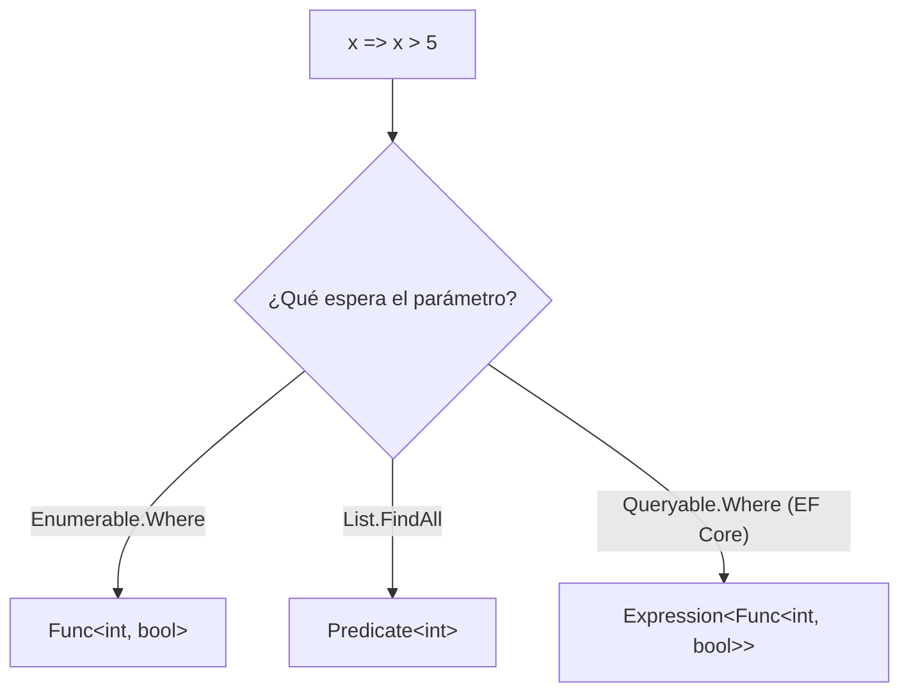

# Func, Action y Predicate

Parte de: [[03-CSharp-DotNet/03 Intermedio/_Índice Intermedio|Intermedio]]

> [!info] Cómo avanzar
> `progreso`: **pendiente** → **viendo** (estudiando) → **visto** (contestaste la autoevaluación sin abrir las respuestas) → **dominado** (hiciste el laboratorio o lo aplicaste de verdad).

## Contenido

### Qué es
`Func`, `Action` y `Predicate` son **tipos de delegado genéricos** que vienen en .NET para no tener que declarar [[Delegates|delegados]] propios. Representan "una función que puedo guardar y pasar":
- **`Func<T1, ..., TResult>`**: recibe de 0 a 16 parámetros y **regresa** un valor. El último parámetro genérico siempre es el tipo de retorno.
- **`Action<T1, ...>`**: recibe de 0 a 16 parámetros y **no regresa** nada (`void`).
- **`Predicate<T>`**: recibe un `T` y regresa `bool`. Es equivalente en forma a `Func<T, bool>`, pero es un tipo distinto; se usa en APIs antiguas como `List<T>.FindAll` o `Array.Find`.

### Cómo funciona
Cuando escribes una lambda, el compilador necesita un tipo de delegado destino para convertirla. Si pasas `x => x > 5` a `Enumerable.Where` sobre `IEnumerable<int>`, el parámetro es `Func<int, bool>`, así que esa lambda se convierte en `Func<int, bool>`. Si la pasas a `List<int>.FindAll`, se convierte en `Predicate<int>`. Y si la pasas a `IQueryable<int>.Where` (EF Core), se convierte en `Expression<Func<int, bool>>`, un árbol de expresión (ver [[Expresiones lambda]]).

Desde C# 10 una lambda tiene **tipo natural**: `var f = (int x) => x > 5;` se infiere como `Func<int, bool>`.



**Funciones que regresan funciones** (currying): `Func<int, Func<int, int>>` es "recibe un `int` y regresa otra función que recibe un `int` y regresa `int`". `suma(2)` crea una función que suma 2; `suma(2)(3)` da 5.

**¿Cuándo recibir `Func<T>` en lugar de `T`?** Cuando quieres **diferir** o **condicionar** el cálculo del valor: solo se evalúa si hace falta, se evalúa cada vez de nuevo, o es caro. Ejemplos: `GetOrAdd(clave, k => CargarDeBd(k))` en caches, `Lazy<T>(() => ...)`, fábricas de DI (`sp => new Servicio(...)`), mensajes de log costosos.

### Ejemplo
```csharp
// Func con dos decimal que regresa el IVA del 16 % sobre la suma
Func<decimal, decimal, decimal> ivaDeSuma = (a, b) => (a + b) * 0.16m;
Console.WriteLine(ivaDeSuma(100m, 50m));       // 24.00

// Action: hace algo, no regresa
Action<string> log = mensaje => Console.WriteLine($"{DateTime.Now:HH:mm:ss} {mensaje}");
log("Inicio");

// Predicate: API antigua de List<T>
var montos = new List<decimal> { 50m, 120m, 300m };
List<decimal> grandes = montos.FindAll(m => m > 100m);   // Predicate<decimal>
IEnumerable<decimal> grandes2 = montos.Where(m => m > 100m); // Func<decimal, bool>

// Currying
Func<int, Func<int, int>> suma = a => b => a + b;
var sumaDos = suma(2);
Console.WriteLine(sumaDos(3));                  // 5

// Func<T> para diferir un cálculo caro: solo se ejecuta si no está en caché
public sealed class CacheSimple<TClave, TValor> where TClave : notnull
{
    private readonly Dictionary<TClave, TValor> _datos = [];

    public TValor Obtener(TClave clave, Func<TClave, TValor> cargar)
    {
        if (_datos.TryGetValue(clave, out var v)) return v;
        v = cargar(clave);          // solo aquí se paga el costo
        _datos[clave] = v;
        return v;
    }
}

// Estrategia inyectada: el cálculo de comisión varía por canal
public static decimal Liquidar(IEnumerable<decimal> ventas, Func<decimal, decimal> comision)
    => ventas.Sum(v => v - comision(v));

var neto = Liquidar([100m, 200m], v => v * 0.035m);   // comisión de tarjeta 3.5 %
```

### Cuándo usarlo y cuándo no
- **`Func`/`Action`** para parámetros de comportamiento pequeños: filtros, mapeos, fábricas, *callbacks*, estrategias puntuales.
- **`Predicate`** solo cuando una API existente lo pide; en código nuevo, `Func<T, bool>` es lo estándar porque encaja con LINQ.
- **No** abuses de firmas como `Func<int, string, bool, decimal, Task<Result>>`: cuando hay más de dos o tres parámetros o el significado no es obvio, una interfaz o un delegado con nombre documenta mejor.
- Recuerda que capturar variables en la lambda crea una *closure* y una asignación en el heap; en rutas muy calientes puede importar.

### Errores comunes
1. **Confundir el orden de `Func`**: el **último** tipo es el retorno. `Func<string, int>` recibe `string` y regresa `int`.
2. **Pensar que `Predicate<T>` y `Func<T, bool>` son intercambiables**: no hay conversión implícita entre ellos aunque tengan la misma forma; tendrías que envolver (`new Predicate<T>(f)`).
3. **Pasar `Func<T, bool>` donde EF Core espera `Expression<...>`**: si tu repositorio recibe `Func`, el filtro se aplica en memoria tras traer toda la tabla (ver [[IEnumerable vs IQueryable]]).
4. **Evaluar el `Func<T>` varias veces** cuando esperabas una sola: si es caro o tiene efectos, guárdalo o usa `Lazy<T>`.

### Para profundizar
- [Delegados Func (referencia de API)](https://learn.microsoft.com/dotnet/api/system.func-2)
- [Delegado Action (referencia de API)](https://learn.microsoft.com/dotnet/api/system.action-1)
- [Expresiones lambda y funciones anónimas](https://learn.microsoft.com/dotnet/csharp/language-reference/operators/lambda-expressions)

## Ejercicios

Resuélvelos en papel o en la herramienta; la solución está plegada.

> [!question]- Declara un `Func` que reciba dos `decimal` y regrese el IVA de 16 % sobre su suma.
> ```csharp
> Func<decimal, decimal, decimal> iva = (a, b) => (a + b) * 0.16m;
> ```

> [!question]- ¿Qué imprime? `Func<int, Func<int, int>> suma = a => b => a + b; Console.Write(suma(2)(3));`
> `5`.

## Autoevaluación

Contesta primero en voz alta o en papel; luego despliega la respuesta.

> [!question]- ¿Qué diferencia hay entre `Func`, `Action` y `Predicate`?
> `Func<T..., TResult>` regresa un valor (el último parámetro de tipo es el resultado). `Action<T...>` no regresa nada. `Predicate<T>` equivale a `Func<T, bool>` y lo usan métodos viejos como `List.FindAll`.

> [!question]- ¿Qué tipo tiene `x => x > 5` si `x` es `int` y lo pasas a `Where`?
> `Func<int, bool>`.

> [!question]- ¿Cuándo un parámetro `Func<T>` en lugar de un valor `T`?
> Cuando quieres diferir o evitar el cálculo: p. ej. `GetOrCreateAsync(clave, () => CargarDeBd())` solo llama la fábrica si no está en caché.

## Práctica

- [[Lab 3 - Consola con LINQ y genéricos]]

