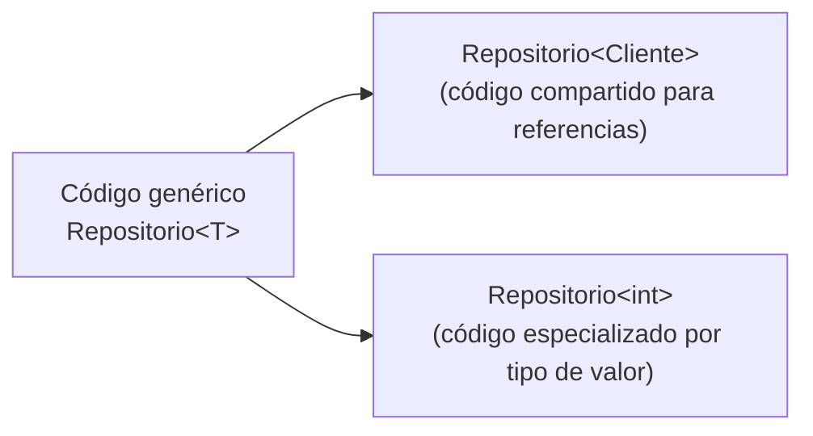

# Genéricos

Parte de: [[03-CSharp-DotNet/03 Intermedio/_Índice Intermedio|Intermedio]]

> [!info] Cómo avanzar
> `progreso`: **pendiente** → **viendo** (estudiando) → **visto** (contestaste la autoevaluación sin abrir las respuestas) → **dominado** (hiciste el laboratorio o lo aplicaste de verdad).

## Contenido

### Qué es
Los **genéricos** permiten escribir una clase, interfaz, método o delegado **una sola vez** y usarlo con muchos tipos, conservando la **seguridad de tipos** en compilación. En lugar de recibir `object` (y castear a cada rato), declaras un *parámetro de tipo* (`T`) que el consumidor sustituye por un tipo concreto: `List<int>`, `Dictionary<string, Cliente>`, `Task<Result>`.

Resuelven tres problemas a la vez: evitas duplicar código por tipo, el compilador detecta errores que con `object` aparecerían hasta producción (`InvalidCastException`), y con tipos de valor no hay *boxing*: `List<int>` guarda `int` de verdad, no objetos en el heap.

### Cómo funciona
- **Declaración**: `class Caja<T> { public T Valor { get; set; } }`. `T` es un marcador que se resuelve al usar el tipo.
- **Métodos genéricos**: el parámetro va en el método, `T Primero<T>(IEnumerable<T> xs)`. Casi nunca escribes `Primero<string>(...)`: el compilador **infiere** `T` a partir de los argumentos. La inferencia solo usa los argumentos, no el tipo al que asignas el resultado.
- **En tiempo de ejecución** el CLR genera código especializado: una versión compartida para todos los tipos de referencia (todos son punteros) y una versión propia por cada tipo de valor (`int`, `decimal`, tus `struct`). Por eso `List<int>` es tan rápido como un arreglo.
- **`default(T)` o `default`**: el valor por defecto del tipo, útil cuando no sabes si `T` es referencia o valor: `null` para clases, `0` para números, `false` para `bool`, un struct con todos sus campos en cero.
- **Restricciones**: con `where T : ...` le dices al compilador qué puede hacer con `T` (ver [[Constraints de genéricos]]).



### Ejemplo
En tus proyectos con [[Dapper]] y SQL en archivos, cada consulta solo declara qué recibe y qué regresa; la mecánica de "leer el `.sql` y ejecutarlo" se escribe una vez:

```csharp
using System.Data;
using Dapper;

// Contratos genéricos: TCampos = parámetros, TFila = forma de cada fila
public interface IConsultaSql<TCampos, TFila>
{
    Task<IReadOnlyList<TFila>> EjecutarAsync(TCampos campos, CancellationToken ct);
}

public abstract class ConsultaSql<TCampos, TFila>(IDbConnection cn, ILectorSql lector)
    : IConsultaSql<TCampos, TFila>
{
    // Cada consulta concreta solo dice qué archivo .sql usa
    protected abstract string Archivo { get; }

    public async Task<IReadOnlyList<TFila>> EjecutarAsync(TCampos campos, CancellationToken ct)
    {
        var sql = lector.Leer(Archivo);
        var filas = await cn.QueryAsync<TFila>(
            new CommandDefinition(sql, campos, cancellationToken: ct));
        return filas.AsList();
    }
}

public interface ILectorSql { string Leer(string archivo); }

// Una consulta concreta: sin lógica repetida
public sealed record CamposPedidosCliente(int ClienteId);
public sealed record FilaPedido(int PedidoId, decimal Total);

public sealed class PedidosPorCliente(IDbConnection cn, ILectorSql lector)
    : ConsultaSql<CamposPedidosCliente, FilaPedido>(cn, lector)
{
    protected override string Archivo => "Pedidos/PedidosPorCliente.sql";
}

// Método genérico con inferencia y default
public static class Utilidades
{
    public static T PrimeroODefecto<T>(IEnumerable<T> xs)
    {
        foreach (var x in xs) return x;
        return default!; // null para referencias, 0 para int
    }
}
// var n = Utilidades.PrimeroODefecto(new[] { 3, 4 }); // T = int inferido
```

Lo que aporta `ConsultaSql<TCampos, TFila>` (y su pareja `ComandoSql<TCampos>` para escrituras) es que el *handler* recibe una interfaz fuertemente tipada: si cambias `FilaPedido`, el compilador te avisa en todos los usos.

### Cuándo usarlo y cuándo no
- **Úsalo** cuando el algoritmo es idéntico y solo cambia el tipo: colecciones, resultados (`Result<T>`), repositorios o consultas, cachés, validadores (`AbstractValidator<T>` de FluentValidation).
- **No lo uses** para "por si acaso": un `Servicio<T>` con un solo `T` real solo agrega ruido. Si el comportamiento cambia según el tipo (con `if (typeof(T) == ...)`), probablemente quieres polimorfismo o varias clases.
- **Alternativas**: interfaces comunes (programar contra una abstracción), sobrecargas cuando son pocos tipos, o `object` solo en fronteras dinámicas (serialización, reflexión).

### Errores comunes
1. **Revisar el tipo dentro del genérico** (`if (typeof(T) == typeof(int))`): rompe la idea; usa restricciones o sobrecargas.
2. **Olvidar que `default` puede ser `null`**: con *nullable reference types* el compilador te avisa; respeta la advertencia o restringe con `where T : notnull`.
3. **Demasiados parámetros de tipo** (`Handler<TA, TB, TC, TD>`): señal de que el diseño mezcla responsabilidades.
4. **Esperar que `List<Perro>` sea `List<Animal>`**: las clases genéricas son invariantes; solo ciertas interfaces y delegados admiten conversión (ver [[Varianza (in y out) en genéricos]]).
5. **Campos `static` en una clase genérica**: hay un campo distinto por cada `T` cerrado, lo cual sorprende si esperabas uno global.

### Para profundizar
- [Genéricos en .NET (Microsoft Learn)](https://learn.microsoft.com/dotnet/standard/generics/)
- [Clases y métodos genéricos en C#](https://learn.microsoft.com/dotnet/csharp/fundamentals/types/generics)
- [Restricciones de parámetros de tipo](https://learn.microsoft.com/dotnet/csharp/programming-guide/generics/constraints-on-type-parameters)

## Autoevaluación

Contesta primero en voz alta o en papel; luego despliega la respuesta.

> [!question]- ¿Qué problema resuelven los genéricos?
> Escribir código una vez para muchos tipos con seguridad de tipos y sin *boxing*: `List<int>` guarda `int` reales, no `object`.

> [!question]- ¿Cómo se ve un método genérico y cómo se infiere el tipo?
> `T Primero<T>(IEnumerable<T> xs)`. Al llamar `Primero(nombres)` el compilador infiere `T = string` por el argumento.

> [!question]- ¿Qué hace `default(T)` o `default`?
> Regresa el valor por defecto del tipo: `null` para referencias, `0` para números, un struct en ceros.

> [!question]- En tu patrón, ¿qué aportan `ConsultaSql<TCampos, TFila>` y `ComandoSql<TCampos>`?
> Una sola implementación de "leer el `.sql` y ejecutar con Dapper" para todas las consultas; cada consulta solo declara sus tipos de entrada y salida.

## Práctica

- [[Lab 3 - Consola con LINQ y genéricos]]
- [[Lab 4 - Registro automático de sentencias SQL por reflexión]]

