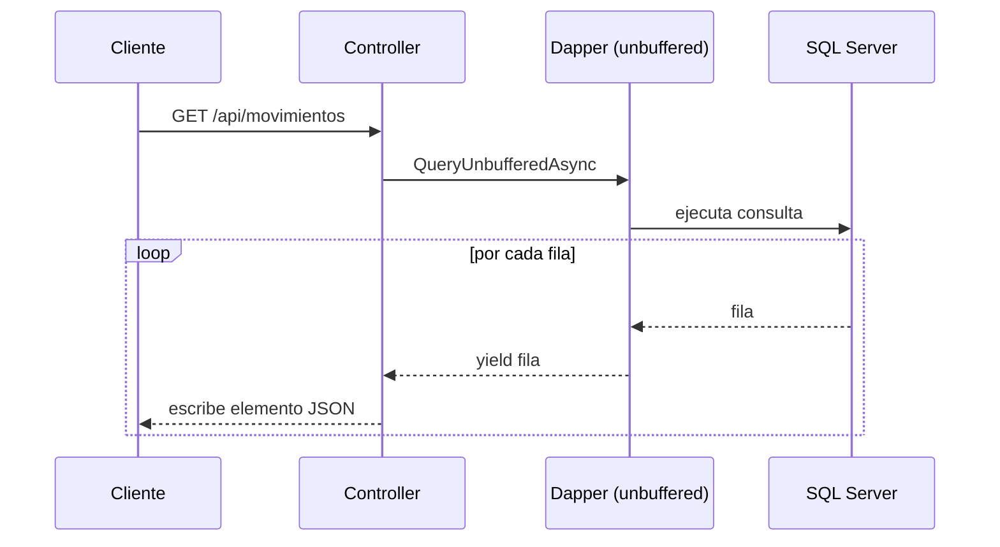

# IAsyncEnumerable

Parte de: [[03-CSharp-DotNet/03 Intermedio/_Índice Intermedio|Intermedio]]

> [!info] Cómo avanzar
> `progreso`: **pendiente** → **viendo** (estudiando) → **visto** (contestaste la autoevaluación sin abrir las respuestas) → **dominado** (hiciste el laboratorio o lo aplicaste de verdad).

## Contenido

### Qué es
`IAsyncEnumerable<T>` (desde .NET Core 3.0 / C# 8) es la versión **asíncrona** de `IEnumerable<T>`: una secuencia cuyos elementos llegan **con espera de por medio** (filas de una BD, páginas de una API, mensajes de una cola). Se consume con `await foreach` y se produce con un método `async` que hace `yield return`. Combina dos ideas: el *streaming* perezoso de [[yield]] y el no bloqueo de [[Task y async-await]].

### Cómo funciona
- El consumidor llama `MoveNextAsync()`, que regresa `ValueTask<bool>`; mientras el siguiente elemento no esté listo, el hilo **no se bloquea**: vuelve al pool.
- `await foreach (var x in fuente)` genera ese ciclo y al final hace `await DisposeAsync()`.
- Producir: `async IAsyncEnumerable<T> Leer(...) { ... await ...; yield return x; }`.

**Cómo se pasa el `CancellationToken`**: el método productor declara un parámetro `CancellationToken` marcado con **`[EnumeratorCancellation]`**. Así funciona de dos maneras: lo pasas directo al llamar (`Leer(ct)`) o el consumidor lo agrega con **`.WithCancellation(ct)`** al enumerar. El atributo hace que el compilador combine ambos tokens.

**En ASP.NET Core**, si una acción de controller regresa `IAsyncEnumerable<T>`, el serializador de System.Text.Json **escribe la respuesta JSON en streaming**: va enviando el arreglo conforme llegan los elementos, sin acumular toda la lista en memoria (y el *buffering* previo de MVC no aplica a este tipo). El cliente recibe un arreglo JSON normal. Si el cliente se desconecta, el token de la petición se cancela y la enumeración se detiene.



### Ejemplo
Leer un resultado grande con [[Dapper]] sin cargarlo completo: `QueryUnbufferedAsync` regresa un `IAsyncEnumerable<T>` que va leyendo del `DataReader` (requiere un `DbConnection`, como `SqlConnection`).

```csharp
using System.Runtime.CompilerServices;
using Dapper;
using Microsoft.AspNetCore.Mvc;
using Microsoft.Data.SqlClient;

public sealed record Movimiento(long Id, DateTime Fecha, decimal Importe);

public interface IConsultaMovimientos
{
    IAsyncEnumerable<Movimiento> LeerAsync(int cuentaId, CancellationToken ct);
}

public sealed class ConsultaMovimientos(string cadena, ILectorSql lector) : IConsultaMovimientos
{
    public async IAsyncEnumerable<Movimiento> LeerAsync(
        int cuentaId, [EnumeratorCancellation] CancellationToken ct = default)
    {
        await using var cn = new SqlConnection(cadena);
        await cn.OpenAsync(ct);
        var sql = lector.Leer("Movimientos/PorCuenta.sql");

        // La conexión sigue abierta mientras se enumera; se cierra al terminar o cancelar
        await foreach (var m in cn.QueryUnbufferedAsync<Movimiento>(sql, new { cuentaId })
                                  .WithCancellation(ct))
        {
            yield return m;
        }
    }
}

[ApiController, Route("api/cuentas/{cuentaId:int}/movimientos")]
public sealed class MovimientosController(IConsultaMovimientos consulta) : ControllerBase
{
    // ASP.NET Core serializa en streaming; ct es HttpContext.RequestAborted
    [HttpGet]
    public IAsyncEnumerable<Movimiento> Get(int cuentaId, CancellationToken ct)
        => consulta.LeerAsync(cuentaId, ct);
}

// Consumo en un proceso de exportación (por ejemplo, a Excel en Wee.Reporteria)
// await foreach (var m in consulta.LeerAsync(10, ct)) hoja.AgregarFila(m);

public interface ILectorSql { string Leer(string archivo); }
```

### Cuándo usarlo y cuándo no
- **Úsalo** para exportaciones y reportes grandes, lectura de archivos remotos o paginación de APIs externas, donde no quieres miles de objetos en memoria a la vez.
- **Úsalo** para consumir colas en memoria: `ChannelReader<T>.ReadAllAsync()` regresa `IAsyncEnumerable<T>` (ver [[System.Threading.Channels]]).
- **No** lo uses para resultados chicos (decenas o cientos de filas): `Task<IReadOnlyList<T>>` es más simple, libera la conexión antes y facilita el manejo de errores (en streaming, si falla a la mitad, ya enviaste parte de la respuesta con status 200).
- **Ojo con la conexión**: en lectura sin buffer, la conexión queda ocupada todo el tiempo que tarda el consumidor; no hagas trabajo lento por fila con la conexión abierta.
- **Operadores LINQ**: en .NET 10, `System.Linq.AsyncEnumerable` trae `Where`, `Select`, `ToListAsync` y demás para `IAsyncEnumerable` (antes había que usar el paquete `System.Linq.Async`) (Pendiente de confirmar si tu proyecto aún referencia ese paquete y genera ambigüedades).

### Errores comunes
1. **Olvidar `[EnumeratorCancellation]`**: el `WithCancellation(ct)` del consumidor se ignora en silencio.
2. **Cerrar la conexión antes de enumerar**: el `await using` debe estar **dentro** del iterador, no en un método que regresa el `IAsyncEnumerable` y sale.
3. **Llamar `ToListAsync()` de inmediato** y perder la ventaja; si lo necesitas en lista, usa una consulta normal.
4. **Esperar un status de error** si la consulta falla a mitad del streaming: la respuesta ya empezó; registra el error y diseña el cliente para detectar respuestas truncadas.

### Para profundizar
- [Tutorial: generar y consumir secuencias asíncronas](https://learn.microsoft.com/dotnet/csharp/asynchronous-programming/generate-consume-asynchronous-stream)
- [Tipos de valor devueltos de acciones en ASP.NET Core (IAsyncEnumerable)](https://learn.microsoft.com/aspnet/core/web-api/action-return-types)
- [Dapper en GitHub (QueryUnbufferedAsync)](https://github.com/DapperLib/Dapper)

## Autoevaluación

Contesta primero en voz alta o en papel; luego despliega la respuesta.

> [!question]- ¿Qué es `IAsyncEnumerable<T>`?
> Una secuencia que se produce de forma asíncrona: se consume con `await foreach` y se genera con `async` + `yield return`.

> [!question]- ¿Cómo se pasa el `CancellationToken`?
> Con `[EnumeratorCancellation] CancellationToken ct` en el iterador, y al consumir `await foreach (var x in xs.WithCancellation(ct))`.

> [!question]- ¿Qué hace ASP.NET Core si una acción regresa `IAsyncEnumerable<T>`?
> Serializa el JSON en *streaming* a medida que llegan los elementos, sin cargar todo en memoria.

> [!question]- ¿Cómo leerías un resultado grande con Dapper sin cargarlo completo?
> Con `QueryUnbufferedAsync<T>()`, que regresa un `IAsyncEnumerable<T>`; la conexión queda ocupada mientras recorres.

