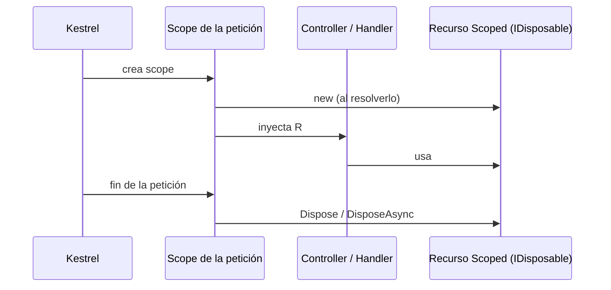

# IDisposable y using

Parte de: [[03-CSharp-DotNet/03 Intermedio/_Índice Intermedio|Intermedio]]

> [!info] Cómo avanzar
> `progreso`: **pendiente** → **viendo** (estudiando) → **visto** (contestaste la autoevaluación sin abrir las respuestas) → **dominado** (hiciste el laboratorio o lo aplicaste de verdad).

## Contenido

### Qué es
`IDisposable` es la interfaz con un solo método, `Dispose()`, que indica que un objeto tiene **recursos que deben liberarse de forma determinista**: conexiones a BD, archivos, sockets, *handles* del sistema operativo, temporizadores, suscripciones. El [[Recolector de basura]] libera **memoria administrada**, pero no sabe cuándo debes cerrar una conexión; `Dispose` es la forma de decir "ya terminé, libéralo ahora". La sentencia **`using`** garantiza que `Dispose` se llame aunque ocurra una excepción.

### Cómo funciona
`using` es azúcar sintáctica sobre `try/finally`:

```csharp
// Forma con bloque: Dispose al cerrar la llave
using (var cn = new SqlConnection(cadena))
{
    // usar cn
}   // aquí: cn.Dispose()

// Declaración using (C# 8): Dispose al terminar el ámbito (normalmente el método)
using var cn2 = new SqlConnection(cadena);
// usar cn2 ...
// al salir del método: cn2.Dispose()
```
Ambas compilan a algo como `var cn = ...; try { ... } finally { cn?.Dispose(); }`. La diferencia es **cuándo** se libera: el bloque te da control fino (liberar antes de seguir con otro trabajo); la declaración es más limpia pero mantiene el recurso hasta el final del bloque que la contiene.

**`await using`** y `IAsyncDisposable`: algunos recursos necesitan trabajo **asíncrono** para cerrarse (vaciar un buffer a disco o red, cerrar una conexión de forma ordenada). Implementan `IAsyncDisposable` con `ValueTask DisposeAsync()`. Usa `await using` en código asíncrono cuando el tipo lo implementa: `SqlConnection`, `FileStream`, `Utf8JsonWriter`, `ServiceProvider`, los *scopes* de DI (`AsyncServiceScope`).

**Quién hace `Dispose` en DI**: el contenedor de [[Inyección de dependencias]] libera los servicios **que él creó** cuando termina el ámbito correspondiente:
- **Scoped**: al terminar la petición HTTP (o el `scope` que creaste).
- **Transient**: también al terminar el scope que los resolvió (el contenedor los rastrea, por eso un transient desechable resuelto desde la raíz vive hasta el apagado).
- **Singleton**: al apagar la aplicación.
- Las instancias que **tú** pasaste ya construidas (`AddSingleton(miInstancia)`) **no** las libera el contenedor.
Por eso **no** debes llamar `Dispose` sobre algo que te inyectaron: no es tuyo.



### Ejemplo
```csharp
using Dapper;
using Microsoft.Data.SqlClient;

public sealed class ComandoGuardarPedido(string cadena)
{
    public async Task EjecutarAsync(int clienteId, decimal total, CancellationToken ct)
    {
        await using var cn = new SqlConnection(cadena);        // DisposeAsync al salir
        await cn.OpenAsync(ct);
        await using var tx = await cn.BeginTransactionAsync(ct); // también desechable

        await cn.ExecuteAsync(new CommandDefinition(
            "dbo.Pedido_Insertar", new { clienteId, total }, tx,
            commandType: System.Data.CommandType.StoredProcedure, cancellationToken: ct));

        await tx.CommitAsync(ct);
    }   // si hubo excepción antes del Commit, Dispose de la transacción hace rollback
}

// Implementar IDisposable en una clase propia que posee un recurso
public sealed class Bitacora : IDisposable
{
    private readonly StreamWriter _escritor = new("bitacora.txt", append: true);
    private bool _desechado;

    public void Escribir(string m)
    {
        ObjectDisposedException.ThrowIf(_desechado, this);
        _escritor.WriteLine(m);
    }

    public void Dispose()
    {
        if (_desechado) return;      // Dispose debe poder llamarse varias veces
        _escritor.Dispose();
        _desechado = true;
    }
}
```

Para clases **selladas** que solo envuelven otros objetos desechables, basta un `Dispose()` simple como el de arriba. El patrón completo con `Dispose(bool disposing)` y finalizador solo hace falta si manejas **recursos no administrados directamente** (algo raro hoy: usa `SafeHandle`).

### Cuándo usarlo y cuándo no
- **Siempre `using`/`await using`** con objetos desechables que tú creas y cuyo ciclo de vida controlas.
- **Implementa `IDisposable`** si tu clase posee (crea y guarda) otro desechable.
- **No** envuelvas en `using` algo inyectado ni algo que vive más que tu método (como el `HttpClient` de `IHttpClientFactory`, que la fábrica administra).
- **`await using`** en código asíncrono cuando el tipo implementa `IAsyncDisposable`.

### Errores comunes
1. **No desechar conexiones**: no regresan al *pool* hasta que el GC las finalice, y el pool se agota bajo carga (ver [[Connection pooling]]).
2. **Desechar algo inyectado**: el siguiente que lo use recibe `ObjectDisposedException`.
3. **Regresar un objeto que se va a desechar** (`using var cn ...; return cn.Query(..., buffered: false);`): se usa cuando ya está cerrado.
4. **`using var` en un método largo**: mantiene la conexión abierta más de lo necesario; usa un bloque o un método más chico.
5. **`Dispose` que lanza excepciones** o no tolera llamarse dos veces.

### Para profundizar
- [Implementar un método Dispose](https://learn.microsoft.com/dotnet/standard/garbage-collection/implementing-dispose)
- [Implementar un método DisposeAsync](https://learn.microsoft.com/dotnet/standard/garbage-collection/implementing-disposeasync)
- [Desechar servicios en la inyección de dependencias](https://learn.microsoft.com/dotnet/core/extensions/dependency-injection-guidelines#disposal-of-services)

## Autoevaluación

Contesta primero en voz alta o en papel; luego despliega la respuesta.

> [!question]- ¿Para qué es `IDisposable`?
> Para liberar recursos no administrados o caros (conexiones, archivos, sockets) de forma determinista con `Dispose()`.

> [!question]- ¿Qué diferencia hay entre `using (var x = ...) { }` y `using var x = ...;`?
> El primero libera al salir del bloque; el segundo al final del ámbito (normalmente del método).

> [!question]- ¿Cuándo `await using`?
> Con objetos `IAsyncDisposable` (`SqlConnection`, `DbTransaction`) en código async, para que la liberación tampoco bloquee.

> [!question]- ¿Quién hace `Dispose` de un servicio registrado en DI?
> El contenedor, al terminar su scope (Scoped/Transient) o al cerrar la app (Singleton). No hagas `Dispose` de lo que te inyectaron.

