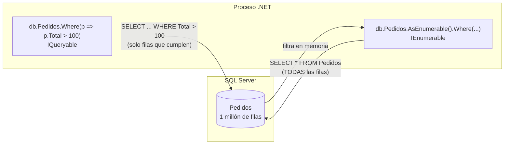

# IEnumerable vs IQueryable

Parte de: [[03-CSharp-DotNet/03 Intermedio/_Índice Intermedio|Intermedio]]

> [!info] Cómo avanzar
> `progreso`: **pendiente** → **viendo** (estudiando) → **visto** (contestaste la autoevaluación sin abrir las respuestas) → **dominado** (hiciste el laboratorio o lo aplicaste de verdad).

## Contenido

### Qué es
Ambas interfaces representan una secuencia que puedes consultar con LINQ, pero **dónde** se ejecuta la consulta es distinto:
- **`IEnumerable<T>`** (LINQ to Objects): los operadores reciben `Func<...>` y se ejecutan **en memoria**, en tu proceso, elemento por elemento.
- **`IQueryable<T>`** (LINQ con proveedor): los operadores reciben `Expression<Func<...>>` y van armando un **árbol de expresión** que un proveedor (EF Core, por ejemplo) **traduce** a otro lenguaje, normalmente SQL, y ejecuta en la base de datos.

### Cómo funciona
`IQueryable<T>` hereda de `IEnumerable<T>` y agrega dos cosas: una `Expression` (el árbol acumulado) y un `Provider` (quien sabe traducirlo). Cada `Where`/`Select`/`OrderBy` sobre un `IQueryable` no filtra nada: solo agrega nodos al árbol. Al enumerar, el proveedor convierte el árbol completo en **una** consulta SQL.

La clave está en qué método de extensión elige el compilador:
- Si la variable es `IQueryable<T>`, usa `Queryable.Where(Expression<...>)` → se traduce a SQL.
- Si la variable es `IEnumerable<T>`, usa `Enumerable.Where(Func<...>)` → se ejecuta en memoria.

Por eso `AsEnumerable()` es un **punto de corte**: todo lo que va antes se traduce a SQL; todo lo que va después se hace en C#.



`db.Pedidos.AsEnumerable().Where(p => p.Total > 100)` manda `SELECT` de **toda la tabla** a SQL Server, transfiere todas las filas por la red, crea un objeto por cada una y luego filtra en memoria. Con mil filas no lo notas; con un millón, la API se cae por memoria o por tiempo.

### Ejemplo
```csharp
using Microsoft.EntityFrameworkCore;

public sealed class Pedido { public int Id { get; set; } public decimal Total { get; set; } public DateOnly Fecha { get; set; } }
public sealed class TiendaDb(DbContextOptions<TiendaDb> o) : DbContext(o) { public DbSet<Pedido> Pedidos => Set<Pedido>(); }

public sealed class ConsultasPedidos(TiendaDb db)
{
    // BIEN: todo se traduce a SQL (WHERE, ORDER BY, OFFSET/FETCH)
    public Task<List<Pedido>> GrandesAsync(decimal minimo, int pagina, CancellationToken ct) =>
        db.Pedidos
          .Where(p => p.Total > minimo)
          .OrderByDescending(p => p.Total)
          .Skip((pagina - 1) * 20).Take(20)
          .AsNoTracking()
          .ToListAsync(ct);

    // MAL: trae toda la tabla y filtra en memoria
    public List<Pedido> GrandesMal(decimal minimo) =>
        db.Pedidos.AsEnumerable().Where(p => p.Total > minimo).ToList();

    // MAL sutil: el parámetro Func fuerza LINQ to Objects aunque la fuente sea IQueryable
    public List<Pedido> FiltrarMal(Func<Pedido, bool> filtro) =>
        db.Pedidos.Where(filtro).ToList();          // Enumerable.Where -> tabla completa

    // BIEN: recibir Expression mantiene la traducción a SQL
    public List<Pedido> Filtrar(System.Linq.Expressions.Expression<Func<Pedido, bool>> filtro) =>
        db.Pedidos.Where(filtro).ToList();
}
```

**¿Aplica en tus proyectos con Dapper?** Casi no. Dapper no tiene `IQueryable`: tú escribes el SQL en archivos `.sql` o procedimientos, y `Query<T>` regresa un `IEnumerable<T>` ya leído (por defecto, una `List<T>` en buffer). La lección equivalente es: **filtra, ordena y pagina en el SQL**, no trayendo todo con un procedimiento genérico para luego hacer `.Where()` en C#. Si ves `repo.ObtenerTodos().Where(...)` en un handler, es el mismo error que `AsEnumerable()`.

### Cuándo usarlo y cuándo no
- **`IQueryable`** dentro de la capa de datos con EF Core, para componer la consulta antes de ejecutarla.
- **`AsEnumerable()`** a propósito, cuando necesitas algo que SQL no puede hacer (un método propio, una regex), y **después** de haber reducido las filas en SQL.
- **No expongas `IQueryable` fuera de la capa de datos**: cualquiera podría agregar operadores no traducibles o ejecutar consultas cuando el `DbContext` ya se desechó. Regresa `IReadOnlyList<T>` o DTOs.
- **`IEnumerable`** para colecciones en memoria y resultados ya materializados.

### Errores comunes
1. **`AsEnumerable()`, `ToList()` o `AsAsyncEnumerable()` antes de filtrar**: tabla completa a memoria.
2. **Recibir `Func<T, bool>` en un repositorio genérico de EF Core**: mismo efecto, menos visible.
3. **Métodos no traducibles dentro del `Where`** (un método propio `EsVip(p)`): EF Core lanza `InvalidOperationException` porque no sabe convertirlo a SQL.
4. **Enumerar un `IQueryable` varias veces**: cada enumeración es un viaje a la BD.

### Para profundizar
- [Evaluación en cliente frente a servidor (EF Core)](https://learn.microsoft.com/ef/core/querying/client-eval)
- [Interfaz IQueryable (referencia de API)](https://learn.microsoft.com/dotnet/api/system.linq.iqueryable-1)
- [Cómo funcionan las consultas en EF Core](https://learn.microsoft.com/ef/core/querying/how-query-works)

## Autoevaluación

Contesta primero en voz alta o en papel; luego despliega la respuesta.

> [!question]- ¿Cuál es la diferencia?
> `IEnumerable<T>` ejecuta en memoria con delegados (`Func`). `IQueryable<T>` construye un árbol de expresión que un proveedor (EF Core) traduce a SQL y ejecuta en la base.

> [!question]- ¿Qué pasa con `db.Pedidos.AsEnumerable().Where(p => p.Total > 100)`?
> Trae **todas** las filas y filtra en memoria. Con `IQueryable` el `WHERE` va a la base.

> [!question]- ¿Aplica en tus proyectos con Dapper?
> No directamente: con Dapper escribes el SQL y recibes `IEnumerable` ya materializado; los filtros van en el `.sql`. Es importante al leer código con EF Core.

