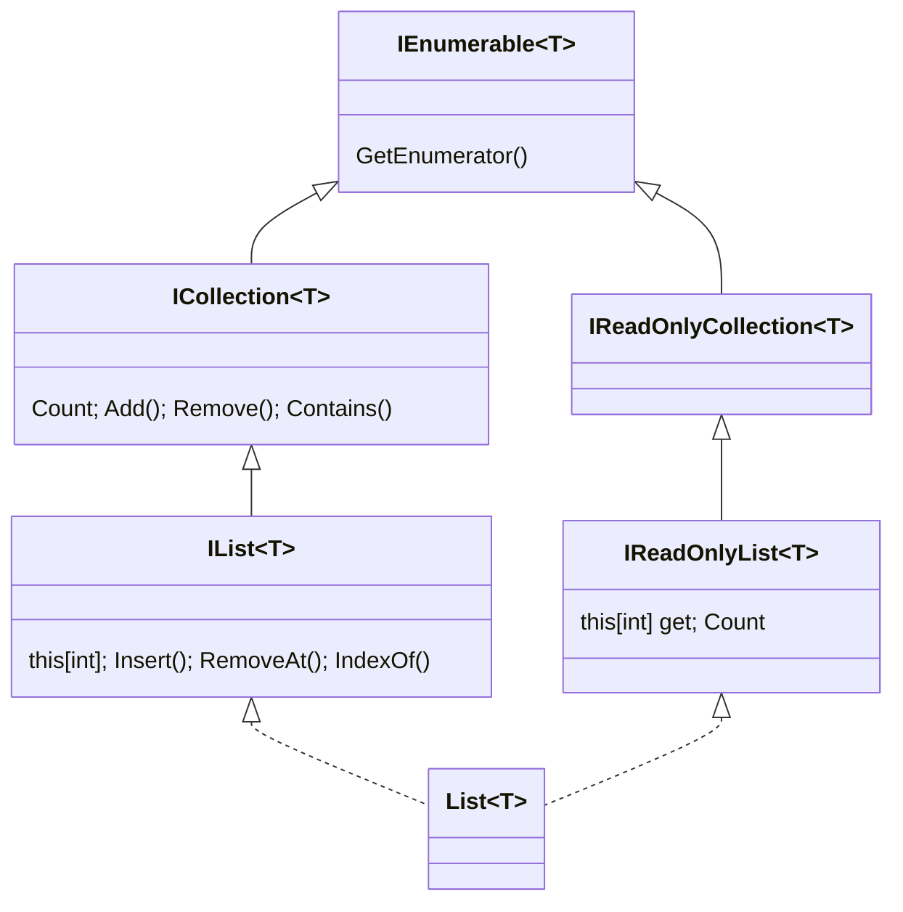

# IEnumerable, ICollection e IList

Parte de: [[03-CSharp-DotNet/03 Intermedio/_Índice Intermedio|Intermedio]]

> [!info] Cómo avanzar
> `progreso`: **pendiente** → **viendo** (estudiando) → **visto** (contestaste la autoevaluación sin abrir las respuestas) → **dominado** (hiciste el laboratorio o lo aplicaste de verdad).

## Contenido

### Qué es
Son las tres interfaces genéricas principales de colecciones en .NET y forman una jerarquía donde cada una **agrega capacidades** a la anterior:
- **`IEnumerable<T>`**: solo se puede **recorrer** (`foreach`). No sabe cuántos elementos hay ni deja modificar. Puede ser perezosa o infinita.
- **`ICollection<T>`**: agrega **`Count`**, `Add`, `Remove`, `Contains`, `Clear`, `CopyTo` e `IsReadOnly`. Es una colección finita y (normalmente) modificable.
- **`IList<T>`**: agrega acceso **por posición**: el indexador `this[int]`, `IndexOf`, `Insert` y `RemoveAt`.

En paralelo existen las versiones de **solo lectura**: `IReadOnlyCollection<T>` (enumerar + `Count`) e `IReadOnlyList<T>` (+ indexador). `List<T>` y los arrays implementan todas.

### Cómo funciona


La regla de diseño que más se cita: **recibe lo más general que te sirva y regresa lo más específico que tenga sentido** (sin exponer más de lo que quieres que hagan con tus datos).
- Como **parámetro**, si solo vas a recorrer, `IEnumerable<T>`; así aceptas listas, arrays, `HashSet`, resultados de LINQ.
- Como **retorno**, si ya tienes los datos materializados, `IReadOnlyList<T>` (o `IReadOnlyCollection<T>`): el llamador sabe que es finita, puede usar `Count` e índice, y no puede modificarla.

**El riesgo de recibir `IEnumerable<T>` y llamar `.Count()` y luego `foreach`**: si te pasan una consulta diferida (LINQ sobre otra colección, un iterador con `yield`, una lectura sin buffer de BD), `Count()` la **recorre completa** y el `foreach` la vuelve a ejecutar desde cero. Pagas el trabajo dos veces, puedes obtener resultados distintos (si la fuente cambió) o fallar (si la fuente solo se puede leer una vez, como un stream o un `DataReader`). Ver [[Ejecución diferida en LINQ]].

### Ejemplo
```csharp
public sealed record Venta(string Vendedor, decimal Monto);

public static class Reportes
{
    // MAL: puede enumerar la fuente dos veces
    public static string ResumenMal(IEnumerable<Venta> ventas)
    {
        var n = ventas.Count();                 // 1.ª enumeración
        decimal total = 0;
        foreach (var v in ventas) total += v.Monto; // 2.ª enumeración
        return $"{n} ventas, {total:C}";
    }

    // BIEN: pide lo que necesita (Count sin recorrer) y lo expresa en la firma
    public static string Resumen(IReadOnlyCollection<Venta> ventas)
        => $"{ventas.Count} ventas, {ventas.Sum(v => v.Monto):C}";

    // BIEN también: recibe IEnumerable pero materializa una sola vez
    public static string Resumen2(IEnumerable<Venta> ventas)
    {
        var lista = ventas as IReadOnlyCollection<Venta> ?? ventas.ToList();
        return $"{lista.Count} ventas, {lista.Sum(v => v.Monto):C}";
    }
}

// Capa de datos con Dapper: regresa algo finito y de solo lectura
public interface IConsultaVentasPorZona
{
    Task<IReadOnlyList<Venta>> EjecutarAsync(string zona, CancellationToken ct);
}
// En la implementación: (await cn.QueryAsync<Venta>(...)).AsList();
// AsList() de Dapper regresa la List<T> interna sin copiar si ya es lista.
```

**¿Qué devuelve tu capa de datos?** En el patrón de una interfaz por consulta, lo recomendable es `IReadOnlyList<TFila>` para listas y `TFila?` para "uno o ninguno". El handler sabe que los datos ya están en memoria (la conexión puede cerrarse), puede usar `Count` y no puede modificar la colección por accidente. Exponer `List<T>` invita a que otras capas la alteren; exponer `IEnumerable<T>` oculta si ya se leyó o no.

### Cuándo usarlo y cuándo no
- **`IEnumerable<T>`**: parámetros que solo recorren; resultados perezosos intencionales (streams de datos, [[yield]]).
- **`IReadOnlyCollection<T>` / `IReadOnlyList<T>`**: retornos de repositorios, consultas y servicios; propiedades que exponen una colección interna.
- **`ICollection<T>` / `IList<T>`**: solo si el llamador realmente debe agregar o quitar elementos (poco común en APIs públicas).
- **`List<T>` concreto**: dentro de un método, o cuando necesitas su API específica (`AddRange`, `Sort`, `AsSpan` vía `CollectionsMarshal`).

### Errores comunes
1. **Enumerar varias veces un `IEnumerable<T>`** recibido como parámetro.
2. **Regresar `IEnumerable<T>` desde un repositorio** que en realidad es una consulta viva ligada a una conexión.
3. **Exponer la `List<T>` interna** de una entidad (`public List<Partida> Partidas`): cualquiera la modifica sin pasar por tus reglas. Expón `IReadOnlyList<T>` y ofrece métodos (`AgregarPartida`).
4. **Creer que `IReadOnlyList<T>` es inmutable**: solo impide modificar *a través de esa referencia*; quien tenga la `List<T>` original puede cambiarla. Para inmutabilidad real, `ImmutableArray<T>` o `FrozenSet<T>`.

### Para profundizar
- [Colecciones y estructuras de datos en .NET](https://learn.microsoft.com/dotnet/standard/collections/)
- [Seleccionar una clase de colección](https://learn.microsoft.com/dotnet/standard/collections/selecting-a-collection-class)
- [Guía de diseño: colecciones](https://learn.microsoft.com/dotnet/standard/design-guidelines/guidelines-for-collections)

## Autoevaluación

Contesta primero en voz alta o en papel; luego despliega la respuesta.

> [!question]- ¿Qué agrega cada una?
> `IEnumerable<T>`: solo recorrer. `ICollection<T>`: + `Count`, `Add`, `Remove`, `Contains`. `IList<T>`: + acceso por índice e `Insert`.

> [!question]- ¿Qué riesgo hay en recibir `IEnumerable<T>` y llamar `.Count()` y luego `foreach`?
> Si es una consulta diferida se ejecuta **dos veces** (dos consultas o dos recorridos). Materializa con `ToList()` si vas a recorrer varias veces.

> [!question]- ¿Qué devuelve tu capa de datos?
> `IReadOnlyList<TFila>`: ya materializado, con `Count` e índice, y sin métodos para modificar.

