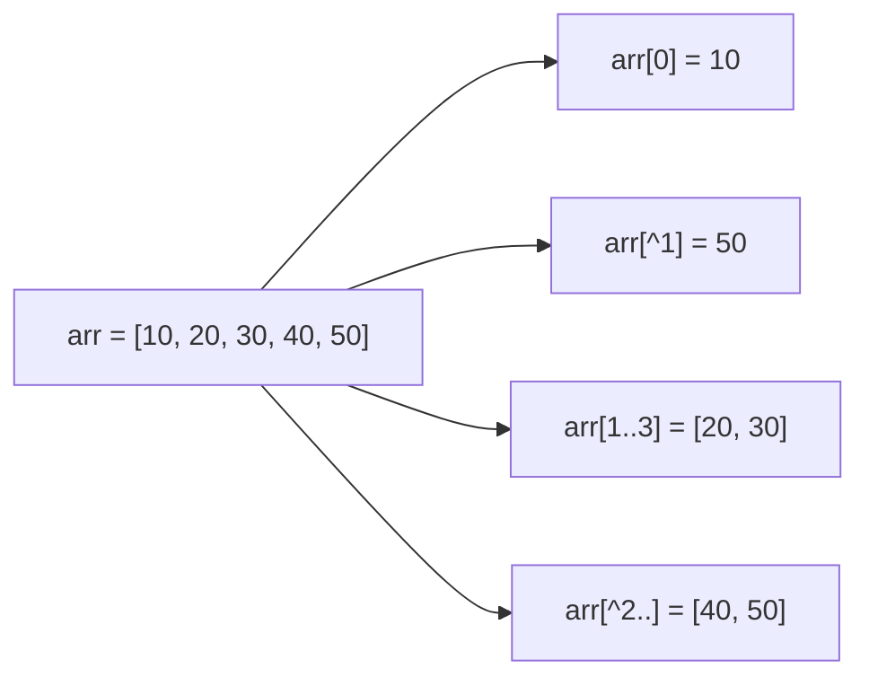

# Indexadores

Parte de: [[03-CSharp-DotNet/03 Intermedio/_Índice Intermedio|Intermedio]]

> [!info] Cómo avanzar
> `progreso`: **pendiente** → **viendo** (estudiando) → **visto** (contestaste la autoevaluación sin abrir las respuestas) → **dominado** (hiciste el laboratorio o lo aplicaste de verdad).

## Contenido

### Qué es
Un **indexador** permite que los objetos de una clase o struct se accedan con corchetes, como si fueran un arreglo: `inventario["CAF-01"]`, `matriz[2, 3]`. Se declara como una propiedad especial llamada `this` con parámetros. `List<T>`, `Dictionary<TKey, TValue>` y `string` exponen indexadores.

Relacionados con ellos están los tipos **`Index`** y **`Range`** (C# 8): `^1` significa "el último", `1..3` significa "del índice 1 al 3 sin incluirlo".

### Cómo funciona
```csharp
public T this[int indice]
{
    get { ... }
    set { ... }   // opcional; sin set es de solo lectura
}
```
- El parámetro puede ser de **cualquier tipo**: `int`, `string`, una tupla, un enum, varios parámetros.
- **Puede haber varios indexadores** en una clase, siempre que difieran en la lista de parámetros (es sobrecarga, igual que con métodos). Por ejemplo, uno por posición (`int`) y otro por clave (`string`).
- Admiten `=> expresión` y acceso `init`.

**`Index` y `Range`**:
- `^n` crea un `Index` "desde el final": `^1` es el último, `^2` el penúltimo. `arr[^1]` equivale a `arr[arr.Length - 1]`.
- `a..b` crea un `Range` desde `a` (incluido) hasta `b` (excluido). Se pueden omitir: `..3` (los primeros 3), `2..` (desde el 2), `^2..` (los dos últimos), `..` (todo).
- Un tipo los soporta automáticamente si tiene `Length` o `Count` más un indexador `int` (para `^`) y un método `Slice(int, int)` (para rangos). `string` y los arreglos los soportan de forma nativa; en arreglos y strings, un rango **crea una copia**; en `Span<T>` es un *slice* sin copiar.
- Desde C# 13 puedes usar `^` en inicializadores de objetos: `new Buffer { [^1] = 0 }`.



### Ejemplo
```csharp
// Inventario con dos indexadores: por posición y por SKU
public sealed class Inventario
{
    private readonly List<Producto> _productos = [];
    private readonly Dictionary<string, Producto> _porSku = new(StringComparer.OrdinalIgnoreCase);

    public int Count => _productos.Count;

    // Indexador por posición (solo lectura); con Count, habilita inv[^1]
    public Producto this[int i] => _productos[i];

    // Indexador por clave (lectura y escritura)
    public Producto this[string sku]
    {
        get => _porSku.TryGetValue(sku, out var p)
            ? p
            : throw new KeyNotFoundException($"SKU {sku} no existe");
        set
        {
            if (_porSku.TryAdd(sku, value)) _productos.Add(value);
            else
            {
                var i = _productos.FindIndex(x => x.Sku.Equals(sku, StringComparison.OrdinalIgnoreCase));
                _productos[i] = value;
                _porSku[sku] = value;
            }
        }
    }
}

public sealed record Producto(string Sku, string Nombre, int Existencia);

var inv = new Inventario();
inv["CAF-01"] = new Producto("CAF-01", "Café de Veracruz", 12);
inv["TE-03"] = new Producto("TE-03", "Té de limón", 4);
Console.WriteLine(inv["caf-01"].Nombre);   // Café de Veracruz (sin distinguir mayúsculas)
Console.WriteLine(inv[^1].Sku);            // TE-03 (gracias a Count + this[int])

// Index y Range en tipos del BCL
int[] arr = [10, 20, 30, 40, 50];
var ultimo = arr[^1];          // 50
var medio = arr[1..3];         // [20, 30] (copia)
var finales = arr[^2..];       // [40, 50]

string folio = "FAC-2026-000123";
var anio = folio[4..8];        // "2026" (nuevo string)
ReadOnlySpan<char> sinCopia = folio.AsSpan()[^6..]; // "000123" sin asignar memoria

// Indexador con varios parámetros
public sealed class Matriz(int filas, int columnas)
{
    private readonly decimal[,] _datos = new decimal[filas, columnas];
    public decimal this[int f, int c] { get => _datos[f, c]; set => _datos[f, c] = value; }
}
```

### Cuándo usarlo y cuándo no
- **Úsalos** cuando tu tipo **es** conceptualmente una colección o un mapa: caches, tablas de configuración, matrices, buffers.
- **No** los uses para operaciones costosas o con efectos inesperados (consultar la BD dentro de un `get`): quien lee `x["a"]` espera algo barato.
- **Prefiere un método con nombre** (`BuscarPorSku`) cuando no encontrar el elemento es un caso normal y quieres un `TryGet` o un resultado anulable.
- **Usa `^` y rangos** en vez de aritmética con `Length - 1`; en código caliente, rangos sobre `Span<T>` para evitar copias (ver [[Span y Memory]]).
- **Piensa en el contrato**: un indexador de escritura convierte tu tipo en algo mutable desde fuera. Si las reglas de negocio deben validarse al agregar (existencias no negativas, SKU con formato válido), valida dentro del `set` o expón solo el `get` y un método explícito que aplique las reglas. En tipos de dominio, lo habitual es un indexador de solo lectura para consultar y métodos con nombre para modificar.

### Errores comunes
1. **Olvidar que `^0` está fuera de rango**: equivale a `Length`, no al último elemento.
2. **Confundir el fin del rango**: `1..3` no incluye el índice 3.
3. **Copias inesperadas** al usar rangos sobre arreglos o strings dentro de bucles.
4. **Indexadores que lanzan `NullReferenceException`** en lugar de una excepción clara (`KeyNotFoundException`, `ArgumentOutOfRangeException`).

### Para profundizar
- [Indexadores (guía de programación de C#)](https://learn.microsoft.com/dotnet/csharp/programming-guide/indexers/)
- [Índices y rangos](https://learn.microsoft.com/dotnet/csharp/tutorials/ranges-indexes)
- [Operadores de acceso a miembros (^ y ..)](https://learn.microsoft.com/dotnet/csharp/language-reference/operators/member-access-operators)

## Autoevaluación

Contesta primero en voz alta o en papel; luego despliega la respuesta.

> [!question]- ¿Qué es un indexador?
> Una propiedad con parámetros que permite usar `obj[clave]`: `public decimal this[string moneda] { get => ...; }`.

> [!question]- ¿Qué son `Index` y `Range`?
> `^1` es el último elemento y `1..3` un rango (final exclusivo). Funcionan con arrays, strings, spans y tipos con `Length` + indexador.

> [!question]- ¿Puede haber varios indexadores en una clase?
> Sí, con distintos tipos o número de parámetros (sobrecarga).

