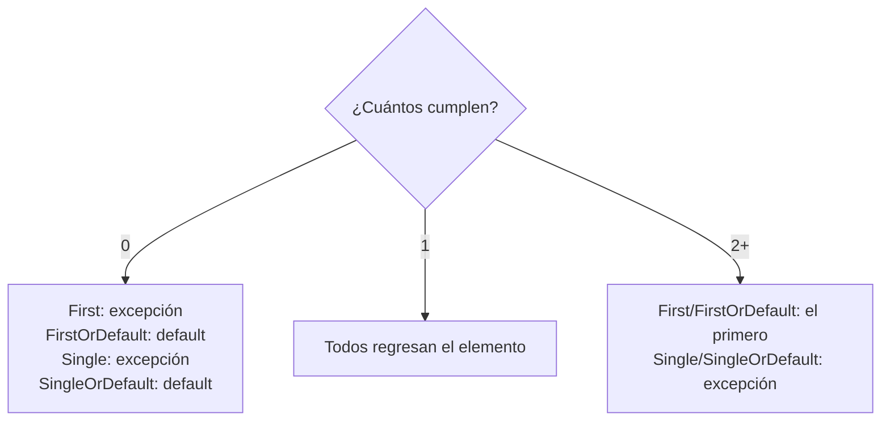

# LINQ - First, Single, Any y All

Parte de: [[LINQ]]

> [!info] Cómo avanzar
> `progreso`: **pendiente** → **viendo** (estudiando) → **visto** (contestaste la autoevaluación sin abrir las respuestas) → **dominado** (hiciste el laboratorio o lo aplicaste de verdad).

## Contenido

### Qué es
Son operadores de **ejecución inmediata** que responden preguntas puntuales sobre una secuencia:
- **`First` / `FirstOrDefault`**: el primer elemento (que cumpla una condición).
- **`Single` / `SingleOrDefault`**: el **único** elemento; además **validan** que no haya más de uno.
- **`Last` / `LastOrDefault`**: el último (requiere recorrer todo).
- **`Any`**: ¿existe al menos uno que cumpla?
- **`All`**: ¿todos cumplen?

### Cómo funciona
| Operador | 0 coincidencias | 1 coincidencia | 2 o más |
|---|---|---|---|
| `First` | lanza `InvalidOperationException` | el elemento | el primero |
| `FirstOrDefault` | `default(T)` | el elemento | el primero |
| `Single` | lanza | el elemento | **lanza** |
| `SingleOrDefault` | `default(T)` | el elemento | **lanza** |

- `default(T)` es `null` para clases y **records**, `0` para `int`, `false` para `bool`. Desde .NET 6 puedes indicar tu propio valor: `FirstOrDefault(pred, valorPorDefecto)`.
- `First` se detiene en cuanto encuentra el primero. `Single` necesita seguir buscando para comprobar que no haya un segundo, así que recorre más (en BD, EF Core pide `TOP 2`).
- `Any` se detiene en el primer `true`; `All` se detiene en el primer `false`.

**Secuencia vacía** (verdad vacía, como en lógica): `All` regresa **`true`** (no hay ningún elemento que incumpla) y `Any` regresa **`false`** (no hay ninguno que cumpla). Esto sorprende: "todos los pedidos están pagados" es verdadero si no hay pedidos. Si eso no es lo que quieres, combina: `lista.Any() && lista.All(...)`.



**¿Cuándo `Single`?** Cuando "exactamente uno" es una **regla de negocio** y que haya más sería un error de datos que quieres detectar: buscar por clave única (RFC, folio, correo de un usuario). Lanzar una excepción ahí es mejor que seguir con el elemento equivocado en silencio. Si solo quieres "alguno" o te da igual cuál, usa `First`.

### Ejemplo
```csharp
new int[0].All(x => x > 100);        // true  (verdad vacía)
new int[0].Any(x => x > 100);        // false

// new[] { 3, 5, 5 }.SingleOrDefault(x => x == 5);
// -> InvalidOperationException: "Sequence contains more than one matching element"

new[] { 3, 5 }.FirstOrDefault(x => x > 10);        // 0 (default de int)
new[] { 3, 5 }.FirstOrDefault(x => x > 10, -1);    // -1 (valor propio, .NET 6+)

public sealed record Cliente(int Id, string Rfc, bool Activo);

List<Cliente> clientes = [new(1, "XAXX010101000", true), new(2, "GODE561231GR8", false)];

// Records: FirstOrDefault regresa null si no hay coincidencia
Cliente? c = clientes.FirstOrDefault(x => x.Rfc == "NOEXISTE");
if (c is null) Console.WriteLine("No encontrado");   // aquí regresarías 404 / ProblemDetails

// Single para claves únicas: si hay duplicados, es un bug de datos y debe explotar
Cliente porRfc = clientes.Single(x => x.Rfc == "XAXX010101000");

// Any / All para validaciones
bool hayInactivos = clientes.Any(x => !x.Activo);    // true
bool todosActivos = clientes.All(x => x.Activo);     // false

// Ejemplo en una regla de FluentValidation
// RuleFor(p => p.Partidas).Must(ps => ps.Any() && ps.All(x => x.Cantidad > 0))
//     .WithMessage("El pedido debe tener partidas con cantidad positiva");
```

### Cuándo usarlo y cuándo no
- **`FirstOrDefault` + `is null`** cuando el "no encontrado" es un caso normal (buscar por id que llega del cliente).
- **`First`** cuando la ausencia sería un error de programación (configuración que siempre debe existir).
- **`Single`/`SingleOrDefault`** para claves únicas donde un duplicado es un error que quieres detectar.
- **`Any`** siempre que solo preguntes "¿hay?". No uses `Count() > 0` ni `FirstOrDefault() != null`.
- **Con Dapper**, el equivalente está en sus métodos: `QueryFirstOrDefaultAsync`, `QuerySingleOrDefaultAsync` (que también lanza si hay más de una fila) y `QuerySingleAsync`. Elige con el mismo criterio.

### Errores comunes
1. **`First` donde puede no haber datos** → `InvalidOperationException` en producción.
2. **`FirstOrDefault` con tipos de valor** y confundir el `0` por defecto con un dato real; usa la sobrecarga con valor propio o proyecta a anulable.
3. **Usar `SingleOrDefault` "por si acaso"** sin saber que lanza con dos coincidencias.
4. **Olvidar la verdad vacía de `All`** en validaciones ("todas las partidas son válidas" pasa con cero partidas).
5. **`Last` sobre secuencias grandes no indexadas**: recorre todo; en una lista usa `lista[^1]`.

### Para profundizar
- [Operaciones de elemento (First, Single, ElementAt)](https://learn.microsoft.com/dotnet/csharp/linq/standard-query-operators/#element-operators)
- [Operaciones cuantificadoras (Any, All, Contains)](https://learn.microsoft.com/dotnet/csharp/linq/standard-query-operators/quantifier-operations)
- [Enumerable.SingleOrDefault (referencia de API)](https://learn.microsoft.com/dotnet/api/system.linq.enumerable.singleordefault)

## Ejercicios

Resuélvelos en papel o en la herramienta; la solución está plegada.

> [!question]- `new int[0].All(x => x > 100)` ¿Qué da? ¿Y `Any(...)`?
> `All` → `true` (no hay contraejemplos). `Any` → `false`.

> [!question]- `new[] { 3, 5, 5 }.SingleOrDefault(x => x == 5)` ¿Qué pasa?
> Lanza `InvalidOperationException` porque hay dos coincidencias.

> [!question]- `new[] { 3, 5 }.FirstOrDefault(x => x > 10)`
> `0` (default de int). Desde .NET 6 puedes pasar el default: `FirstOrDefault(x => x > 10, -1)`.

## Autoevaluación

Contesta primero en voz alta o en papel; luego despliega la respuesta.

> [!question]- ¿Qué diferencia hay entre `First`, `FirstOrDefault`, `Single` y `SingleOrDefault`?
> `First` toma el primero y lanza si no hay. `Single` exige **exactamente uno** y lanza si hay 0 o más de 1. Las versiones `OrDefault` regresan `default` si no hay (y `SingleOrDefault` aún lanza si hay más de uno).

> [!question]- ¿Cuándo usarías `Single`?
> Cuando que haya más de uno sería un error de datos (buscar por llave única) y quieres enterarte.

> [!question]- ¿Qué regresa `FirstOrDefault` sobre una lista de records si no hay coincidencia?
> `null` (default de un tipo de referencia); con nullable activado el tipo es `T?` y debes comprobarlo.

## Práctica

- [[Lab 3 - Consola con LINQ y genéricos]]

