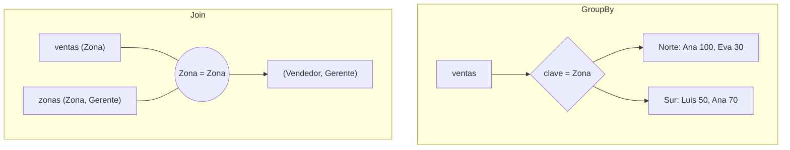

# LINQ - GroupBy y Join

Parte de: [[LINQ]]

> [!info] Cómo avanzar
> `progreso`: **pendiente** → **viendo** (estudiando) → **visto** (contestaste la autoevaluación sin abrir las respuestas) → **dominado** (hiciste el laboratorio o lo aplicaste de verdad).

## Contenido

### Qué es
- **`GroupBy`** agrupa los elementos de una secuencia según una **clave** (zona, cliente, mes). Es el equivalente de `GROUP BY` de SQL, pero en memoria conserva los elementos de cada grupo, no solo los agregados.
- **`Join`** combina dos secuencias emparejando elementos con **claves iguales**. Es un *inner join*: los elementos sin pareja se descartan.
- **`GroupJoin`** también combina por clave, pero por cada elemento de la izquierda entrega el **grupo** (posiblemente vacío) de coincidencias de la derecha. Es la base del *left join*.

### Cómo funciona
**`GroupBy`** regresa `IEnumerable<IGrouping<TKey, TElement>>`. Cada `IGrouping` es a la vez:
- una **clave** (`g.Key`),
- y una **secuencia** con los elementos de ese grupo (puedes hacer `g.Count()`, `g.Sum(...)`, `foreach (var x in g)`).

Internamente recorre toda la fuente la primera vez que lo enumeras y arma un diccionario de listas (por eso, aunque es diferido, no es *streaming*). Los grupos salen en el orden en que apareció cada clave por primera vez.

**`Join`** construye una tabla hash con la secuencia interna (derecha) y recorre la externa (izquierda) buscando coincidencias. Por eso es O(n + m) y no O(n·m) como un `Where` anidado.

**Left join**: `GroupJoin` + `SelectMany` + `DefaultIfEmpty()`. `DefaultIfEmpty` convierte un grupo vacío en un grupo con un `null` (o `default`), así el elemento de la izquierda no se pierde. Desde .NET 10 existe además el operador `LeftJoin` que lo hace en un solo paso (Pendiente de confirmar si tu versión de EF Core lo traduce en todos los casos).



### Ejemplo
```csharp
public sealed record V(string Vendedor, string Zona, decimal Monto);

List<V> ventas = [new("Ana", "Norte", 100), new("Luis", "Sur", 50), new("Ana", "Sur", 70), new("Eva", "Norte", 30)];
List<(string Zona, string Gerente)> zonas = [("Norte", "Ana Gte"), ("Sur", "Beto Gte")];

// 1) Total por zona
var porZona = ventas
    .GroupBy(v => v.Zona)
    .Select(g => new { Zona = g.Key, Total = g.Sum(v => v.Monto) });
// Norte 130, Sur 120

// 2) Vendedor con más ventas sumadas
var mejor = ventas
    .GroupBy(v => v.Vendedor)
    .Select(g => new { Vendedor = g.Key, Total = g.Sum(v => v.Monto) })
    .MaxBy(x => x.Total);
// Ana, 170

// 3) Join: (Vendedor, Gerente)
var conGerente = ventas.Join(
    zonas,
    v => v.Zona,                    // clave izquierda
    z => z.Zona,                    // clave derecha
    (v, z) => (v.Vendedor, z.Gerente));
// (Ana, Ana Gte), (Luis, Beto Gte), (Ana, Beto Gte), (Eva, Ana Gte)

// Mismo join en sintaxis de consulta
var conGerente2 = from v in ventas
                  join z in zonas on v.Zona equals z.Zona
                  select (v.Vendedor, z.Gerente);

// 4) Left join: todas las zonas, aunque no tengan ventas
List<(string Zona, string Gerente)> todas = [.. zonas, ("Centro", "Caro Gte")];
var zonasConVentas =
    from z in todas
    join v in ventas on z.Zona equals v.Zona into grupo   // GroupJoin
    from v in grupo.DefaultIfEmpty()                       // aplana; null si no hay
    select new { z.Zona, Vendedor = v?.Vendedor ?? "(sin ventas)", Monto = v?.Monto ?? 0 };
// ... Centro, (sin ventas), 0

// 5) GroupJoin directo: cada zona con su lista de ventas
var resumen = todas.GroupJoin(ventas, z => z.Zona, v => v.Zona,
    (z, vs) => new { z.Zona, Cantidad = vs.Count(), Total = vs.Sum(x => x.Monto) });
// Norte 2/130, Sur 2/120, Centro 0/0

// Atajos .NET 9 para conteos y sumas por clave
var conteo = ventas.CountBy(v => v.Zona);                         // Norte 2, Sur 2
var sumas = ventas.AggregateBy(v => v.Zona, 0m, (acc, v) => acc + v.Monto); // Norte 130, Sur 120
```

### Cuándo usarlo y cuándo no
- **`GroupBy` en memoria** para reportes sobre datos ya traídos (Excel de Wee.Reporteria, tableros pequeños). Si solo necesitas totales, `CountBy`/`AggregateBy` o un `ToLookup` son más directos.
- **Con Dapper**, si la tabla es grande, agrupa y une **en SQL** (`GROUP BY`, `JOIN` en el `.sql`): la base de datos tiene índices y no transfiere filas innecesarias.
- **`Join`** en memoria cuando combinas resultados de dos fuentes distintas (una API externa y tu BD). Para búsquedas repetidas, un `Dictionary` o `ToLookup` construido una vez es equivalente y más explícito.
- **`ToLookup`** es la versión inmediata de `GroupBy`: lo materializa y permite `lookup["Norte"]` (si la clave no existe, regresa una secuencia vacía).

### Errores comunes
1. **Esperar que `GroupBy` regrese solo totales**: regresa grupos completos; agrega con `Select(g => ...)`.
2. **Agrupar por un objeto sin igualdad por valor** (una clase normal): cada instancia es un grupo distinto. Usa records, tuplas o tipos anónimos como clave.
3. **Hacer *joins* con `Where` anidado** (`a.Select(x => b.First(y => y.Id == x.Id))`): O(n·m) y explota si no hay coincidencia.
4. **Olvidar `DefaultIfEmpty()`** y obtener un *inner join* cuando querías un *left join*.
5. **Claves de texto con distinta capitalización** ("norte" vs "Norte"): pasa un `StringComparer.OrdinalIgnoreCase` a `GroupBy`.

### Para profundizar
- [Agrupación de datos (GroupBy)](https://learn.microsoft.com/dotnet/csharp/linq/standard-query-operators/grouping-data)
- [Operaciones de combinación (Join y GroupJoin)](https://learn.microsoft.com/dotnet/csharp/linq/standard-query-operators/join-operations)
- [Enumerable.GroupBy (referencia de API)](https://learn.microsoft.com/dotnet/api/system.linq.enumerable.groupby)

## Ejercicios

Resuélvelos en papel o en la herramienta; la solución está plegada.

> [!question]- Datos: `record V(string Vendedor, string Zona, decimal Monto);` con `ventas = [V("Ana","Norte",100), V("Luis","Sur",50), V("Ana","Sur",70), V("Eva","Norte",30)]`. Total por zona.
> ```csharp
> ventas.GroupBy(v => v.Zona)
>       .Select(g => new { Zona = g.Key, Total = g.Sum(v => v.Monto) })
> // Norte 130, Sur 120
> ```

> [!question]- Datos: `record V(string Vendedor, string Zona, decimal Monto);` con `ventas = [V("Ana","Norte",100), V("Luis","Sur",50), V("Ana","Sur",70), V("Eva","Norte",30)]`. ¿Qué vendedor tiene más ventas sumadas?
> ```csharp
> ventas.GroupBy(v => v.Vendedor)
>       .Select(g => (g.Key, Total: g.Sum(v => v.Monto)))
>       .MaxBy(x => x.Total)
> // ("Ana", 170)
> ```

> [!question]- Une `zonas = [("Norte","Ana Gte"), ("Sur","Beto Gte")]` con `ventas` para obtener (Vendedor, Gerente).
> ```csharp
> ventas.Join(zonas, v => v.Zona, z => z.Item1, (v, z) => (v.Vendedor, Gerente: z.Item2))
> ```

## Autoevaluación

Contesta primero en voz alta o en papel; luego despliega la respuesta.

> [!question]- ¿Qué regresa `GroupBy`?
> Una secuencia de `IGrouping<TKey, T>`: cada grupo tiene `Key` y es enumerable con sus elementos.

> [!question]- ¿Qué diferencia hay entre `Join` y `GroupJoin`?
> `Join` es un inner join (una fila por par). `GroupJoin` da cada elemento de la izquierda con la colección de sus coincidencias (base del left join).

> [!question]- ¿Cómo se hace un *left join* en LINQ?
> Con `GroupJoin` + `SelectMany(... .DefaultIfEmpty())`, o en sintaxis de consulta `join ... into g from x in g.DefaultIfEmpty()`. Desde .NET 10 existe el operador `LeftJoin` (Pendiente de confirmar).

## Práctica

- [[Lab 3 - Consola con LINQ y genéricos]]

