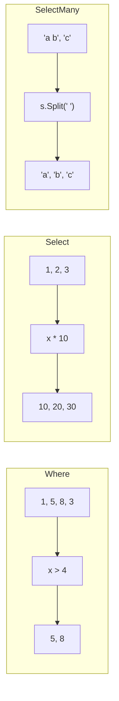

# LINQ - Where, Select y SelectMany

Parte de: [[LINQ]]

> [!info] Cómo avanzar
> `progreso`: **pendiente** → **viendo** (estudiando) → **visto** (contestaste la autoevaluación sin abrir las respuestas) → **dominado** (hiciste el laboratorio o lo aplicaste de verdad).

## Contenido

### Qué es
Son los tres operadores básicos de LINQ:
- **`Where`** filtra: conserva los elementos que cumplen una condición (`Func<T, bool>`). La cantidad baja o se queda igual; el tipo no cambia.
- **`Select`** proyecta: transforma **cada** elemento en otra cosa (`Func<T, TResult>`). La cantidad se mantiene; el tipo puede cambiar.
- **`SelectMany`** proyecta y **aplana**: cada elemento produce una secuencia, y el resultado es la concatenación de todas. Convierte "lista de listas" en "una lista".

### Cómo funciona


Los tres son **diferidos** y **en streaming**: procesan un elemento a la vez cuando alguien enumera (ver [[Ejecución diferida en LINQ]]).

**Sobrecargas con índice**: `Where((x, i) => ...)` y `Select((x, i) => ...)` reciben también la posición (base 0). Útiles para numerar o tomar elementos pares.

**¿Cuándo `SelectMany`?** Cuando cada elemento "contiene" varios y quieres trabajar con todos juntos: las partidas de todos los pedidos, las palabras de varias líneas, los roles de varios usuarios, combinaciones (producto cartesiano). En sintaxis de consulta equivale a dos `from` seguidos.

**¿Importa el orden entre `Where` y `Select`?** Sí, por dos razones:
1. **Qué tienes disponible**: después de `Select(v => v.Vendedor)` ya solo tienes strings; no puedes filtrar por `Monto`. Filtra antes de proyectar si el filtro usa datos que la proyección descarta.
2. **Costo**: si la proyección es cara (crear objetos, formatear, calcular), filtrar primero evita hacerla en elementos que se van a descartar. Con `IQueryable` (EF Core) el proveedor suele optimizar, pero en memoria se ejecuta tal cual lo escribes.

### Ejemplo
```csharp
public sealed record V(string Vendedor, string Zona, decimal Monto);

List<V> ventas = [new("Ana", "Norte", 100), new("Luis", "Sur", 50), new("Ana", "Sur", 70), new("Eva", "Norte", 30)];

// Vendedores con montos > 60, sin repetir
var nombres = ventas
    .Where(v => v.Monto > 60)     // Ana(100), Ana(70)
    .Select(v => v.Vendedor)      // "Ana", "Ana"
    .Distinct()                   // "Ana"
    .ToList();
Console.WriteLine(string.Join(", ", nombres)); // Ana

// SelectMany aplana: 'a b' -> a, b ; 'c' -> c
var cuenta = new[] { "a b", "c" }.SelectMany(s => s.Split(' ')).Count(); // 3

// Select con índice para numerar
var numerados = new[] { "x", "y" }.Select((s, i) => $"{i + 1}. {s}").ToList();
// "1. x", "2. y"

// Caso real: todas las partidas de varios pedidos con el folio del pedido
public sealed record Partida(string Sku, int Cantidad);
public sealed record Pedido(string Folio, List<Partida> Partidas);

List<Pedido> pedidos =
[
    new("A-1", [new("CAF-01", 2), new("TE-03", 1)]),
    new("A-2", [new("CAF-01", 5)]),
];

var lineas = pedidos.SelectMany(
    p => p.Partidas,                                  // qué aplanar
    (p, partida) => new { p.Folio, partida.Sku, partida.Cantidad }); // cómo combinar

var totalCafe = pedidos
    .SelectMany(p => p.Partidas)
    .Where(x => x.Sku == "CAF-01")
    .Sum(x => x.Cantidad);                            // 7

// Lo mismo en sintaxis de consulta
var lineas2 = from p in pedidos
              from x in p.Partidas
              where x.Cantidad > 1
              select $"{p.Folio}: {x.Sku} x{x.Cantidad}";
```

### Cuándo usarlo y cuándo no
- **`Where` + `Select`** para mapear entidades o filas a DTOs de respuesta, preparar filas de un reporte o validar listas.
- **`SelectMany`** para relaciones uno-a-muchos ya cargadas en memoria y para aplanar resultados de `Split`, `GroupBy` o colecciones anidadas.
- **No** uses `Select` para efectos secundarios (guardar, loguear): es diferido y puede ejecutarse cero o varias veces. Usa `foreach`.
- Si solo quieres el **tipo** de cada elemento filtrado, `OfType<T>()` es más claro que `Where(x => x is T).Select(x => (T)x)`.

### Errores comunes
1. **Proyectar antes de filtrar** y quedarte sin la propiedad que necesitabas, o pagar una proyección cara en todos los elementos.
2. **Usar `Select` cuando querías `SelectMany`**: obtienes `IEnumerable<IEnumerable<T>>` (o `IEnumerable<string[]>`) y el `Count()` da el número de grupos, no de elementos.
3. **Olvidar `Distinct()`** y repetir valores; o usar `Distinct` sobre clases sin igualdad por valor (usa records o `DistinctBy`).
4. **Lambdas con efectos secundarios** dentro de `Where`/`Select`.

### Para profundizar
- [Filtrado de datos con LINQ (Where)](https://learn.microsoft.com/dotnet/csharp/linq/standard-query-operators/filtering-data)
- [Operaciones de proyección (Select y SelectMany)](https://learn.microsoft.com/dotnet/csharp/linq/standard-query-operators/projection-operations)
- [Enumerable.SelectMany (referencia de API)](https://learn.microsoft.com/dotnet/api/system.linq.enumerable.selectmany)

## Ejercicios

Resuélvelos en papel o en la herramienta; la solución está plegada.

> [!question]- Datos: `record V(string Vendedor, string Zona, decimal Monto);` con `ventas = [V("Ana","Norte",100), V("Luis","Sur",50), V("Ana","Sur",70), V("Eva","Norte",30)]`. Obtén los nombres de vendedores con montos mayores a 60, sin repetir.
> ```csharp
> ventas.Where(v => v.Monto > 60).Select(v => v.Vendedor).Distinct()
> // ["Ana"]
> ```

> [!question]- `new[] { "a b", "c" }.SelectMany(s => s.Split(' ')).Count()` ¿Cuánto da?
> `3`.

> [!question]- Con `Select((x, i) => ...)` numera `["x","y"]` como `"1. x"`, `"2. y"`.
> ```csharp
> xs.Select((x, i) => $"{i + 1}. {x}")
> ```

## Autoevaluación

Contesta primero en voz alta o en papel; luego despliega la respuesta.

> [!question]- ¿Qué hace cada uno?
> `Where` filtra, `Select` transforma cada elemento, `SelectMany` aplana: de cada elemento saca una colección y las une en una sola.

> [!question]- ¿Cuándo `SelectMany`?
> Para pasar de pedidos a todas sus líneas: `pedidos.SelectMany(p => p.Lineas)`.

> [!question]- ¿Importa el orden entre `Where` y `Select`?
> Sí para el rendimiento y la claridad: filtra primero (`Where`) para no transformar elementos que vas a descartar.

## Práctica

- [[Lab 3 - Consola con LINQ y genéricos]]

