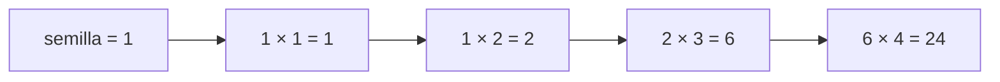

# LINQ - agregaciones (Count, Sum, Aggregate)

Parte de: [[LINQ]]

> [!info] Cómo avanzar
> `progreso`: **pendiente** → **viendo** (estudiando) → **visto** (contestaste la autoevaluación sin abrir las respuestas) → **dominado** (hiciste el laboratorio o lo aplicaste de verdad).

## Contenido

### Qué es
Los **operadores de agregación** reducen una secuencia completa a **un solo valor**: cuántos hay (`Count`, `LongCount`), cuánto suman (`Sum`), el promedio (`Average`), el mínimo y el máximo (`Min`, `Max`, y sus variantes `MinBy`/`MaxBy` que regresan el elemento) y el acumulado general (`Aggregate`). Todos son de **ejecución inmediata**: al llamarlos se recorre la fuente.

### Cómo funciona
- **`Count()`** cuenta elementos; `Count(pred)` cuenta los que cumplen. Si la fuente es una `ICollection<T>` (lista, array) y no hay predicado, usa la propiedad `Count` sin recorrer.
- **`Sum(selector)`** suma; con secuencia vacía regresa **0**.
- **`Average(selector)`** regresa `double` para enteros y `decimal` para `decimal`.
- **`Min`/`Max`**: el menor/mayor valor. `MinBy`/`MaxBy` (.NET 6) regresan el **elemento** con ese valor.
- **`Aggregate`** es el operador general (en otros lenguajes, `fold` o `reduce`): parte de una **semilla**, y para cada elemento aplica `acumulador = f(acumulador, elemento)`. Sin semilla, usa el primer elemento como semilla.

**Secuencias vacías**: `Average`, `Min` y `Max` sobre una secuencia vacía de un **tipo de valor no anulable** (`int`, `decimal`) lanzan `InvalidOperationException` ("Sequence contains no elements"), porque no hay un valor correcto que regresar. Sobre tipos **anulables** (`int?`) regresan `null`. `Aggregate` sin semilla también lanza. `Sum` y `Count` regresan 0.



**¿`Count()` o `Any()` para saber si hay elementos?** `Any()`. Se detiene en cuanto encuentra el primero, mientras que `Count()` sobre una secuencia que no es colección (una consulta LINQ, un iterador) la recorre **entera** solo para comparar con 0. Con EF Core, `Any()` se traduce a `EXISTS`, que también es más barato que `COUNT(*)`. Además expresa mejor la intención.

### Ejemplo
```csharp
public sealed record V(string Vendedor, string Zona, decimal Monto);

List<V> ventas = [new("Ana", "Norte", 100), new("Luis", "Sur", 50), new("Ana", "Sur", 70), new("Eva", "Norte", 30)];

decimal total = ventas.Sum(v => v.Monto);         // 250
decimal promedio = ventas.Average(v => v.Monto);  // 62.5
int enSur = ventas.Count(v => v.Zona == "Sur");   // 2
V mayor = ventas.MaxBy(v => v.Monto)!;            // Ana, Norte, 100

// Aggregate con semilla: factorial de 4
int producto = new[] { 1, 2, 3, 4 }.Aggregate(1, (acc, x) => acc * x); // 24

// Aggregate con semilla, acumulador y selector de resultado
string lista = ventas.Aggregate(
    new System.Text.StringBuilder(),
    (sb, v) => sb.Append(v.Vendedor).Append(';'),
    sb => sb.ToString().TrimEnd(';'));            // "Ana;Luis;Ana;Eva"

// Secuencias vacías
int[] vacio = [];
int suma = vacio.Sum();               // 0
// double p = vacio.Average();        // InvalidOperationException
// int m = vacio.Max();               // InvalidOperationException
int? mSeguro = vacio.Select(x => (int?)x).Max();   // null
int mDefecto = vacio.DefaultIfEmpty(0).Max();      // 0

// Any vs Count
bool hayGrandes = ventas.Any(v => v.Monto > 90);    // se detiene en el primero
// bool hayGrandes2 = ventas.Count(v => v.Monto > 90) > 0; // recorre todo

// Varios totales en una sola pasada (útil en reportes grandes)
var (cantidad, suma2, maximo) = ventas.Aggregate(
    (Cantidad: 0, Suma: 0m, Max: decimal.MinValue),
    (acc, v) => (acc.Cantidad + 1, acc.Suma + v.Monto, Math.Max(acc.Max, v.Monto)));
// (4, 250, 100)
```

### Cuándo usarlo y cuándo no
- **Úsalos** para totales de reportes, validaciones (`ventas.Sum(...) == totalFactura`), indicadores en memoria.
- **Con datos en BD** (Dapper), calcula los totales en SQL (`SUM`, `COUNT`, `AVG`) cuando la tabla es grande: viaja un número en lugar de miles de filas.
- **`Aggregate`** cuando ningún operador específico sirve; si existe `Sum`, `Max` o `string.Join`, úsalos: se leen mejor.
- **Cuidado con `decimal` vs `double`**: para dinero, proyecta a `decimal` antes de sumar o promediar para no perder precisión.

### Errores comunes
1. **`Average`/`Max` sobre una lista que puede venir vacía** (filtro sin resultados): excepción en producción. Revisa con `Any()`, usa `DefaultIfEmpty` o proyecta a anulable.
2. **`Count() > 0`** en lugar de `Any()`.
3. **Varias pasadas** (`Sum`, luego `Count`, luego `Max`) sobre una consulta diferida cara: materializa primero o usa un `Aggregate` de una sola pasada.
4. **Desbordamiento**: `Sum` sobre `int` lanza `OverflowException` si se pasa del rango; usa `long` o `decimal`.
5. **Olvidar la semilla en `Aggregate`** y que el primer elemento se use como acumulador, con un tipo distinto al esperado.

### Para profundizar
- [Operaciones de agregación en LINQ](https://learn.microsoft.com/dotnet/csharp/linq/standard-query-operators/#aggregation-operations)
- [Enumerable.Aggregate (referencia de API)](https://learn.microsoft.com/dotnet/api/system.linq.enumerable.aggregate)
- [Enumerable.Average (referencia de API)](https://learn.microsoft.com/dotnet/api/system.linq.enumerable.average)

## Ejercicios

Resuélvelos en papel o en la herramienta; la solución está plegada.

> [!question]- Datos: `record V(string Vendedor, string Zona, decimal Monto);` con `ventas = [V("Ana","Norte",100), V("Luis","Sur",50), V("Ana","Sur",70), V("Eva","Norte",30)]`. ¿Cuánto da `ventas.Sum(v => v.Monto)` y `ventas.Average(v => v.Monto)`?
> `250` y `62.5`.

> [!question]- `new[] { 1, 2, 3, 4 }.Aggregate(1, (a, x) => a * x)`
> `24`.

> [!question]- Datos: `record V(string Vendedor, string Zona, decimal Monto);` con `ventas = [V("Ana","Norte",100), V("Luis","Sur",50), V("Ana","Sur",70), V("Eva","Norte",30)]`. Cuenta cuántas ventas hay en la zona Sur.
> `ventas.Count(v => v.Zona == "Sur")` → `2`.

## Autoevaluación

Contesta primero en voz alta o en papel; luego despliega la respuesta.

> [!question]- ¿Qué pasa con `Average()` o `Max()` en una secuencia vacía de `int`?
> Lanzan `InvalidOperationException`. Con `int?` regresan `null`; o usa `DefaultIfEmpty()`.

> [!question]- ¿Qué hace `Aggregate`?
> Un *fold*: recorre acumulando: `xs.Aggregate(semilla, (acc, x) => ...)`.

> [!question]- ¿`Count()` o `Any()` para saber si hay elementos?
> `Any()`: se detiene en el primero; `Count()` puede recorrer todo.

## Práctica

- [[Lab 3 - Consola con LINQ y genéricos]]

