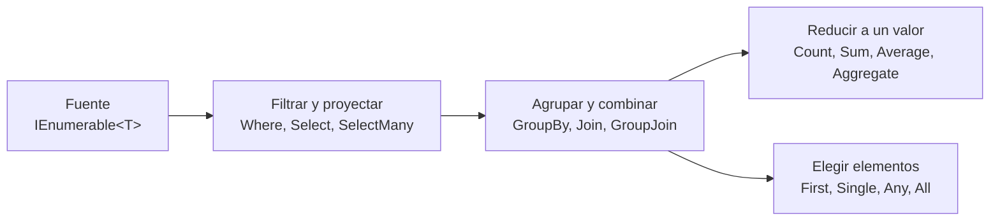

# LINQ

Parte de: [[03-CSharp-DotNet/03 Intermedio/_Índice Intermedio|Intermedio]]

> [!info] Cómo avanzar
> `progreso`: **pendiente** → **viendo** (estudiando) → **visto** (contestaste la autoevaluación sin abrir las respuestas) → **dominado** (hiciste el laboratorio o lo aplicaste de verdad).

## Contenido

### Qué es
**LINQ** (*Language Integrated Query*) es un conjunto de operadores y sintaxis de C# para **consultar y transformar secuencias** de datos de forma declarativa: dices *qué* quieres (filtrar, proyectar, agrupar, ordenar) y no *cómo* recorrer. Funciona igual sobre listas en memoria (LINQ to Objects), sobre XML (LINQ to XML) y, mediante proveedores, sobre bases de datos (EF Core traduce LINQ a SQL).

Técnicamente LINQ es una colección de [[Métodos de extensión]] sobre `IEnumerable<T>` (clase `Enumerable`) y sobre `IQueryable<T>` (clase `Queryable`), que reciben [[Expresiones lambda]].

### Cómo funciona
Las piezas que conviene tener claras antes de los subtemas:
- **Tubería**: cada operador recibe una secuencia y regresa otra, así que se encadenan: `ventas.Where(...).Select(...).OrderBy(...)`.
- **Ejecución diferida**: la mayoría no se ejecuta hasta que enumeras el resultado. Es el concepto más importante de LINQ y tiene su propia nota: [[Ejecución diferida en LINQ]].
- **Dónde se ejecuta**: `IEnumerable` en memoria, `IQueryable` en el proveedor (ver [[IEnumerable vs IQueryable]]).

**Dos sintaxis**, mismo resultado (el compilador traduce la de consulta a llamadas de métodos):

```csharp
// Sintaxis de métodos (la más usada)
var q1 = ventas.Where(v => v.Monto > 60).Select(v => v.Vendedor);

// Sintaxis de consulta (parecida a SQL)
var q2 = from v in ventas
         where v.Monto > 60
         select v.Vendedor;
```
La sintaxis de **métodos** cubre todos los operadores (`Distinct`, `Take`, `Sum`, `Chunk` no tienen palabra clave) y es la habitual en código moderno. La de **consulta** se lee mejor en *joins* múltiples y con `let`. Puedes mezclarlas: `(from v in ventas where ... select v).Distinct()`.

Los subtemas agrupan los operadores por propósito:



- [[LINQ - Where, Select y SelectMany]]: filtrar, transformar y aplanar. Es el 80 % del uso diario.
- [[LINQ - GroupBy y Join]]: agrupar por clave y combinar dos secuencias (incluido el *left join*).
- [[LINQ - agregaciones (Count, Sum, Aggregate)]]: reducir una secuencia a un número o un acumulado.
- [[LINQ - First, Single, Any y All]]: obtener un elemento o responder preguntas de sí/no, y qué pasa cuando no hay coincidencias.

### Ejemplo
Un reporte típico de Wee.Reporteria combinando varios operadores:

```csharp
public sealed record Venta(string Vendedor, string Zona, decimal Monto, DateOnly Fecha);

List<Venta> ventas =
[
    new("Ana", "Norte", 100m, new(2026, 11, 2)),
    new("Luis", "Sur", 50m, new(2026, 11, 3)),
    new("Ana", "Sur", 70m, new(2026, 11, 3)),
    new("Eva", "Norte", 30m, new(2026, 11, 4)),
];

var resumen = ventas
    .Where(v => v.Fecha.Month == 11)                 // filtrar
    .GroupBy(v => v.Zona)                            // agrupar
    .Select(g => new                                  // proyectar
    {
        Zona = g.Key,
        Total = g.Sum(v => v.Monto),                 // agregar
        Mejor = g.MaxBy(v => v.Monto)!.Vendedor      // elegir (.NET 6+)
    })
    .OrderByDescending(r => r.Total)
    .ToList();                                        // ejecutar

foreach (var r in resumen)
    Console.WriteLine($"{r.Zona}: {r.Total} (mejor: {r.Mejor})");
// Norte: 130 (mejor: Ana)
// Sur: 120 (mejor: Ana)
```

Operadores relativamente nuevos que vale la pena conocer: `MaxBy`/`MinBy`, `DistinctBy`, `Chunk` (.NET 6); `Order`/`OrderDescending` (.NET 7); `CountBy`, `AggregateBy` e `Index` (.NET 9).

### Cuándo usarlo y cuándo no
- **Úsalo** para transformar colecciones de forma legible: reportes, mapeos a DTOs, validaciones sobre listas, preparar datos para Excel.
- **Con bases de datos y Dapper**, el filtrado pesado va en el SQL; LINQ se usa después, sobre los resultados ya traídos.
- **Cuidado en bucles muy calientes**: cada operador crea objetos iteradores y, si la lambda captura variables, una *closure*; además hay llamadas a delegados por elemento. En un método que corre millones de veces por segundo (parseo, serialización, un *hot path* medido con [[BenchmarkDotNet]]), un `for` sobre un array o `Span<T>` puede ser varias veces más rápido y sin asignaciones. En código de negocio normal, la claridad de LINQ gana; optimiza solo cuando el *profiler* lo indique.

### Errores comunes
1. **Olvidar la ejecución diferida**: enumerar varias veces o leer después de cerrar la conexión.
2. **LINQ dentro de otro LINQ que recorre listas grandes** (`a.Where(x => b.Any(y => y.Id == x.Id))`): es O(n·m); crea antes un `HashSet` o un diccionario.
3. **Usar `Count() > 0`** en lugar de `Any()`.
4. **Usar `First` donde puede no haber datos**, o `Single` sin entender que valida unicidad.

### Para profundizar
- [LINQ en C# (Microsoft Learn)](https://learn.microsoft.com/dotnet/csharp/linq/)
- [Información general sobre operadores de consulta estándar](https://learn.microsoft.com/dotnet/csharp/linq/standard-query-operators/)
- [Clase Enumerable (referencia de API)](https://learn.microsoft.com/dotnet/api/system.linq.enumerable)

## Subtemas

- [[LINQ - Where, Select y SelectMany]]
- [[LINQ - GroupBy y Join]]
- [[LINQ - agregaciones (Count, Sum, Aggregate)]]
- [[LINQ - First, Single, Any y All]]

## Autoevaluación

Contesta primero en voz alta o en papel; luego despliega la respuesta.

> [!question]- ¿Qué es LINQ?
> Un conjunto de operadores (métodos de extensión sobre `IEnumerable<T>`/`IQueryable<T>`) para filtrar, proyectar, agrupar y agregar datos de forma declarativa.

> [!question]- ¿Sintaxis de métodos o de consulta?
> Son equivalentes; la de métodos (`.Where().Select()`) es la más usada. La de consulta (`from ... select`) es cómoda con varios `join` o `let`.

> [!question]- Error común: LINQ dentro de un bucle muy caliente. ¿Por qué cuidarlo?
> Cada operador crea iteradores y delegados (asignaciones). En código crítico mide con BenchmarkDotNet; para el resto, la claridad gana.

## Práctica

- [[Lab 3 - Consola con LINQ y genéricos]]

## Progreso de los subtemas

```base
filters:
  and:
    - file.inFolder("03-CSharp-DotNet/03 Intermedio/LINQ")
    - file.name != "LINQ"
views:
  - type: table
    name: Progreso
    order:
      - file.name
      - progreso
      - nivel
```
