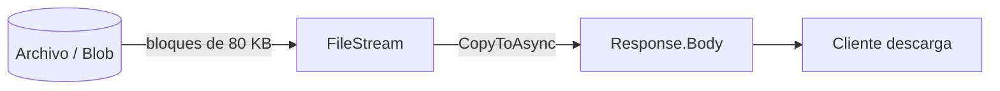

# Manejo de archivos y streams

Parte de: [[03-CSharp-DotNet/03 Intermedio/_Índice Intermedio|Intermedio]]

> [!info] Cómo avanzar
> `progreso`: **pendiente** → **viendo** (estudiando) → **visto** (contestaste la autoevaluación sin abrir las respuestas) → **dominado** (hiciste el laboratorio o lo aplicaste de verdad).

## Contenido

### Qué es
.NET ofrece dos niveles para trabajar con archivos:
- **Métodos de conveniencia** de la clase `File` (`ReadAllTextAsync`, `WriteAllTextAsync`, `ReadAllBytesAsync`, `ReadLinesAsync`): una línea de código, leen o escriben **todo** el contenido de una vez.
- **Streams** (`Stream`, `FileStream`, `StreamReader`, `StreamWriter`): una abstracción de **secuencia de bytes** que se lee o escribe **por partes**. Archivos, respuestas HTTP, memoria (`MemoryStream`), compresión (`GZipStream`) y blobs de Azure son todos streams, así que el mismo código sirve para cualquier origen o destino.

Además, `Path` y `Directory` resuelven rutas y carpetas de forma portable.

### Cómo funciona
**Stream**: tiene `Read`/`ReadAsync`, `Write`/`WriteAsync`, `CopyToAsync`, `Flush`, y propiedades como `CanSeek` y `Length` (no siempre disponibles: un stream de red no sabe su longitud). Lees en un buffer de tamaño fijo, procesas y repites; la memoria usada no depende del tamaño del archivo.

**Lectores y escritores de texto**: `StreamReader`/`StreamWriter` envuelven un stream y manejan la **codificación** (UTF-8 por defecto) y las líneas.

**¿Cuándo `File.ReadAllTextAsync` y cuándo un stream?**
- Archivos **pequeños y acotados** (configuración, una plantilla, un JSON de unos KB): `ReadAllTextAsync` es claro y suficiente.
- Archivos **grandes o de tamaño desconocido** (CSV de exportación, logs, cargas de usuarios, Excel de reportes): un stream, para no cargar cientos de MB en memoria (y no caer en el *Large Object Heap*, ver [[Recolector de basura]]).

**`Path.Combine` en vez de concatenar con `"\\"`**: el separador de carpetas depende del sistema operativo (`\` en Windows, `/` en Linux). Tu API puede correr en Windows en tu PC y en Linux en un contenedor o en Azure App Service para Linux. `Path.Combine("datos", "reportes", nombre)` usa el separador correcto, evita dobles barras y maneja bien rutas absolutas. Ojo: si un segmento posterior es una ruta absoluta, `Combine` descarta lo anterior; para nombres que vienen del usuario usa `Path.GetFileName` y valida, o `Path.Join`.

**Regresar un archivo desde una API**: con un stream, ASP.NET Core **copia por bloques** del origen a la respuesta. La memoria del servidor no crece con el tamaño del archivo, el cliente empieza a recibir antes y puedes soportar rangos (`enableRangeProcessing`) para descargas reanudables. Cargarlo todo a un `byte[]` multiplica la memoria por cada descarga simultánea.



### Ejemplo
```csharp
using System.Text;
using Microsoft.AspNetCore.Mvc;

public sealed class Archivos
{
    // Pequeño: una línea
    public static Task<string> LeerPlantillaAsync(string raiz, CancellationToken ct)
        => File.ReadAllTextAsync(Path.Combine(raiz, "Plantillas", "bienvenida.html"), Encoding.UTF8, ct);

    // Grande: línea por línea, memoria constante
    public static async Task<int> ContarErroresAsync(string ruta, CancellationToken ct)
    {
        int errores = 0;
        await foreach (var linea in File.ReadLinesAsync(ruta, ct))   // .NET 7+
            if (linea.Contains("ERROR", StringComparison.Ordinal)) errores++;
        return errores;
    }

    // Escritura en streaming de un CSV grande
    public static async Task ExportarAsync(string ruta, IAsyncEnumerable<string> filas, CancellationToken ct)
    {
        await using var fs = new FileStream(ruta, new FileStreamOptions
        {
            Mode = FileMode.Create, Access = FileAccess.Write,
            Options = FileOptions.Asynchronous, BufferSize = 64 * 1024
        });
        await using var w = new StreamWriter(fs, new UTF8Encoding(encoderShouldEmitUTF8Identifier: true)); // BOM para Excel
        await w.WriteLineAsync("Folio,Total");
        await foreach (var f in filas.WithCancellation(ct)) await w.WriteLineAsync(f);
    }
}

[ApiController, Route("api/reportes")]
public sealed class ReportesController(IWebHostEnvironment env) : ControllerBase
{
    [HttpGet("{nombre}")]
    public IActionResult Descargar(string nombre)
    {
        // Evita path traversal: solo el nombre, sin carpetas
        var seguro = Path.GetFileName(nombre);
        var ruta = Path.Combine(env.ContentRootPath, "reportes", seguro);
        if (!System.IO.File.Exists(ruta)) return NotFound();

        var stream = new FileStream(ruta, FileMode.Open, FileAccess.Read, FileShare.Read,
                                    bufferSize: 64 * 1024, useAsync: true);
        // ASP.NET Core copia por bloques y cierra el stream al terminar
        return File(stream, "application/vnd.openxmlformats-officedocument.spreadsheetml.sheet",
                    seguro, enableRangeProcessing: true);
    }
}
```

Dentro de un controller, `File(...)` es el método de `ControllerBase`; por eso para la clase estática se escribe `System.IO.File`. Para subidas, ver [[Subida y descarga de archivos]].

### Cuándo usarlo y cuándo no
- **`File.*AllText/Bytes`** para archivos chicos y conocidos.
- **Streams** para todo lo grande, lo que viene de la red, y para encadenar transformaciones (comprimir, cifrar, calcular hash) sin copias.
- **Archivos en servidores web**: en Azure, prefiere Blob Storage sobre el disco local de la instancia (puede no persistir o no compartirse entre instancias); el SDK de Blob también trabaja con streams.
- **Asíncrono siempre en APIs**: los métodos `Async` liberan el hilo mientras el disco o la red responden.

### Errores comunes
1. **Cargar archivos grandes completos** (`ReadAllBytes`) en una API con muchas descargas simultáneas: memoria disparada.
2. **Concatenar rutas con `"\\"`** y fallar al desplegar en Linux.
3. **No cerrar streams** (falta `using`/`await using`): el archivo queda bloqueado y no se puede borrar o reescribir.
4. **Path traversal**: usar el nombre del usuario directo (`../../appsettings.json`). Usa `Path.GetFileName` y valida contra una carpeta raíz.
5. **Codificación**: escribir CSV sin BOM y que Excel muestre mal los acentos; o leer con una codificación distinta a la del archivo.

### Para profundizar
- [E/S de archivos y secuencias en .NET](https://learn.microsoft.com/dotnet/standard/io/)
- [Formatos de ruta de archivo en Windows y Linux](https://learn.microsoft.com/dotnet/standard/io/file-path-formats)
- [Clase Path (referencia de API)](https://learn.microsoft.com/dotnet/api/system.io.path)

## Autoevaluación

Contesta primero en voz alta o en papel; luego despliega la respuesta.

> [!question]- ¿Cuándo `File.ReadAllTextAsync` y cuándo un `Stream`?
> `ReadAll*` para archivos pequeños. Para grandes, lee por partes con `FileStream`/`StreamReader` o `File.ReadLinesAsync` y no cargues todo en memoria.

> [!question]- ¿Por qué `Path.Combine` y no concatenar con `"\\"`?
> Usa el separador correcto en cada sistema (Windows/Linux en contenedores).

> [!question]- Al regresar un archivo desde una API, ¿por qué conviene un stream?
> `File(stream, contentType, nombre)` envía por partes; con `byte[]` cargas todo el archivo en memoria por petición.

