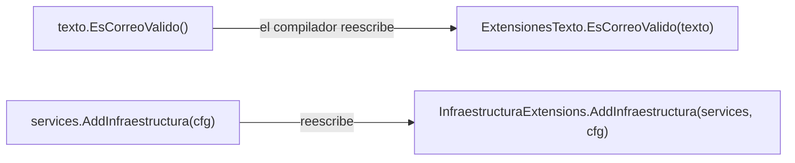

# Métodos de extensión

Parte de: [[03-CSharp-DotNet/03 Intermedio/_Índice Intermedio|Intermedio]]

> [!info] Cómo avanzar
> `progreso`: **pendiente** → **viendo** (estudiando) → **visto** (contestaste la autoevaluación sin abrir las respuestas) → **dominado** (hiciste el laboratorio o lo aplicaste de verdad).

## Contenido

### Qué es
Un **método de extensión** te permite "agregar" métodos a un tipo que no controlas (o que no quieres modificar) sin heredar ni envolverlo. Se escribe como un método estático, pero se llama como si fuera de instancia: `texto.EsCorreoValido()`, `services.AddInfraestructura(config)`. Todo LINQ (`Where`, `Select`, `ToList`) está hecho con métodos de extensión sobre `IEnumerable<T>`.

### Cómo funciona
**Forma clásica** (desde C# 3):
1. Una clase `static` no anidada y no genérica.
2. Un método `static` cuyo primer parámetro lleva `this`: `public static bool EsVacio(this string? s)`.
3. El llamador necesita el `using` del namespace donde está la clase.

El compilador simplemente reescribe `s.EsVacio()` como `Extensiones.EsVacio(s)`. No hay magia en ejecución: el método **no** accede a miembros privados y **no** forma parte del tipo.

**Reglas de resolución**: si el tipo ya tiene un **método de instancia** con firma compatible, **siempre gana el de instancia** y tu extensión se ignora sin aviso. Las extensiones solo se consideran cuando no hay un método de instancia aplicable. Entre varias extensiones aplicables, gana la más específica (o el compilador marca ambigüedad).

**Por qué `AddSentenciasSql()` o `AddInfraestructura()` son extensiones de `IServiceCollection`**: es la convención de ASP.NET Core para que cada módulo o capa empaquete sus registros de DI. `Program.cs` queda legible (`builder.Services.AddInfraestructura(builder.Configuration)`), los detalles quedan encapsulados en el proyecto que los conoce, y se pueden encadenar porque regresan el mismo `IServiceCollection`.

**C# 14 (con .NET 10): bloques `extension`**. Además de métodos, ahora puedes declarar **propiedades de extensión**, **miembros estáticos de extensión** (que se llaman sobre el tipo, como `string.Algo`) y operadores, agrupados en un bloque `extension(Receptor r) { ... }`. La sintaxis clásica con `this` sigue siendo válida y compatible.



### Ejemplo
```csharp
using System.Text.RegularExpressions;
using Microsoft.Extensions.Configuration;
using Microsoft.Extensions.DependencyInjection;

namespace Itzamna.Dionisio.Infraestructura;

// 1) Forma clásica: registro de DI por capa
public static class InfraestructuraExtensions
{
    public static IServiceCollection AddInfraestructura(
        this IServiceCollection services, IConfiguration config)
    {
        services.AddSingleton<ILectorSql, LectorSqlEmbebido>();
        services.AddScoped<IConexionFactory>(_ =>
            new ConexionSqlFactory(config.GetConnectionString("Principal")!));
        return services; // permite encadenar
    }
}

// 2) Forma clásica sobre string
public static partial class ExtensionesTexto
{
    [GeneratedRegex(@"^[^@\s]+@[^@\s]+\.[^@\s]+$")]
    private static partial Regex Correo();

    public static bool EsCorreoValido(this string? s)
        => !string.IsNullOrWhiteSpace(s) && Correo().IsMatch(s);
}

// 3) C# 14: bloque extension con propiedad y miembro estático
public static class ExtensionesColeccion
{
    extension<T>(IEnumerable<T> fuente)
    {
        // Propiedad de extensión
        public bool EstaVacia => !fuente.Any();
    }

    extension(decimal)
    {
        // Miembro estático de extensión: se llama decimal.TasaIva
        public static decimal TasaIva => 0.16m;
    }
}

// Uso
// "ana@correo.mx".EsCorreoValido()      -> true
// new List<int>().EstaVacia              -> true
// decimal.TasaIva                         -> 0.16

// Interfaces y clases de apoyo para que compile
public interface ILectorSql { string Leer(string archivo); }
public sealed class LectorSqlEmbebido : ILectorSql { public string Leer(string a) => ""; }
public interface IConexionFactory { }
public sealed class ConexionSqlFactory(string cadena) : IConexionFactory { }
```

### Cuándo usarlo y cuándo no
- **Úsalos** para: registros de DI por módulo, utilidades sobre tipos de terceros o del BCL (`string`, `DateOnly`, `IQueryable`), APIs fluidas, y para dar comportamiento a interfaces sin obligar a cada implementación.
- **No** los uses para lógica de dominio central de tus propias clases: si controlas el tipo, un método de instancia es más descubrible y puede usar estado privado.
- **Evita** extender `object` o tipos muy generales: contaminan el IntelliSense de todo el proyecto.
- **Alternativas**: métodos de instancia, clases auxiliares inyectables (si necesitas dependencias o quieres simularlas en pruebas), o el patrón decorador.

### Errores comunes
1. **Esperar que tu extensión reemplace un método existente**: el método de instancia gana siempre; si más adelante la librería agrega un método con el mismo nombre, tu extensión deja de llamarse sin aviso.
2. **Olvidar el `using`** del namespace y pensar que el método "no existe".
3. **No validar nulos**: la extensión se puede llamar sobre `null` (`((string?)null).EsVacio()` no lanza por sí misma); decide si eso es una característica o valida con `ArgumentNullException.ThrowIfNull`.
4. **Meter dependencias ocultas** (estáticos, `DateTime.Now`, acceso a BD) en una extensión: se vuelve imposible de probar.

### Para profundizar
- [Métodos de extensión (guía de C#)](https://learn.microsoft.com/dotnet/csharp/programming-guide/classes-and-structs/extension-methods)
- [Miembros de extensión (C# 14)](https://learn.microsoft.com/dotnet/csharp/language-reference/keywords/extension)
- [Novedades de C# 14](https://learn.microsoft.com/dotnet/csharp/whats-new/csharp-14)

## Autoevaluación

Contesta primero en voz alta o en papel; luego despliega la respuesta.

> [!question]- ¿Cómo se declara un método de extensión?
> Método `static` en una clase `static`, con `this` en el primer parámetro: `public static bool EsVacio(this string? s) => string.IsNullOrWhiteSpace(s);`.

> [!question]- ¿Por qué `AddSentenciasSql()` o `AddInfraestructura()` son métodos de extensión de `IServiceCollection`?
> Agrupan el registro de servicios de una capa y dejan `Program.cs` legible: `builder.Services.AddInfraestructura(config);`.

> [!question]- ¿Qué pasa si la clase ya tiene un método de instancia con la misma firma?
> Gana el de instancia; el de extensión se ignora.

> [!question]- ¿Qué agregó C# 14 sobre extensiones?
> Bloques `extension(Tipo x) { ... }` que permiten declarar también propiedades y miembros estáticos de extensión.

## Práctica

- [[Lab 3 - Consola con LINQ y genéricos]]

