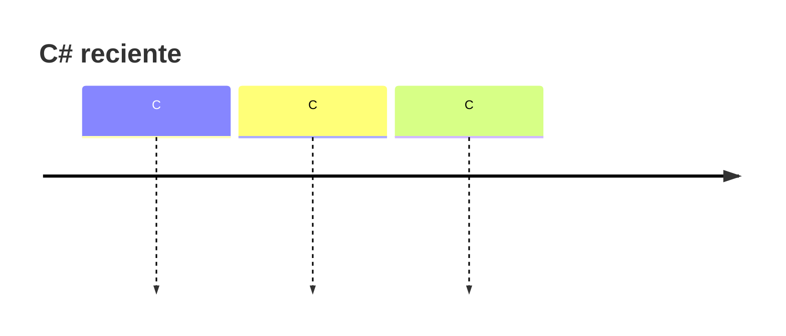

# Novedades recientes de CSharp (collection expressions, primary constructors y más)

Parte de: [[03-CSharp-DotNet/03 Intermedio/_Índice Intermedio|Intermedio]]

> [!info] Cómo avanzar
> `progreso`: **pendiente** → **viendo** (estudiando) → **visto** (contestaste la autoevaluación sin abrir las respuestas) → **dominado** (hiciste el laboratorio o lo aplicaste de verdad).

## Contenido

### Qué es
C# saca una versión nueva cada año junto con .NET (en noviembre). Cada versión trae características que reducen código repetitivo o mejoran el rendimiento. Esta nota resume las tres más recientes que vas a ver en proyectos con .NET 8, 9 y 10: **C# 12** (.NET 8), **C# 13** (.NET 9) y **C# 14** (.NET 10). Para la siguiente, .NET 11 con C# 15 se anunció para noviembre de 2026 (Pendiente de confirmar fecha final y qué características llegan a la versión estable).

### Cómo funciona
**La versión de C# depende del *target framework***: el SDK elige por defecto la versión de lenguaje que corresponde al `TargetFramework` del proyecto. `net8.0` → C# 12, `net9.0` → C# 13, `net10.0` → C# 14. Puedes forzar otra con `<LangVersion>` en el `.csproj`, pero no se recomienda usar una más nueva que la del framework (algunas características necesitan soporte del runtime).

**Cómo saber qué versión usa tu proyecto**: revisa el `TargetFramework` (y si hay `<LangVersion>` explícito en el `.csproj` o en `Directory.Build.props`). Un truco rápido: escribe `#error version` en cualquier archivo y el compilador te responde con la versión de lenguaje y del compilador en el mensaje de error.

**C# 12 (.NET 8)**
- **Collection expressions**: sintaxis única con corchetes para crear colecciones: `int[] a = [1, 2, 3];`, `List<string> l = [];`, `Span<int> s = [1, 2];`. El operador **spread** `..` inserta otra colección: `[.. a, 4, .. b]`. El compilador elige la forma más eficiente según el tipo destino.
- **Primary constructors** en clases y structs: `public sealed class Handler(IRepo repo, ILogger<Handler> log)`. Los parámetros están disponibles en todo el cuerpo. Son ideales para inyección de dependencias. Ojo: son **parámetros**, no campos `readonly`; se pueden reasignar.
- Parámetros por defecto en lambdas, `using` alias para cualquier tipo (`using Punto = (int X, int Y);`), *inline arrays*, atributo `[Experimental]`.

**C# 13 (.NET 9)**
- **`params` con colecciones**: `params ReadOnlySpan<T>`, `params List<T>`, `params IEnumerable<T>`; con `Span` se evita crear un arreglo por llamada.
- **Nuevo tipo `System.Threading.Lock`**: `lock` sobre un `Lock` usa una API más eficiente que `Monitor` (ver [[lock y concurrencia]]).
- **Propiedades e indexadores `partial`**, útiles con *source generators*.
- Secuencia de escape `\e`, `^` en inicializadores de objetos, `ref struct` que implementan interfaces y la anti-restricción `allows ref struct`, `ref` y `unsafe` en métodos async e iteradores, `[OverloadResolutionPriority]`.

**C# 14 (.NET 10)**
- **Miembros de extensión**: bloques `extension(...)` con propiedades, métodos y miembros estáticos de extensión (ver [[Métodos de extensión]]).
- **Palabra clave `field`**: acceso al campo generado de una propiedad automática, para agregar lógica sin declarar el campo: `public string Nombre { get; set => field = value.Trim(); }`.
- **Asignación condicional por nulo**: `cliente?.Direccion = nueva;` solo asigna si `cliente` no es nulo.
- **`nameof` con genéricos sin argumentos** (`nameof(List<>)`), conversiones implícitas a `Span<T>`/`ReadOnlySpan<T>`, modificadores en parámetros de lambda sin tipo, constructores y eventos `partial`, y operadores de asignación compuesta definidos por el usuario.



### Ejemplo
Un *handler* de vertical slice usando varias de estas características:

```csharp
using Microsoft.Extensions.Logging;

namespace Itzamna.Dionisio.Features.Clientes;

public sealed record CrearCliente(string Rfc, string Nombre, string[] Etiquetas);

// C# 12: primary constructor para DI
public sealed class CrearClienteHandler(IComandoCrearCliente comando, ILogger<CrearClienteHandler> log)
{
    // C# 12: collection expression
    private static readonly string[] EtiquetasBase = ["nuevo", "web"];

    public async Task<int> Handle(CrearCliente cmd, CancellationToken ct)
    {
        // C# 12: spread
        string[] etiquetas = [.. EtiquetasBase, .. cmd.Etiquetas];
        var id = await comando.EjecutarAsync(cmd with { Etiquetas = etiquetas }, ct);
        log.LogInformation("Cliente {Id} creado", id);
        return id;
    }
}

public sealed class Cliente
{
    // C# 14: field, sin declarar _nombre
    public string Nombre
    {
        get;
        set => field = value?.Trim() ?? throw new ArgumentNullException(nameof(value));
    } = "";

    public Direccion? Direccion { get; set; }
}

public sealed class Direccion { public string Cp { get; set; } = ""; }

public static class Ejemplos
{
    // C# 13: params con ReadOnlySpan, sin arreglo por llamada
    public static decimal Sumar(params ReadOnlySpan<decimal> montos)
    {
        decimal t = 0;
        foreach (var m in montos) t += m;
        return t;
    }

    public static void Actualizar(Cliente? c, Direccion nueva)
    {
        c?.Direccion = nueva;     // C# 14: solo asigna si c no es null
    }
}

public interface IComandoCrearCliente { Task<int> EjecutarAsync(CrearCliente cmd, CancellationToken ct); }
```

### Cuándo usarlo y cuándo no
- **Adopta** collection expressions y primary constructors en código nuevo: son el estilo actual y los analizadores del IDE los sugieren.
- **Primary constructors** en servicios con DI; en entidades de dominio con invariantes, un constructor explícito con validación suele ser más claro.
- **`field`** cuando necesitas una pequeña regla en el `set` (normalizar, validar) sin campo explícito.
- **No mezcles versiones de lenguaje** entre proyectos de la misma solución sin motivo: centraliza `TargetFramework` en `Directory.Build.props` (ver [[Directory.Build.props y Central Package Management]]).

### Errores comunes
1. **Tratar los parámetros del primary constructor como campos `readonly`**: se pueden reasignar; si lo necesitas inmutable, asígnalo a un campo `readonly`.
2. **Subir `LangVersion` sin subir el framework** y usar características que requieren runtime nuevo.
3. **Variables o propiedades llamadas `field`** en código existente: en C# 14 dentro de un accesor se interpreta como la palabra clave; usa `@field` o renombra.
4. **Creer que `[]` siempre crea un arreglo**: el tipo destino decide (`List<T>`, `Span<T>`, `ImmutableArray<T>`).

### Para profundizar
- [Novedades de C# 14](https://learn.microsoft.com/dotnet/csharp/whats-new/csharp-14)
- [Novedades de C# 13](https://learn.microsoft.com/dotnet/csharp/whats-new/csharp-13)
- [Novedades de C# 12](https://learn.microsoft.com/dotnet/csharp/whats-new/csharp-12)
- [Control de versiones del lenguaje C#](https://learn.microsoft.com/dotnet/csharp/language-reference/configure-language-version)

## Autoevaluación

Contesta primero en voz alta o en papel; luego despliega la respuesta.

> [!question]- ¿Qué son las *collection expressions* (C# 12)?
> Sintaxis `[1, 2, 3]` para crear arrays, listas, spans e inmutables según el tipo destino; `[..a, ..b]` concatena.

> [!question]- ¿Qué agregó C# 13 que uses a diario?
> `params` con colecciones (`params ReadOnlySpan<T>`), el tipo `System.Threading.Lock`, `\e` como escape y propiedades `partial`.

> [!question]- ¿Qué trae C# 14 (con .NET 10)?
> Miembros de extensión (`extension(T x) { }`), la palabra `field` en propiedades, asignación condicional a null (`a?.B = x;`), `nameof` con genéricos sin cerrar y conversiones implícitas a `Span`.

> [!question]- ¿Cómo sabes qué versión de C# usa tu proyecto?
> La define el TFM: `net10.0` usa C# 14 por defecto. No es necesario fijar `<LangVersion>`.

