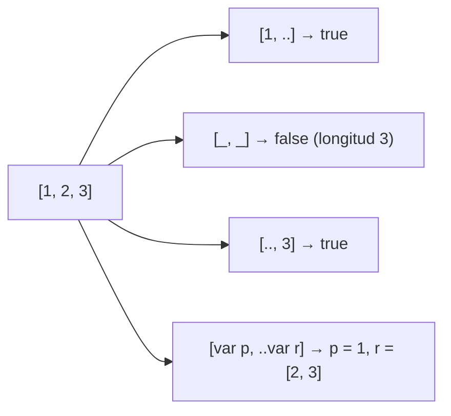

# Patrones de lista en CSharp

Parte de: [[Pattern matching]]

> [!info] Cómo avanzar
> `progreso`: **pendiente** → **viendo** (estudiando) → **visto** (contestaste la autoevaluación sin abrir las respuestas) → **dominado** (hiciste el laboratorio o lo aplicaste de verdad).

## Contenido

### Qué es
Los **patrones de lista** (C# 11) comprueban la **forma** de una secuencia indexable: cuántos elementos tiene y qué hay en ciertas posiciones. Se escriben entre corchetes: `[]` (vacía), `[var x]` (exactamente uno), `[1, 2, ..]` (empieza con 1 y 2), `[.., 3]` (termina en 3). Cada posición acepta cualquier otro patrón: constantes, relacionales, `var`, `_`, de propiedad.

### Cómo funciona
- **`_`** (descarte) ocupa exactamente **una** posición con cualquier valor.
- **`..`** (*slice*) ocupa **cero o más** elementos. Solo puede aparecer **una vez** por patrón.
- **`..var resto`** captura ese tramo en una variable. En arreglos, `resto` es un nuevo arreglo; en `Span<T>` es un *slice* sin copiar; en `string`, un substring.
- Sin `..`, el patrón exige una longitud exacta: `[_, _]` solo coincide con dos elementos.

**¿Qué tipos aceptan?** Cualquier tipo que sea **contable** (tiene `Length` o `Count`) e **indexable** (tiene indexador con `int` o `Index`). Eso incluye arreglos, `List<T>`, `string`, `Span<T>`, `ReadOnlySpan<T>`, `ImmutableArray<T>`. Para capturar con `..var resto`, además debe soportar rangos (indexador con `Range` o método `Slice`). **No** funcionan con `IEnumerable<T>` puro, porque no tiene longitud ni índice.

Con `int[] a = [1, 2, 3]`:
- `a is [1, ..]` → **true** (empieza con 1).
- `a is [_, _]` → **false** (exige exactamente dos elementos).
- `a is [.., 3]` → **true** (termina en 3).



### Ejemplo
```csharp
// Vacío, uno o varios
static string Describir(string[] xs) => xs switch
{
    []              => "vacío",
    [var unico]     => $"uno ({unico})",
    [var primero, ..] => $"varios (primero {primero})"
};
// Describir([])               -> vacío
// Describir(["a"])            -> uno (a)
// Describir(["a", "b", "c"])  -> varios (primero a)

// Captura del resto
int[] a = [1, 2, 3];
if (a is [var p, .. var resto])
    Console.WriteLine($"{p} y luego {resto.Length} más"); // 1 y luego 2 más

// Argumentos de línea de comandos de una herramienta interna
static int Ejecutar(string[] args) => args switch
{
    ["migrar", var entorno] => Migrar(entorno),
    ["migrar"]              => Migrar("dev"),
    ["reporte", var mes, .. var opciones] => Reporte(mes, opciones),
    _ => Ayuda()
};

// Patrones dentro de cada posición
static bool EsCpJalisco(string cp) => cp is ['4', '4' or '5' or '6' or '7' or '8' or '9', _, _, _];

// Encabezado de un archivo: ¿empieza con la firma ZIP (PK\x03\x04)? .xlsx es un ZIP
static bool PareceXlsx(ReadOnlySpan<byte> inicio) => inicio is [0x50, 0x4B, 0x03, 0x04, ..];

// "ni nulo ni vacío" con lista
static bool TieneDatos(List<int>? xs) => xs is [_, ..];   // null no coincide

static int Migrar(string e) => 0;
static int Reporte(string m, string[] o) => 0;
static int Ayuda() => 1;
```

El ejemplo de `PareceXlsx` es útil en Wee.Reporteria o en un endpoint de subida (ver [[Subida y descarga de archivos]]): validas la firma real del archivo en lugar de confiar en la extensión o el `Content-Type`.

### Cuándo usarlo y cuándo no
- **Úsalos** para decidir por la forma de una colección pequeña: argumentos de CLI, segmentos de una ruta, tokens de un texto, firmas de archivos, respuestas con "cero, uno o muchos".
- **Con `Span<T>`** son baratos: capturar un *slice* no copia.
- **No** los uses con colecciones grandes y `..var resto` sobre arreglos o listas si te importa la memoria: el resto se **copia**.
- **Si tienes un `IEnumerable<T>`**, materializa primero (`ToArray()`) o usa operadores LINQ (`Any`, `Take`).
- **Combínalos con otros patrones**: dentro de cada posición puedes usar relacionales, de tipo o de propiedad, por ejemplo `[> 0, ..]` para "el primer elemento es positivo" o `[{ Estado: "Pagado" }, ..]` para revisar el primer pedido de una lista. Esto permite expresar reglas pequeñas sobre la forma de los datos en una sola línea legible, siempre que no se vuelva un acertijo; si el patrón necesita un comentario para entenderse, extráelo a un método con nombre.

### Errores comunes
1. **Olvidar que sin `..` la longitud es exacta**: `[1, 2]` no coincide con `[1, 2, 3]`.
2. **Poner dos `..`** en el mismo patrón: no compila.
3. **Intentarlo con `IEnumerable<T>`** o con un tipo sin `Count`/`Length`: no compila.
4. **Copias ocultas** al capturar `..var resto` sobre arreglos dentro de un bucle caliente.

### Para profundizar
- [Patrones de lista (referencia)](https://learn.microsoft.com/dotnet/csharp/language-reference/operators/patterns#list-patterns)
- [Novedades de C# 11](https://learn.microsoft.com/dotnet/csharp/whats-new/csharp-11)
- [Tutorial: pattern matching para algoritmos basados en tipos](https://learn.microsoft.com/dotnet/csharp/fundamentals/tutorials/pattern-matching)

## Ejercicios

Resuélvelos en papel o en la herramienta; la solución está plegada.

> [!question]- ¿Qué devuelve cada caso para `int[] a = [1, 2, 3]`? `a is [1, ..]`, `a is [_, _]`, `a is [.., 3]`.
> `true`, `false` (tiene 3 elementos), `true`.

> [!question]- Escribe un switch que diga "vacío", "uno" o "varios (primero X)" para un array de strings.
> ```csharp
> string d = xs switch {
>     [] => "vacío",
>     [var u] => "uno",
>     [var p, ..] => $"varios (primero {p})"
> };
> ```

## Autoevaluación

Contesta primero en voz alta o en papel; luego despliega la respuesta.

> [!question]- ¿Qué son los patrones de lista (C# 11)?
> Patrones sobre arrays y listas: `[1, 2, ..]`, `[_, var segundo, ..]`, `[.., var ultimo]`. `..` es un *slice* de cero o más elementos.

> [!question]- ¿Qué tipos aceptan?
> Los que tienen indexador y `Length`/`Count` (arrays, `List<T>`, `Span<T>`); el *slice* `..var resto` requiere soporte de rangos.

> [!question]- ¿Qué hace `..var resto` en `[var primero, ..var resto]`?
> Captura en `resto` el *slice* con el resto de elementos (un array o `Span` según el tipo de origen).

