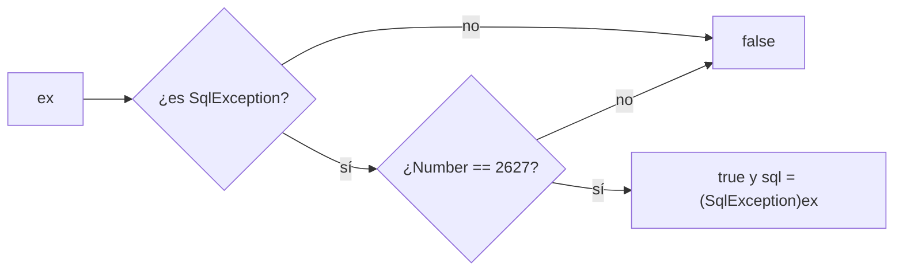

# Patrones de tipo y de propiedad en CSharp

Parte de: [[Pattern matching]]

> [!info] Cómo avanzar
> `progreso`: **pendiente** → **viendo** (estudiando) → **visto** (contestaste la autoevaluación sin abrir las respuestas) → **dominado** (hiciste el laboratorio o lo aplicaste de verdad).

## Contenido

### Qué es
- El **patrón de tipo** comprueba si un valor es de cierto tipo y, opcionalmente, lo guarda en una variable ya convertida: `o is string s`.
- El **patrón de propiedad** comprueba valores de propiedades o campos del objeto: `o is Pedido { Estado: "Pagado", Total: > 0 }`. Implica además que el objeto **no es nulo**.
- El **patrón de propiedad extendido** (C# 10) permite navegar propiedades anidadas con punto: `{ Cliente.Direccion.Estado: "Jalisco" }` en lugar de `{ Cliente: { Direccion: { Estado: "Jalisco" } } }`.

### Cómo funciona
**Patrón de tipo con declaración** (`is T variable`):
1. Si el valor es `null`, da `false`.
2. Si el valor es de tipo `T` (o derivado, o lo implementa), da `true` y asigna `variable` ya convertida.
3. La variable solo está "definitivamente asignada" en la rama donde el patrón fue verdadero; el compilador lo sabe y te deja usarla sin cast.

`object o = 5; o is int n && n > 3` → `o` contiene un `int` en caja, el patrón lo desempaca en `n = 5`, y `5 > 3`, así que es `true`.

**`is` frente a `as`**:
- `o as string` regresa el valor convertido o `null`. Solo funciona con tipos de referencia o anulables, y te obliga a revisar `null` después.
- `o is string s` hace la prueba y la conversión en una sola expresión, funciona con tipos de valor (`o is int n`), y el compilador garantiza que `s` no es nulo dentro del `if`.

**Patrón de propiedad**: `{ Prop: patrón, Otra: patrón }`. Cada propiedad se compara con un sub-patrón, que puede ser una constante, un relacional (`> 3`), otro patrón de propiedad o un `var` para extraer. `{ }` solo significa "no nulo". Puedes combinar tipo y propiedad y aun así declarar variable: `ex is SqlException { Number: 2627 } sql`.



### Ejemplo
```csharp
using Microsoft.Data.SqlClient;

// o es string de más de 3 caracteres
static bool EsTextoLargo(object? o) => o is string { Length: > 3 };

object o = 5;
Console.WriteLine(o is int n && n > 3);   // True

// Violación de llave única (2627) al insertar en SQL Server con Dapper
public sealed class CrearClienteHandler(IComandoCrearCliente comando)
{
    public async Task<Resultado> Handle(CrearCliente cmd, CancellationToken ct)
    {
        try
        {
            await comando.EjecutarAsync(cmd, ct);
            return Resultado.Ok();
        }
        catch (SqlException ex) when (ex is { Number: 2627 or 2601 })
        {
            return Resultado.Falla("duplicado", "Ya existe un cliente con ese RFC.");
        }
    }
}

// La forma con variable, útil si necesitas datos de la excepción
static string Explicar(Exception ex)
{
    if (ex is SqlException { Number: 2627 } sql)
        return $"Duplicado en servidor {sql.Server}: {sql.Message}";
    return ex.Message;
}

// Patrón de propiedad extendido (C# 10)
public sealed record Direccion(string Estado, string Cp);
public sealed record Cliente(string Nombre, Direccion Direccion);
public sealed record Pedido(Cliente Cliente, decimal Total);

static decimal Envio(Pedido p) => p switch
{
    { Total: >= 1_000m } => 0m,                               // envío gratis
    { Cliente.Direccion.Estado: "Jalisco" } => 59m,           // extendido
    { Cliente.Direccion.Cp: ['4', '5', ..] } => 79m,          // combinado con patrón de lista sobre string
    _ => 149m
};

// is vs as
static int LongitudConAs(object o)
{
    var s = o as string;          // null si no es string
    return s is null ? 0 : s.Length;
}
static int LongitudConIs(object o) => o is string s ? s.Length : 0;

// Tipos de apoyo
public interface IComandoCrearCliente { Task EjecutarAsync(CrearCliente cmd, CancellationToken ct); }
public sealed record CrearCliente(string Rfc, string Nombre);
public sealed record Resultado(bool Exito, string? Codigo, string? Mensaje)
{
    public static Resultado Ok() => new(true, null, null);
    public static Resultado Falla(string c, string m) => new(false, c, m);
}
```

### Cuándo usarlo y cuándo no
- **Patrón de tipo** en lugar de `as` + `if (x != null)` o de `if (x is T) { var y = (T)x; }`.
- **Patrón de propiedad** para condiciones sobre varios campos de un objeto (estado de un pedido, datos de una excepción, *claims* de un token).
- **Filtros de excepción** (`catch (SqlException ex) when (ex is { Number: 2627 })`) para atrapar solo lo que sabes manejar, sin perder la pila del resto.
- **No** encadenes diez propiedades en un patrón: si la regla es de negocio, dale nombre con un método o propiedad en el tipo.

### Errores comunes
1. **Usar `as` con tipos de valor** (`o as int`): no compila; usa `is int n` o `as int?`.
2. **Olvidar que el patrón de propiedad excluye `null`**: `p is { }` ya es "no nulo"; no necesitas `p != null &&`.
3. **Catch genérico de `SqlException`** que trata cualquier error como duplicado; filtra por `Number`.
4. **Usar la variable del patrón fuera de la rama** donde quedó asignada: el compilador lo marca como no asignada.

### Para profundizar
- [Patrones de declaración y de tipo](https://learn.microsoft.com/dotnet/csharp/language-reference/operators/patterns#declaration-and-type-patterns)
- [Patrón de propiedad](https://learn.microsoft.com/dotnet/csharp/language-reference/operators/patterns#property-pattern)
- [Errores del motor de SQL Server 2000 a 2999 (incluye 2627)](https://learn.microsoft.com/sql/relational-databases/errors-events/database-engine-events-and-errors-2000-to-2999)

## Ejercicios

Resuélvelos en papel o en la herramienta; la solución está plegada.

> [!question]- Escribe la condición: `o` es string de más de 3 caracteres.
> `o is string { Length: > 3 }`

> [!question]- ¿Qué da `object o = 5; o is int n && n > 3`?
> `true`, y `n` vale 5.

## Autoevaluación

Contesta primero en voz alta o en papel; luego despliega la respuesta.

> [!question]- ¿Qué hace `if (ex is SqlException { Number: 2627 } sql)`?
> Comprueba que sea `SqlException`, que `Number` sea 2627 y deja la variable `sql` tipada.

> [!question]- ¿Qué es un patrón de propiedad extendido?
> Acceder a propiedades anidadas con punto: `pedido is { Cliente.Pais: "MX" }`.

> [!question]- ¿Qué diferencia hay entre `o is string s` y `o as string`?
> `is string s` prueba y declara la variable en un paso; `as` regresa null si no es string y luego tienes que comprobar null aparte. Además `is` funciona con tipos de valor.

