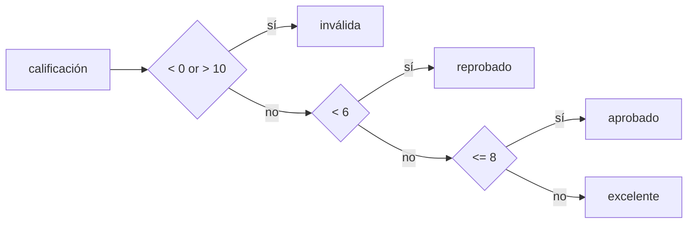

# Patrones relacionales y lógicos en CSharp

Parte de: [[Pattern matching]]

> [!info] Cómo avanzar
> `progreso`: **pendiente** → **viendo** (estudiando) → **visto** (contestaste la autoevaluación sin abrir las respuestas) → **dominado** (hiciste el laboratorio o lo aplicaste de verdad).

## Contenido

### Qué es
Introducidos en C# 9, permiten expresar condiciones sobre un valor **sin repetir el nombre de la variable**:
- **Relacionales**: `<`, `<=`, `>`, `>=` contra una constante: `n is > 0`, `c is >= 'a'`.
- **Lógicos**: `and`, `or` y `not` para combinar patrones: `n is >= 1 and <= 10`, `s is not null`, `codigo is "A" or "B"`.
- Se pueden **agrupar con paréntesis**: `c is (>= 'a' and <= 'z') or (>= 'A' and <= 'Z')`.

### Cómo funciona
Todos los patrones se aplican **al mismo valor de entrada**. `x is > 0 and < 10` significa "x es mayor que 0 y x es menor que 10". Las constantes deben conocerse en compilación (literales, `const`, valores de `enum`).

**Precedencia**: `not` se aplica primero, luego `and`, luego `or` (igual que `!`, `&&`, `||`). Por eso

`c is >= 'a' and <= 'z' or >= 'A' and <= 'Z'`

se lee como `(>= 'a' and <= 'z') or (>= 'A' and <= 'Z')`. Con `char c = 'q'` la primera mitad es verdadera, así que el resultado es `true`. Aunque la precedencia ya lo resuelve, los paréntesis ayudan a quien lee.

**`not null` frente a `!= null`**: `is not null` es un patrón y **ignora** cualquier `operator !=` sobrecargado; siempre compara la referencia real. `!= null` llama al operador del tipo si existe. Además `is not null` se combina con otros patrones (`is not null and { Count: > 0 }`) y el análisis de nulabilidad lo entiende igual de bien.

**Exhaustividad**: en una *switch expression*, el compilador analiza los rangos y te avisa (CS8509) si quedan valores sin cubrir, o te marca error si un brazo es inalcanzable porque los anteriores ya lo cubren.



### Ejemplo
```csharp
// Clasificar una calificación (escala 0 a 10)
static string Clasificar(int c) => c switch
{
    < 0 or > 10 => "inválida",      // primero lo que está fuera de rango
    < 6         => "reprobado",     // 0..5
    <= 8        => "aprobado",      // 6..8
    _           => "excelente"      // 9..10
};
// Clasificar(5) -> reprobado, Clasificar(7) -> aprobado, Clasificar(10) -> excelente, Clasificar(11) -> inválida

// Letras ASCII
char c = 'q';
bool esLetra = c is (>= 'a' and <= 'z') or (>= 'A' and <= 'Z'); // true

// "ni nulo ni vacío" para una lista
static bool TieneElementos(List<int>? lista) => lista is not null and { Count: > 0 };
// o con patrón de lista (C# 11):
static bool TieneElementos2(List<int>? lista) => lista is [_, ..];

// Rangos para tarifas o descuentos (decimal acepta constantes literales)
static decimal Descuento(decimal total) => total switch
{
    >= 10_000m => 0.10m,
    >= 5_000m  => 0.05m,
    > 0m       => 0m,
    _          => throw new ArgumentOutOfRangeException(nameof(total))
};

// not con tipos y constantes
static bool EsEstadoFinal(string? estado) => estado is "Entregado" or "Cancelado";
static bool EsEditable(string? estado) => estado is not ("Entregado" or "Cancelado") and not null;

// Fechas: las constantes deben ser de compilación, así que se comparan partes
static string Trimestre(DateOnly f) => f.Month switch
{
    <= 3 => "T1", <= 6 => "T2", <= 9 => "T3", _ => "T4"
};
```

### Cuándo usarlo y cuándo no
- **Úsalos** para rangos y listas de valores permitidos: tarifas, estados, códigos HTTP (`status is >= 200 and < 300`), validaciones de entrada.
- **Ordena los brazos** de lo más restrictivo a lo más general; así cada brazo puede escribirse de forma corta (`< 6`, `<= 8`).
- **No sirven** con valores calculados en ejecución (`> limiteConfigurado`): ahí usa `when` (`n when n > limite`) o un `if` normal.
- Para reglas que cambian por configuración o negocio, mejor una tabla de datos que constantes en el código.

### Errores comunes
1. **Confundir precedencia** y escribir `not "A" or "B"` (que es `(not "A") or "B"`, casi siempre `true`); usa `not ("A" or "B")`.
2. **Huecos en los rangos** (`< 6` y `> 6` olvidan el 6); el compilador avisa en *switch expressions* pero no en cadenas de `is`.
3. **Usar `!= null`** con tipos que sobrecargan el operador.
4. **Comparar `double` con rangos exactos** y olvidar `NaN`: `double.NaN is > 0 or <= 0` es `false`.

### Para profundizar
- [Patrones relacionales](https://learn.microsoft.com/dotnet/csharp/language-reference/operators/patterns#relational-patterns)
- [Patrones lógicos (and, or, not)](https://learn.microsoft.com/dotnet/csharp/language-reference/operators/patterns#logical-patterns)
- [Novedades de C# 9](https://learn.microsoft.com/dotnet/csharp/whats-new/csharp-9)

## Ejercicios

Resuélvelos en papel o en la herramienta; la solución está plegada.

> [!question]- Clasifica una calificación: <6 "reprobado", 6–8 "aprobado", 9–10 "excelente", resto "inválida".
> ```csharp
> string c = n switch {
>     < 0 or > 10 => "inválida",
>     < 6 => "reprobado",
>     <= 8 => "aprobado",
>     _ => "excelente"
> };
> ```

> [!question]- ¿`char c = 'q'; c is >= 'a' and <= 'z' or >= 'A' and <= 'Z'` es true?
> `true` (`and` tiene mayor precedencia que `or`).

## Autoevaluación

Contesta primero en voz alta o en papel; luego despliega la respuesta.

> [!question]- ¿Qué son?
> Relacionales: `< > <= >=` contra constantes. Lógicos: `and`, `or`, `not` para combinarlos: `x is >= 0 and < 10`.

> [!question]- ¿Qué diferencia hay entre `not null` y `!= null` en un patrón?
> `is not null` es un patrón y no usa sobrecargas de operadores.

> [!question]- ¿Cómo se escribe "ni nulo ni vacío" para una lista con patrones?
> `lista is { Count: > 0 }` (si es null no coincide, porque el patrón de propiedad exige no nulo).

