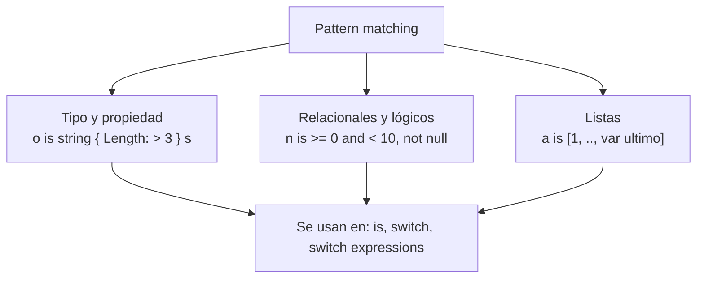

# Pattern matching

Parte de: [[03-CSharp-DotNet/03 Intermedio/_Índice Intermedio|Intermedio]]

> [!info] Cómo avanzar
> `progreso`: **pendiente** → **viendo** (estudiando) → **visto** (contestaste la autoevaluación sin abrir las respuestas) → **dominado** (hiciste el laboratorio o lo aplicaste de verdad).

## Contenido

### Qué es
El **pattern matching** (coincidencia de patrones) es la capacidad de C# de **probar si un valor tiene cierta forma** y, al mismo tiempo, **extraer** partes de él en variables. "¿Es un `string` de más de 3 caracteres?", "¿es una `SqlException` con número 2627?", "¿es un arreglo que empieza con 1?". Se usa con `is`, con la sentencia `switch` y con las [[switch expressions]].

Ha crecido versión tras versión: patrones de tipo (C# 7), de propiedad y posicionales (C# 8), relacionales y lógicos (C# 9), de propiedad extendidos (C# 10) y de lista (C# 11).

### Cómo funciona
Un patrón se evalúa contra un valor de entrada y da `true` o `false`; si da `true`, las variables declaradas en el patrón quedan asignadas (y el compilador sabe que son no nulas y del tipo correcto). Los patrones se **combinan**: puedes poner un patrón de propiedad dentro de uno de tipo, con relacionales dentro.



Cada familia tiene su nota con el detalle:
- [[Patrones de tipo y de propiedad en CSharp]]: comprobar el tipo, declarar la variable y revisar propiedades (`is SqlException { Number: 2627 }`).
- [[Patrones relacionales y lógicos en CSharp]]: rangos (`>= 6 and <= 8`), negación (`not null`) y combinaciones con `and`/`or`.
- [[Patrones de lista en CSharp]]: forma de arreglos y listas (`[]`, `[var x]`, `[var primero, ..]`).

**`x is null` frente a `x == null`**: `==` puede estar **sobrecargado** por el tipo (ver [[Sobrecarga de operadores]]); una implementación rara o con errores puede decir que un objeto real "es igual a null" o lanzar una excepción. `is null` **ignora** cualquier sobrecarga y hace la comprobación de referencia real, siempre. Lo mismo `is not null`. Además se lee bien y funciona con patrones más grandes (`is not null and { Activo: true }`).

### Ejemplo
Dónde aparece más en una API: traducir excepciones y resultados a respuestas HTTP, validar entradas y decidir flujos.

```csharp
using Microsoft.AspNetCore.Mvc;
using Microsoft.Data.SqlClient;

public static class MapeoErrores
{
    // Traducir excepciones de SQL Server a ProblemDetails con 'codigo'
    public static ProblemDetails AProblema(Exception ex) => ex switch
    {
        SqlException { Number: 2627 or 2601 } => Problema(409, "duplicado", "El registro ya existe."),
        SqlException { Number: 547 }          => Problema(409, "referencia", "Hay datos relacionados."),
        OperationCanceledException            => Problema(499, "cancelado", "La petición se canceló."),
        ArgumentException { ParamName: { } p } => Problema(400, "validacion", $"Parámetro inválido: {p}"),
        _                                     => Problema(500, "error_interno", "Ocurrió un error.")
    };

    private static ProblemDetails Problema(int status, string codigo, string detalle)
    {
        var pd = new ProblemDetails { Status = status, Title = detalle };
        pd.Extensions["codigo"] = codigo;
        return pd;
    }
}

public sealed record Resultado<T>(T? Valor, string? Codigo);

public static class Ejemplos
{
    // is null / is not null y extracción en una sola expresión
    public static string Describir(object? o)
    {
        if (o is null) return "nulo";
        if (o is string { Length: > 3 } s) return $"texto largo: {s}";
        if (o is int[] [var primero, ..]) return $"arreglo que empieza en {primero}";
        if (o is decimal and >= 0 and < 1000) return "monto chico";
        return o.GetType().Name;
    }
}
```

Lugares típicos en tus proyectos: el `IExceptionHandler` global (ver [[Manejo global de errores (IExceptionHandler)]]), traducir el `codigo` de un `Result` a status HTTP, revisar *claims* en Xolotl.Hecate (`user.FindFirst("scope") is { Value: var v }`), y validar formas de datos en FluentValidation con `Must(x => x is { Length: > 0 })`.

### Cuándo usarlo y cuándo no
- **Úsalo** cuando la lógica depende de la **forma** o del **tipo** del dato, y para reemplazar cadenas de `if`/`as`/casts.
- **Prefiere polimorfismo** (métodos virtuales o interfaces) cuando tú controlas la jerarquía y el comportamiento pertenece a cada tipo; un `switch` por tipo que crece cada vez que agregas una clase es una señal de diseño.
- **Evita patrones gigantes anidados** de difícil lectura; extrae métodos o propiedades con nombre (`EsClienteVip`).

### Errores comunes
1. **Usar `== null`** en tipos con `==` sobrecargado y obtener resultados inesperados.
2. **Orden de los brazos**: el primero que coincide gana; un caso general antes de uno específico lo oculta (el compilador marca error si es inalcanzable por completo).
3. **Olvidar el descarte `_`** en una *switch expression* y recibir `SwitchExpressionException` en tiempo de ejecución.
4. **Confundir `and`/`or` de patrones con `&&`/`||`**: los primeros solo combinan patrones contra el mismo valor.

### Para profundizar
- [Pattern matching en C# (información general)](https://learn.microsoft.com/dotnet/csharp/fundamentals/functional/pattern-matching)
- [Patrones (referencia del lenguaje)](https://learn.microsoft.com/dotnet/csharp/language-reference/operators/patterns)
- [Operador is](https://learn.microsoft.com/dotnet/csharp/language-reference/operators/is)

## Subtemas

- [[Patrones de tipo y de propiedad en CSharp]]
- [[Patrones relacionales y lógicos en CSharp]]
- [[Patrones de lista en CSharp]]

## Autoevaluación

Contesta primero en voz alta o en papel; luego despliega la respuesta.

> [!question]- ¿Qué es pattern matching en C#?
> Probar la forma de un valor (tipo, propiedades, rangos, listas) y extraer partes en la misma expresión, con `is`, `switch` y `switch` expressions.

> [!question]- ¿Por qué `x is null` es preferible a `x == null`?
> No depende de un `==` sobrecargado y expresa la intención.

> [!question]- ¿Dónde se usa más en una API?
> Para traducir un `Result` o una excepción a una respuesta: `error switch { NoEncontrado => 404, Conflicto => 409, _ => 500 }`.

## Progreso de los subtemas

```base
filters:
  and:
    - file.inFolder("03-CSharp-DotNet/03 Intermedio/Pattern matching")
    - file.name != "Pattern matching"
views:
  - type: table
    name: Progreso
    order:
      - file.name
      - progreso
      - nivel
```
