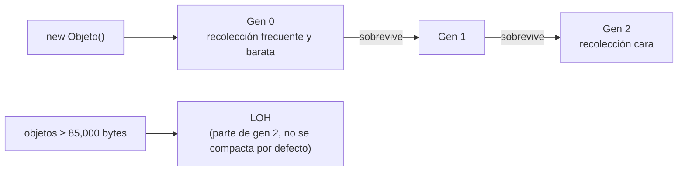

# Recolector de basura

Parte de: [[03-CSharp-DotNet/03 Intermedio/_Índice Intermedio|Intermedio]]

> [!info] Cómo avanzar
> `progreso`: **pendiente** → **viendo** (estudiando) → **visto** (contestaste la autoevaluación sin abrir las respuestas) → **dominado** (hiciste el laboratorio o lo aplicaste de verdad).

## Contenido

### Qué es
El **recolector de basura** (GC, *garbage collector*) es el componente del runtime de .NET que **libera automáticamente la memoria administrada** que ya no se usa. Tú creas objetos con `new` y nunca los liberas a mano; el GC detecta cuáles ya no son alcanzables y recupera su espacio. Evita fugas típicas de C/C++ (olvidar `free`, liberar dos veces), pero no es gratis ni lo resuelve todo: solo maneja **memoria**, no otros recursos.

### Cómo funciona
**¿Cómo decide qué liberar? Por alcanzabilidad**, no por "tiempo sin usarse":
1. Parte de las **raíces**: variables locales y parámetros en las pilas de los hilos activos, campos `static`, *handles* del GC y registros del CPU.
2. **Marca** todo objeto alcanzable siguiendo referencias desde esas raíces.
3. Todo lo no marcado es basura: se **barre** y, normalmente, se **compacta** (mueve los objetos vivos juntos para eliminar huecos y que las nuevas asignaciones sean rápidas).

**Generaciones**: la observación clave es que la mayoría de los objetos muere joven (DTOs de una petición, strings temporales). El heap se divide en:
- **Gen 0**: objetos recién creados. Se recolecta muy seguido y es muy barato.
- **Gen 1**: los que sobrevivieron una recolección; zona de amortiguamiento.
- **Gen 2**: objetos de larga vida (singletons, cachés). Su recolección es la más cara.
Un objeto que sobrevive sube de generación. Las recolecciones de gen 0 son rápidas porque solo revisan lo joven.

**LOH (*Large Object Heap*)**: los objetos de **85,000 bytes o más** (arreglos grandes, strings enormes, `byte[]` de archivos) van a un heap aparte que lógicamente pertenece a gen 2. Por defecto **no se compacta** (mover objetos grandes es caro), así que puede fragmentarse; y como solo se limpia en recolecciones de gen 2, asignar muchos objetos grandes temporales provoca recolecciones caras. Por eso conviene leer archivos en streaming y reutilizar buffers (`ArrayPool<T>`).

**Modos**: *workstation* (apps de escritorio) y *server* (ASP.NET Core por defecto: un heap por núcleo, más rendimiento). Desde .NET 9, el server GC usa por defecto **DATAS**, que ajusta dinámicamente el número de heaps según la carga para usar menos memoria en contenedores (ver [[Allocations y modos del GC]]).



**¿Debes llamar `GC.Collect()`?** Casi nunca. El GC tiene heurísticas mucho mejores que una llamada manual; forzarlo detiene la app, **promueve** objetos vivos a generaciones más altas (haciéndolos más caros de recolectar después) y suele empeorar el rendimiento. Excepciones raras: pruebas de memoria o benchmarks, o justo después de liberar una estructura enorme en un momento de inactividad, y aun así medido.

**¿Libera el GC una conexión a SQL?** No de forma útil. El GC libera la **memoria** del objeto `SqlConnection`, pero la conexión física (el socket, la sesión en SQL Server, el lugar en el *pool*) es un recurso **no administrado** que se libera con `Dispose`/`Close`. Si no llamas `Dispose`, la conexión queda ocupada hasta que, algún día, un finalizador corra; bajo carga el *pool* se agota y aparecen *timeouts* (ver [[IDisposable y using]] y [[Connection pooling]]).

### Ejemplo
```csharp
using System.Buffers;

// Fuga lógica: el GC no puede liberar lo que sigue siendo alcanzable
public static class CacheIngenua
{
    // Campo static = raíz; todo lo que se agrega vive para siempre
    private static readonly Dictionary<string, byte[]> _archivos = [];
    public static void Guardar(string clave, byte[] datos) => _archivos[clave] = datos;
}
// Solución: IMemoryCache con expiración y límite de tamaño.

// Reducir presión sobre el LOH reutilizando buffers
public static async Task<long> CopiarAsync(Stream origen, Stream destino, CancellationToken ct)
{
    byte[] buffer = ArrayPool<byte>.Shared.Rent(81_920);   // menos de 85,000: no va al LOH
    try
    {
        long total = 0;
        int leidos;
        while ((leidos = await origen.ReadAsync(buffer, ct)) > 0)
        {
            await destino.WriteAsync(buffer.AsMemory(0, leidos), ct);
            total += leidos;
        }
        return total;
    }
    finally
    {
        ArrayPool<byte>.Shared.Return(buffer);
    }
}

// Observar el GC (útil en diagnóstico, no en lógica de negocio)
Console.WriteLine($"Gen0: {GC.CollectionCount(0)}, Gen1: {GC.CollectionCount(1)}, Gen2: {GC.CollectionCount(2)}");
Console.WriteLine($"Memoria administrada: {GC.GetTotalMemory(false) / 1024 / 1024} MB");
```

En producción, observa el GC con [[dotnet-counters]] (`% Time in GC`, tamaño de cada generación, conteo de recolecciones) en lugar de adivinar.

### Cuándo usarlo y cuándo no
- **Confía en el GC** para la memoria y enfócate en **no generar basura innecesaria** en rutas calientes: menos asignaciones, buffers reutilizados, `Span<T>`, `StringBuilder`.
- **Usa `Dispose`** para todo recurso que no sea memoria: conexiones, archivos, sockets, timers.
- **Revisa raíces inesperadas** cuando la memoria crece: campos estáticos, cachés sin límite, eventos no desuscritos (ver [[Events]]), singletons que guardan objetos scoped.
- **No** escribas finalizadores (`~Clase()`) salvo que manejes recursos nativos directamente; retrasan la liberación y cuestan rendimiento.

### Errores comunes
1. **Llamar `GC.Collect()`** "para liberar memoria": empeora el rendimiento.
2. **Confiar en el GC para cerrar conexiones o archivos**: agotamiento del pool, archivos bloqueados.
3. **Fugas lógicas**: colecciones estáticas que solo crecen, eventos sin `-=`.
4. **Asignar arreglos grandes temporales** en cada petición (leer archivos completos): presión en el LOH y recolecciones de gen 2.

### Para profundizar
- [Fundamentos de la recolección de elementos no utilizados](https://learn.microsoft.com/dotnet/standard/garbage-collection/fundamentals)
- [El montón de objetos grandes (LOH)](https://learn.microsoft.com/dotnet/standard/garbage-collection/large-object-heap)
- [Opciones de configuración del GC (DATAS, server, workstation)](https://learn.microsoft.com/dotnet/core/runtime-config/garbage-collector)

## Autoevaluación

Contesta primero en voz alta o en papel; luego despliega la respuesta.

> [!question]- ¿Cómo decide el GC qué liberar?
> Marca los objetos alcanzables desde raíces (variables locales, estáticos, handles) y libera el resto. Es generacional: Gen0 (nuevos), Gen1 y Gen2 (sobrevivientes).

> [!question]- ¿Qué es el LOH?
> Large Object Heap: objetos de 85 000 bytes o más. Se recolecta con Gen2 y no se compacta por defecto, así que los arrays grandes repetidos causan fragmentación. Usa `ArrayPool<T>`.

> [!question]- ¿Debes llamar `GC.Collect()`?
> Casi nunca: interrumpe la heurística del GC y empeora el rendimiento. Primero mide con dotnet-counters.

> [!question]- ¿Libera el GC una conexión a SQL?
> Libera la memoria del objeto en algún momento, pero no a tiempo: la conexión física queda tomada del pool. Por eso `using`.

