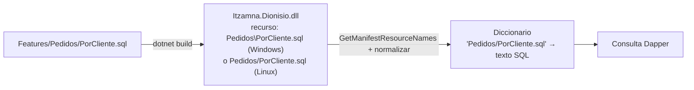

# Recursos embebidos (EmbeddedResource)

Parte de: [[03-CSharp-DotNet/03 Intermedio/_Índice Intermedio|Intermedio]]

> [!info] Cómo avanzar
> `progreso`: **pendiente** → **viendo** (estudiando) → **visto** (contestaste la autoevaluación sin abrir las respuestas) → **dominado** (hiciste el laboratorio o lo aplicaste de verdad).

## Contenido

### Qué es
Un **recurso embebido** es un archivo (un `.sql`, una plantilla de correo, un JSON de catálogos, una imagen) que se **incrusta dentro del ensamblado** (`.dll`) al compilar. En ejecución lo lees como un `Stream` desde el propio ensamblado, sin depender de que el archivo exista en disco junto a la app. En tus proyectos es la pieza que hace funcionar el patrón de [[SQL en archivos con una interfaz por consulta]]: cada `.sql` viaja dentro de la DLL.

### Cómo funciona
1. **Declaración en el `.csproj`** con el elemento `EmbeddedResource`. Puedes usar comodines para incluir todos los `.sql` de una carpeta y sus subcarpetas.
2. **Nombre del recurso**: cada recurso tiene un *manifest resource name*.
   - **Sin `LogicalName`**, MSBuild lo arma así: `RootNamespace` + ruta relativa con las carpetas separadas por **puntos** + nombre del archivo. `Features/Pedidos/PorCliente.sql` en un proyecto con `RootNamespace` `Itzamna.Dionisio` queda como `Itzamna.Dionisio.Features.Pedidos.PorCliente.sql`. Ojo: los nombres de carpeta que no son identificadores válidos se transforman (por ejemplo, una carpeta que empieza con número recibe un guion bajo), así que ese nombre es frágil.
   - **Con `LogicalName`** decides tú el nombre exacto, por ejemplo la ruta relativa: `%(RecursiveDir)%(Filename)%(Extension)`.
3. **Lectura**: `Assembly.GetManifestResourceStream(nombre)` regresa el `Stream` (o `null` si el nombre no existe); `GetManifestResourceNames()` lista todos.

**Por qué normalizar `\` a `/`**: `%(RecursiveDir)` usa el **separador del sistema operativo donde se compila**. Si compilas en Windows queda `Pedidos\PorCliente.sql`; en un agente Linux de Azure DevOps o en un contenedor Docker queda `Pedidos/PorCliente.sql`. Si tu código busca uno de los dos, funcionará en tu PC y fallará en el pipeline (o al revés). Normalizando al cargar (reemplazar `\` por `/` en todos los nombres) obtienes claves estables en cualquier plataforma.



### Ejemplo
```xml
<!-- Itzamna.Dionisio.csproj -->
<ItemGroup>
  <EmbeddedResource Include="Features\**\*.sql"
                    LogicalName="%(RecursiveDir)%(Filename)%(Extension)" />
</ItemGroup>
```

```csharp
using System.Collections.Frozen;
using System.Reflection;

public interface ILectorSql { string Leer(string ruta); }

// Singleton: carga todos los .sql una vez al arrancar
public sealed class LectorSqlEmbebido : ILectorSql
{
    private readonly FrozenDictionary<string, string> _sentencias;

    public LectorSqlEmbebido(Assembly ensamblado)
    {
        _sentencias = ensamblado.GetManifestResourceNames()
            .Where(n => n.EndsWith(".sql", StringComparison.OrdinalIgnoreCase))
            .ToFrozenDictionary(
                n => n.Replace('\\', '/'),                 // misma clave en Windows y Linux
                n => LeerTexto(ensamblado, n),
                StringComparer.OrdinalIgnoreCase);
    }

    public string Leer(string ruta) =>
        _sentencias.TryGetValue(ruta.Replace('\\', '/'), out var sql)
            ? sql
            : throw new InvalidOperationException($"No existe el recurso SQL '{ruta}'. ¿Está como EmbeddedResource?");

    private static string LeerTexto(Assembly a, string nombre)
    {
        using var stream = a.GetManifestResourceStream(nombre)
            ?? throw new InvalidOperationException($"Recurso {nombre} no encontrado");
        using var lector = new StreamReader(stream);
        return lector.ReadToEnd();
    }
}

// Program.cs
// builder.Services.AddSingleton<ILectorSql>(new LectorSqlEmbebido(typeof(Program).Assembly));
```

Una prueba unitaria sencilla que recorra todas tus interfaces de consulta y verifique que `Leer(...)` encuentra su archivo detecta de inmediato un `.sql` que se te olvidó incluir o renombraste.

### Cuándo usarlo y cuándo no
- **Úsalo** para archivos que son parte del **código** y deben versionarse con él: SQL, plantillas, esquemas JSON, catálogos fijos, datos semilla.
- **No** lo uses para lo que cambia sin recompilar (configuración por entorno, plantillas editables por negocio): eso va en `appsettings`, Azure App Configuration, la BD o Blob Storage.
- **No** para secretos: cualquiera con la DLL puede extraer el recurso.
- **Alternativa**: `CopyToOutputDirectory` deja los archivos sueltos junto a la DLL; es más fácil de inspeccionar, pero depende del despliegue (y de rutas, ver [[Manejo de archivos y streams]]).

### Errores comunes
1. **Olvidar declarar el archivo como `EmbeddedResource`**: compila bien y falla en ejecución con "recurso no encontrado".
2. **Depender del nombre por defecto** con puntos y carpetas transformadas: cambia si renombras el namespace o una carpeta.
3. **No normalizar separadores** y fallar solo en el pipeline Linux.
4. **Leer el recurso en cada petición**: cárgalo una vez (singleton) y cachea el texto.
5. **Codificación**: guarda los `.sql` en UTF-8 para que acentos y `ñ` en comentarios o literales no se corrompan.

### Para profundizar
- [Elementos comunes de proyectos de MSBuild (EmbeddedResource)](https://learn.microsoft.com/visualstudio/msbuild/common-msbuild-project-items#embeddedresource)
- [Assembly.GetManifestResourceStream (referencia de API)](https://learn.microsoft.com/dotnet/api/system.reflection.assembly.getmanifestresourcestream)
- [Metadatos de elementos conocidos de MSBuild (RecursiveDir)](https://learn.microsoft.com/visualstudio/msbuild/msbuild-well-known-item-metadata)

## Autoevaluación

Contesta primero en voz alta o en papel; luego despliega la respuesta.

> [!question]- ¿Cómo incrustas tus `.sql` en el ensamblado?
> En el `.csproj`:
> ```xml
> <ItemGroup>
>   <EmbeddedResource Include="Persistence\Sql\**\*.sql" LogicalName="Sql/%(RecursiveDir)%(Filename)%(Extension)" />
> </ItemGroup>
> ```

> [!question]- ¿Cómo los lees?
> `asm.GetManifestResourceStream(nombre)` y un `StreamReader`. `GetManifestResourceNames()` lista todos.

> [!question]- ¿Por qué normalizar `\` a `/` en el nombre?
> En Windows `%(RecursiveDir)` usa diagonal invertida; si no normalizas, el nombre cambia según el sistema donde compilas.

> [!question]- ¿Qué nombre recibe un recurso sin `LogicalName`?
> `EspacioRaiz.Carpeta.Subcarpeta.Archivo.sql` (con puntos), lo que hace ambigua la ruta.

## Práctica

- [[Lab 4 - Registro automático de sentencias SQL por reflexión]]

