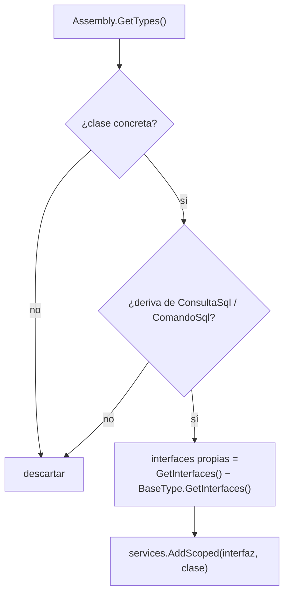

# Reflexión

Parte de: [[03-CSharp-DotNet/03 Intermedio/_Índice Intermedio|Intermedio]]

> [!info] Cómo avanzar
> `progreso`: **pendiente** → **viendo** (estudiando) → **visto** (contestaste la autoevaluación sin abrir las respuestas) → **dominado** (hiciste el laboratorio o lo aplicaste de verdad).

## Contenido

### Qué es
La **reflexión** (*reflection*) es la capacidad de un programa .NET de **inspeccionarse a sí mismo en tiempo de ejecución**: listar los tipos de un ensamblado, ver qué interfaces implementa una clase, leer sus propiedades y [[Atributos]], crear instancias o invocar métodos sin conocerlos en compilación. Vive en `System.Reflection` y empieza casi siempre con un objeto `Type` (`typeof(T)`, `obj.GetType()`) o un `Assembly`.

### Cómo funciona
Cada ensamblado guarda **metadatos** que describen todos sus tipos y miembros. La API de reflexión los expone como objetos:
- `Assembly` → `GetTypes()`, `GetManifestResourceNames()`.
- `Type` → `GetInterfaces()`, `GetProperties()`, `GetMethods()`, `BaseType`, `IsAbstract`, `IsGenericType`, `GetCustomAttribute<T>()`.
- `PropertyInfo`, `MethodInfo`, `ConstructorInfo` → `GetValue`, `Invoke`.
- `Activator.CreateInstance(tipo)` para crear objetos.

**Cómo funciona un `AddSentenciasSql()`** (registro automático de consultas en tus proyectos): al arrancar la app, el método de extensión recorre los tipos del ensamblado, se queda con las **clases concretas** que implementan interfaces de consulta o comando (por ejemplo, las que derivan de `ConsultaSql<,>`/`ComandoSql<>` o implementan una interfaz marcadora), y por cada una registra en DI "interfaz propia → implementación". Así, al agregar una consulta nueva (su `.sql`, su interfaz y su clase) no tienes que tocar `Program.cs`.

**Interfaces "propias" de una clase**: `GetInterfaces()` regresa **todas**, incluidas las heredadas de la clase base y las genéricas de infraestructura (`IConsultaSql<TCampos, TFila>`). Para quedarte con las que la clase declara de verdad, resta las de su base: `t.GetInterfaces().Except(t.BaseType?.GetInterfaces() ?? [])`. Otra opción es filtrar por convención (las que no son genéricas, o las que viven en tu namespace, o las marcadas con un atributo).



### Ejemplo
```csharp
using System.Reflection;
using Microsoft.Extensions.DependencyInjection;

public interface ISentenciaSql { }                      // marcador de infraestructura
public abstract class ConsultaSql<TCampos, TFila> : ISentenciaSql { }

public interface IPedidosPorCliente { }                 // interfaz "propia"
public sealed class PedidosPorCliente : ConsultaSql<int, string>, IPedidosPorCliente { }

public static class SentenciasSqlExtensions
{
    public static IServiceCollection AddSentenciasSql(this IServiceCollection services, Assembly ensamblado)
    {
        var tipos = ensamblado.GetTypes()
            .Where(t => t is { IsClass: true, IsAbstract: false }
                        && typeof(ISentenciaSql).IsAssignableFrom(t));

        foreach (var clase in tipos)
        {
            var heredadas = clase.BaseType?.GetInterfaces() ?? [];
            var propias = clase.GetInterfaces().Except(heredadas);

            foreach (var interfaz in propias)
                services.AddScoped(interfaz, clase);     // IPedidosPorCliente -> PedidosPorCliente
        }
        return services;
    }
}

// Program.cs
// builder.Services.AddSentenciasSql(typeof(Program).Assembly);

// Otras operaciones comunes
var tipo = typeof(PedidosPorCliente);
Console.WriteLine(tipo.BaseType!.IsGenericType);                         // True
Console.WriteLine(tipo.BaseType.GetGenericTypeDefinition() == typeof(ConsultaSql<,>)); // True
foreach (var p in typeof(Uri).GetProperties().Take(3)) Console.WriteLine(p.Name);
```

Una prueba de arquitectura (ver [[Pruebas de reglas de arquitectura (NetArchTest)]]) o una prueba de integración que resuelva cada interfaz registrada desde el contenedor te protege de que una consulta quede sin registrar.

### Cuándo usarlo y cuándo no
- **Úsala al arrancar**: escaneo de ensamblados para DI, descubrimiento de *handlers*, validadores (`AddValidatorsFromAssembly` de FluentValidation lo hace así), lectura de atributos de configuración.
- **Evítala en cada petición**: invocar métodos o leer propiedades por reflexión es mucho más lento que una llamada directa. Si la necesitas en caliente, cachea los `MethodInfo`/delegados compilados.
- **Costos y riesgos**: es lenta en comparación con código directo; se rompe en silencio con renombres (no hay verificación en compilación); puede saltarse el encapsulamiento (acceder a privados); y es **incompatible o problemática con *trimming* y Native AOT**, porque el *linker* no sabe qué tipos vas a usar y puede eliminarlos (ver [[Native AOT y rendimiento]]).
- **Alternativas**: registro explícito, *source generators* que generan el código de registro en compilación (ver [[Source generators y GeneratedRegex]]), o librerías como Scrutor que encapsulan el escaneo.

### Errores comunes
1. **Registrar también la interfaz genérica de infraestructura** (`IConsultaSql<,>`) por no filtrar las interfaces heredadas: errores de resolución ambiguos o registros duplicados.
2. **Incluir clases abstractas o genéricas abiertas** en el escaneo: `AddScoped` falla o registra algo imposible de construir.
3. **Reflexión por petición** sin caché: latencia y asignaciones extra.
4. **Escanear el ensamblado equivocado** (`Assembly.GetExecutingAssembly()` en una librería distinta a la que contiene las consultas).
5. **Publicar con AOT o trimming** sin anotar (`[DynamicallyAccessedMembers]`) y perder tipos en producción.

### Para profundizar
- [Reflexión en .NET](https://learn.microsoft.com/dotnet/fundamentals/reflection/reflection)
- [Ver información de tipos con reflexión](https://learn.microsoft.com/dotnet/fundamentals/reflection/viewing-type-information)
- [Preparar librerías para trimming](https://learn.microsoft.com/dotnet/core/deploying/trimming/prepare-libraries-for-trimming)

## Autoevaluación

Contesta primero en voz alta o en papel; luego despliega la respuesta.

> [!question]- ¿Qué es la reflexión?
> Inspeccionar tipos en ejecución: listar clases de un ensamblado, leer atributos, crear instancias o invocar miembros (`typeof`, `Assembly.GetTypes`, `Activator.CreateInstance`).

> [!question]- ¿Cómo funciona `AddSentenciasSql()` en tus proyectos?
> Recorre los tipos del ensamblado, toma las clases concretas que implementan `ISentenciaSql` y las registra como singleton por su clase y por su interfaz propia.

> [!question]- ¿Qué costos y riesgos tiene?
> Es más lenta que el código directo (hazla al arrancar, no por petición) y el *trimming* o Native AOT pueden eliminar tipos que solo se usan por reflexión. Un source generator evita ambos.

> [!question]- ¿Cómo encuentras las interfaces "propias" de una clase por reflexión?
> `tipo.GetInterfaces().Where(i => typeof(ISentenciaSql).IsAssignableFrom(i) && i != typeof(ISentenciaSql))`, filtrando también las genéricas base.

## Práctica

- [[Lab 4 - Registro automático de sentencias SQL por reflexión]]

