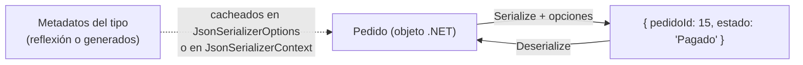

# Serialización con System.Text.Json

Parte de: [[03-CSharp-DotNet/03 Intermedio/_Índice Intermedio|Intermedio]]

> [!info] Cómo avanzar
> `progreso`: **pendiente** → **viendo** (estudiando) → **visto** (contestaste la autoevaluación sin abrir las respuestas) → **dominado** (hiciste el laboratorio o lo aplicaste de verdad).

## Contenido

### Qué es
**System.Text.Json** (STJ) es el serializador JSON incluido en .NET y el que usa ASP.NET Core por defecto para leer los cuerpos de las peticiones (`[FromBody]`) y escribir las respuestas. Convierte objetos .NET a JSON (`JsonSerializer.Serialize`) y JSON a objetos (`Deserialize<T>`), con énfasis en rendimiento, bajo uso de memoria y seguridad (por defecto es estricto).

### Cómo funciona
**Opciones**: todo el comportamiento se controla con `JsonSerializerOptions`: nombres de propiedades, sensibilidad a mayúsculas, enums, nulos, números, convertidores.

**Valores por defecto de ASP.NET Core** (los llamados *web defaults*, disponibles también como `JsonSerializerOptions.Web` desde .NET 9):
- Nombres en **camelCase** (`PedidoId` → `pedidoId`).
- Lectura **sin distinguir mayúsculas** en los nombres de propiedad.
- Se permite leer **números escritos como texto** (`"12"` → `12`).
Fuera de ASP.NET Core, `JsonSerializer` "a secas" usa los nombres tal cual (PascalCase) y distingue mayúsculas, lo cual causa sorpresas al probar.

**Caché de metadatos**: la primera vez que serializas un tipo con unas opciones, STJ analiza el tipo (por reflexión) y guarda el resultado **dentro de esa instancia de `JsonSerializerOptions`**. Si creas `new JsonSerializerOptions()` en cada llamada, repites ese análisis cada vez: más CPU, más asignaciones y, en casos extremos, crecimiento de memoria. Crea las opciones **una vez** (campo `static readonly` o configuradas en DI) y reutilízalas. Además, una instancia se vuelve inmutable después del primer uso.

**Personalización** por atributos:
- `[JsonPropertyName("rfc_cliente")]` cambia el nombre de una propiedad.
- `[JsonIgnore]` la omite; `[JsonIgnore(Condition = JsonIgnoreCondition.WhenWritingNull)]` solo si es nula.
- `[JsonConverter(typeof(JsonStringEnumConverter<Estado>))]` o el convertidor global `JsonStringEnumConverter` serializan **enums como texto** (`"Pagado"` en lugar de `2`).
- `[JsonRequired]` o `required` hacen obligatoria una propiedad al deserializar.

**Source generation** (`JsonSerializerContext`): un *source generator* (ver [[Source generators y GeneratedRegex]]) genera en compilación los metadatos y el código de serialización de los tipos que declares. Sin reflexión en ejecución: arranque más rápido, menos memoria, y es **obligatorio para Native AOT** y *trimming* completos.



### Ejemplo
```csharp
using System.Text.Json;
using System.Text.Json.Serialization;

public enum EstadoPedido { Pendiente, Pagado, Enviado }

public sealed record PedidoDto(
    int PedidoId,
    [property: JsonPropertyName("rfc_cliente")] string Rfc,
    EstadoPedido Estado,
    [property: JsonIgnore(Condition = JsonIgnoreCondition.WhenWritingNull)] string? Notas);

public static class Json
{
    // Una sola instancia reutilizable: web defaults + enums como texto
    public static readonly JsonSerializerOptions Opciones = new(JsonSerializerDefaults.Web)
    {
        Converters = { new JsonStringEnumConverter() }
    };
}

var dto = new PedidoDto(15, "XAXX010101000", EstadoPedido.Pagado, null);
string json = JsonSerializer.Serialize(dto, Json.Opciones);
// {"pedidoId":15,"rfc_cliente":"XAXX010101000","estado":"Pagado"}

var deVuelta = JsonSerializer.Deserialize<PedidoDto>(json, Json.Opciones);

// Source generation: el contexto se genera en compilación
[JsonSourceGenerationOptions(JsonSerializerDefaults.Web, UseStringEnumConverter = true)]
[JsonSerializable(typeof(PedidoDto))]
[JsonSerializable(typeof(List<PedidoDto>))]
public partial class DionisioJsonContext : JsonSerializerContext { }

string json2 = JsonSerializer.Serialize(dto, DionisioJsonContext.Default.PedidoDto);
```

```csharp
// Program.cs: configurar las opciones de MVC (controllers)
builder.Services.AddControllers()
    .AddJsonOptions(o =>
    {
        o.JsonSerializerOptions.Converters.Add(new JsonStringEnumConverter());
        o.JsonSerializerOptions.TypeInfoResolverChain.Insert(0, DionisioJsonContext.Default);
    });
```

### Cuándo usarlo y cuándo no
- **Úsalo por defecto** en APIs y clientes HTTP (`HttpClient.GetFromJsonAsync`, `PostAsJsonAsync` ya lo usan con web defaults).
- **Enums como texto** en contratos públicos: son legibles y no se rompen si reordenas el enum.
- **Source generation** si publicas con AOT, en Azure Functions o contenedores donde el arranque importa, o en rutas muy calientes.
- **Newtonsoft.Json** sigue siendo opción si dependes de características que STJ no cubre igual (algunos escenarios de `JObject` dinámico o configuraciones heredadas); para lo dinámico, STJ ofrece `JsonNode` y `JsonDocument`.

### Errores comunes
1. **`new JsonSerializerOptions()` en cada llamada**: sin caché de metadatos, más CPU y memoria. Reutiliza una instancia.
2. **Probar con `JsonSerializer` sin opciones** y esperar camelCase como en la API.
3. **Cambiar un nombre de propiedad en C#** y romper el contrato JSON sin darte cuenta; fija los nombres públicos con `[JsonPropertyName]` o pruebas de contrato.
4. **Enums numéricos** en contratos: reordenar el enum cambia el significado de los datos guardados o enviados.
5. **Ciclos de referencias** al serializar entidades de EF Core: usa DTOs (o `ReferenceHandler.IgnoreCycles` como último recurso).

### Para profundizar
- [Serialización JSON en .NET (información general)](https://learn.microsoft.com/dotnet/standard/serialization/system-text-json/overview)
- [Instanciar y reutilizar JsonSerializerOptions](https://learn.microsoft.com/dotnet/standard/serialization/system-text-json/configure-options)
- [Generación de código fuente en System.Text.Json](https://learn.microsoft.com/dotnet/standard/serialization/system-text-json/source-generation)

## Autoevaluación

Contesta primero en voz alta o en papel; luego despliega la respuesta.

> [!question]- ¿Qué opciones usa ASP.NET Core por defecto?
> `JsonSerializerDefaults.Web`: propiedades en camelCase y lectura sin distinguir mayúsculas. `JsonSerializer` a secas distingue mayúsculas y usa PascalCase.

> [!question]- Error común: `new JsonSerializerOptions()` en cada llamada. ¿Qué problema tiene?
> Las opciones guardan en caché metadatos de los tipos; crearlas cada vez es lento y genera basura. Crea una instancia estática o usa la de DI.

> [!question]- ¿Cómo cambias un nombre o serializas enums como texto?
> `[JsonPropertyName("codigo")]` y `JsonStringEnumConverter` en las opciones (`AddControllers().AddJsonOptions(o => o.JsonSerializerOptions.Converters.Add(new JsonStringEnumConverter()))`).

> [!question]- ¿Para qué sirve un `JsonSerializerContext` (source generation)?
> Genera el código de serialización en compilación: más rápido al arrancar y necesario para Native AOT.

