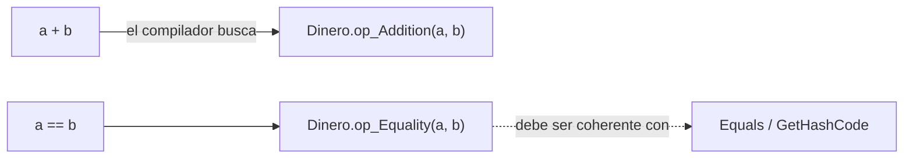

# Sobrecarga de operadores

Parte de: [[03-CSharp-DotNet/03 Intermedio/_Índice Intermedio|Intermedio]]

> [!info] Cómo avanzar
> `progreso`: **pendiente** → **viendo** (estudiando) → **visto** (contestaste la autoevaluación sin abrir las respuestas) → **dominado** (hiciste el laboratorio o lo aplicaste de verdad).

## Contenido

### Qué es
La **sobrecarga de operadores** permite definir qué significan `+`, `-`, `*`, `==`, `<`, etc. para **tus propios tipos**. Así, un tipo de dominio como `Dinero` o `Cantidad` puede usarse con la misma sintaxis que los números: `subtotal + iva`, `precio * 3`, `a > b`. El objetivo es que el código de dominio se lea natural sin perder seguridad de tipos.

### Cómo funciona
Un operador es un método `public static` con la palabra `operator`:

```csharp
public static Dinero operator +(Dinero a, Dinero b) => ...;
```
- Al menos un parámetro debe ser del tipo que lo declara.
- Los **unarios** reciben un parámetro (`-x`, `!x`, `++x`); los **binarios**, dos.
- Los **compuestos** (`+=`, `-=`) se obtienen automáticamente a partir del binario. Desde **C# 14** también puedes definir operadores de asignación compuesta como métodos de instancia, para modificar el objeto en su lugar sin crear uno nuevo (útil en tipos grandes y mutables).
- **Conversiones**: `implicit operator` y `explicit operator` definen *casts*.
- No se pueden sobrecargar `=`, `&&`, `||` (se derivan de `&`, `|`, `true` y `false`), `?:`, `??`, `new` ni `.`.

**Reglas de pareja** (el compilador las exige):
- `==` y `!=` van juntos.
- `<` y `>` van juntos.
- `<=` y `>=` van juntos.
- `true` y `false` van juntos.
Además, si sobrecargas `==`, debes **sobrescribir `Equals` y `GetHashCode`** para que la igualdad sea coherente en colecciones, diccionarios y LINQ (el compilador da advertencias si no). Los **records** ya generan `==`, `!=`, `Equals` y `GetHashCode` por valor; si usas un `record`, normalmente no tienes que escribirlos.



### Ejemplo
Un tipo de valor `Dinero` que impide sumar pesos con dólares por accidente:

```csharp
public readonly record struct Dinero(decimal Monto, string Moneda)
{
    public static Dinero Mxn(decimal monto) => new(monto, "MXN");

    public static Dinero operator +(Dinero a, Dinero b)
    {
        MismaMoneda(a, b);
        return a with { Monto = a.Monto + b.Monto };
    }

    public static Dinero operator -(Dinero a, Dinero b)
    {
        MismaMoneda(a, b);
        return a with { Monto = a.Monto - b.Monto };
    }

    public static Dinero operator *(Dinero a, decimal factor) => a with { Monto = a.Monto * factor };
    public static Dinero operator -(Dinero a) => a with { Monto = -a.Monto };   // unario

    // Comparación: pareja < y >, pareja <= y >=
    public static bool operator <(Dinero a, Dinero b) { MismaMoneda(a, b); return a.Monto < b.Monto; }
    public static bool operator >(Dinero a, Dinero b) { MismaMoneda(a, b); return a.Monto > b.Monto; }
    public static bool operator <=(Dinero a, Dinero b) => !(a > b);
    public static bool operator >=(Dinero a, Dinero b) => !(a < b);

    // == y != , Equals y GetHashCode ya los genera el record struct

    private static void MismaMoneda(Dinero a, Dinero b)
    {
        if (a.Moneda != b.Moneda)
            throw new InvalidOperationException($"No se pueden combinar {a.Moneda} y {b.Moneda}");
    }

    public override string ToString() => $"{Monto:N2} {Moneda}";
}

var subtotal = Dinero.Mxn(1_000m);
var iva = subtotal * 0.16m;
var total = subtotal + iva;                 // 1,160.00 MXN
total -= Dinero.Mxn(60m);                   // += y -= salen gratis del binario
Console.WriteLine(total > subtotal);        // True
// var error = total + new Dinero(10m, "USD"); // InvalidOperationException
```

### Cuándo usarlo y cuándo no
- **Tiene sentido** cuando el operador tiene un significado **obvio y matemático** para el tipo: dinero, cantidades con unidad, coordenadas, vectores, fechas o rangos propios, números grandes.
- **Con *generic math***, implementar interfaces como `IAdditionOperators<TSelf, TOther, TResult>` permite que tu tipo funcione en métodos genéricos (ver [[Constraints de genéricos]]).
- **No** lo uses para operaciones que no se adivinan: `pedido + producto` para "agregar un producto" es confuso; un método `AgregarPartida` es más claro.
- **No** sobrecargues `==` en clases mutables o entidades con identidad (un `Cliente` con `Id`): la igualdad por referencia o por `Id` explícita suele ser lo correcto.

### Errores comunes
1. **Sobrecargar `==` sin `Equals`/`GetHashCode`**: `==` dice que son iguales, pero un `HashSet` o un `Dictionary` los trata como distintos.
2. **Olvidar el caso `null`** en `==` de clases: `a == null` puede lanzar `NullReferenceException` dentro de tu operador. (Por esto se prefiere `is null`, ver [[Pattern matching]].)
3. **Operadores con efectos secundarios** o que modifican sus argumentos: se espera que `a + b` no cambie ni `a` ni `b`.
4. **Semántica sorpresiva** (`-` que concatena, `*` que guarda en BD).

### Para profundizar
- [Sobrecarga de operadores (referencia de C#)](https://learn.microsoft.com/dotnet/csharp/language-reference/operators/operator-overloading)
- [Operadores de conversión definidos por el usuario](https://learn.microsoft.com/dotnet/csharp/language-reference/operators/user-defined-conversion-operators)
- [Cómo definir la igualdad de valores para un tipo](https://learn.microsoft.com/dotnet/csharp/programming-guide/statements-expressions-operators/how-to-define-value-equality-for-a-type)

## Autoevaluación

Contesta primero en voz alta o en papel; luego despliega la respuesta.

> [!question]- ¿Cómo se sobrecarga `+`?
> `public static Dinero operator +(Dinero a, Dinero b) => ...;` Siempre `public static`.

> [!question]- ¿Qué reglas de pareja hay?
> Si sobrecargas `==` debes sobrecargar `!=` (igual con `<` y `>`); y conviene sobrescribir `Equals` y `GetHashCode`.

> [!question]- ¿Cuándo tiene sentido?
> En tipos de valor matemáticos o de dominio (`Dinero`, `Vector`). Evítalo si el significado del operador no es obvio.

