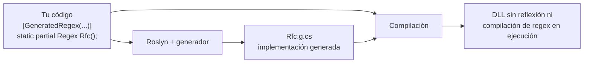

# Source generators y GeneratedRegex

Parte de: [[03-CSharp-DotNet/03 Intermedio/_Índice Intermedio|Intermedio]]

> [!info] Cómo avanzar
> `progreso`: **pendiente** → **viendo** (estudiando) → **visto** (contestaste la autoevaluación sin abrir las respuestas) → **dominado** (hiciste el laboratorio o lo aplicaste de verdad).

## Contenido

### Qué es
Un **source generator** es un componente que se ejecuta **dentro del compilador** (Roslyn) mientras compilas: analiza tu código (clases, atributos, archivos adicionales) y **genera código C# nuevo** que se compila junto con el tuyo. A diferencia de la [[Reflexión]], el trabajo ocurre en compilación: en ejecución no hay escaneo ni código dinámico, solo código normal ya generado. `[GeneratedRegex]` es uno de los generadores que trae .NET: convierte una expresión regular en código C# optimizado.

### Cómo funciona
1. Instalas o ya tienes el generador (muchos vienen incluidos en el SDK de .NET; otros son paquetes NuGet).
2. Marcas tu código con lo que el generador busca, normalmente un **atributo** sobre un método o tipo `partial`.
3. Al compilar, el generador lee esa declaración y **escribe la otra mitad** del `partial` en un archivo `.g.cs`.
4. El resultado es código que puedes ver: en Visual Studio, en *Dependencies → Analyzers → (generador)*; o agregando `<EmitCompilerGeneratedFiles>true</EmitCompilerGeneratedFiles>` al `.csproj` para guardarlo en `obj/`.

Los generadores modernos son **incrementales** (`IIncrementalGenerator`): solo regeneran lo que cambió, para no volver lento el IDE.



**`GeneratedRegex`** (.NET 7+): declaras un método (o, desde C# 13, una propiedad) `static partial` que regresa `Regex`, con el patrón y opciones en el atributo. Beneficios frente a `new Regex(...)`:
- El patrón se valida **al compilar** (un patrón inválido es error de compilación, no excepción en producción).
- No hay costo de construir y compilar la regex en el arranque.
- El código generado es legible, se puede depurar y funciona con **Native AOT** y *trimming*.

**Ejemplos de generadores incluidos en .NET**:
- **System.Text.Json**: `JsonSerializerContext` genera serializadores sin reflexión (ver [[Serialización con System.Text.Json]]).
- **Logging**: `[LoggerMessage]` genera métodos de log de alto rendimiento sin *boxing* ni análisis de plantilla en cada llamada.
- **Interop**: `[LibraryImport]` genera el código de P/Invoke.
- **Configuración**: el *binder* de configuración con generación de código (`EnableConfigurationBindingGenerator`), y validación de opciones con `[OptionsValidator]`.
- **Minimal APIs**: el *Request Delegate Generator* para que los endpoints funcionen con AOT.

### Ejemplo
```csharp
using System.Text.RegularExpressions;
using Microsoft.Extensions.Logging;

public static partial class Validaciones
{
    // RFC de persona moral o física (simplificado): 3-4 letras, 6 dígitos de fecha, 3 alfanuméricos
    [GeneratedRegex(@"^[A-ZÑ&]{3,4}\d{6}[A-Z0-9]{3}$", RegexOptions.IgnoreCase | RegexOptions.CultureInvariant)]
    private static partial Regex Rfc();

    [GeneratedRegex(@"^\d{5}$")]
    private static partial Regex CodigoPostal();

    public static bool EsRfcValido(string? s) => s is not null && Rfc().IsMatch(s);
    public static bool EsCpValido(string? s) => s is not null && CodigoPostal().IsMatch(s);
}

// Uso con FluentValidation
// RuleFor(x => x.Rfc).Must(Validaciones.EsRfcValido).WithMessage("RFC inválido");

// Logging generado: más rápido y con plantillas verificadas en compilación
public static partial class Log
{
    [LoggerMessage(EventId = 1001, Level = LogLevel.Warning,
        Message = "Pedido {PedidoId} rechazado por {Motivo}")]
    public static partial void PedidoRechazado(this ILogger logger, int pedidoId, string motivo);
}
// logger.PedidoRechazado(15, "sin existencia");
```

```xml
<!-- Para ver el código generado en obj/ -->
<PropertyGroup>
  <EmitCompilerGeneratedFiles>true</EmitCompilerGeneratedFiles>
</PropertyGroup>
```

### Cuándo usarlo y cuándo no
- **`GeneratedRegex`** siempre que el patrón sea **constante**. Es la recomendación oficial; el analizador SYSLIB1045 te sugiere el cambio.
- **`LoggerMessage`** en rutas calientes o servicios con mucho log.
- **Generadores de serialización y configuración** cuando publicas con Native AOT o *trimming*, o cuando el arranque en frío importa (Azure Functions, contenedores que escalan).
- **Escribir tu propio generador** vale la pena para eliminar código repetitivo a gran escala (por ejemplo, generar el registro de todas tus consultas SQL sin reflexión). Es un proyecto aparte (`netstandard2.0`, paquete `Microsoft.CodeAnalysis.CSharp`), con su propia curva de aprendizaje y pruebas; para algo pequeño, no compensa.
- **No sirve** para patrones de regex que llegan en ejecución (configuración, entrada del usuario): ahí usa `new Regex(...)` con `RegexOptions.Compiled` o `NonBacktracking` y un `matchTimeout`.

### Errores comunes
1. **Olvidar `partial`** en el método y en la clase contenedora: el generador no puede completar la declaración.
2. **Crear `new Regex(patron)` en cada llamada**: costo de construcción repetido; usa `GeneratedRegex` o una instancia estática.
3. **No ver el código generado** y depurar a ciegas; habilita `EmitCompilerGeneratedFiles`.
4. **Generadores no incrementales** (los antiguos `ISourceGenerator`): vuelven lento el IDE.
5. **Regex sin límites** sobre entrada del usuario: riesgo de *backtracking* catastrófico (ReDoS); usa `matchTimeoutMilliseconds` o `RegexOptions.NonBacktracking`.

### Para profundizar
- [Source generators de .NET (Microsoft Learn)](https://learn.microsoft.com/dotnet/csharp/roslyn-sdk/source-generators-overview)
- [Generadores de código fuente de expresiones regulares](https://learn.microsoft.com/dotnet/standard/base-types/regular-expression-source-generators)
- [Generación de código de logging en tiempo de compilación](https://learn.microsoft.com/dotnet/core/extensions/logger-message-generator)

## Autoevaluación

Contesta primero en voz alta o en papel; luego despliega la respuesta.

> [!question]- ¿Qué es un source generator?
> Un componente del compilador que lee tu código y genera código C# nuevo durante el build. Evita reflexión en ejecución y es compatible con Native AOT.

> [!question]- ¿Cómo se usa `GeneratedRegex`?
> ```csharp
> public static partial class Patrones {
>     [GeneratedRegex(@"^[A-Z]{3}-\d{4}$")]
>     public static partial Regex Codigo();
> }
> ```
> El regex se genera en compilación y se valida al compilar.

> [!question]- Ejemplos de generadores en .NET
> System.Text.Json (`JsonSerializerContext`), `LoggerMessage` para logging, `LibraryImport`, `GeneratedRegex` y la validación de Options.

