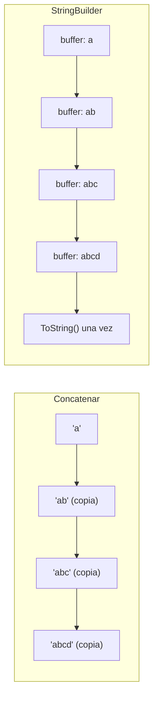

# StringBuilder

Parte de: [[03-CSharp-DotNet/03 Intermedio/_Índice Intermedio|Intermedio]]

> [!info] Cómo avanzar
> `progreso`: **pendiente** → **viendo** (estudiando) → **visto** (contestaste la autoevaluación sin abrir las respuestas) → **dominado** (hiciste el laboratorio o lo aplicaste de verdad).

## Contenido

### Qué es
`StringBuilder` (en `System.Text`) es un **buffer de texto mutable** para construir cadenas por partes. Como `string` es **inmutable** (ver [[string e inmutabilidad]]), cada `s += "x"` crea un string nuevo y copia todo el contenido anterior. En un ciclo de *n* concatenaciones eso significa copiar cada vez más texto (costo cuadrático) y generar mucha basura para el [[Recolector de basura]]. `StringBuilder` va agregando en un buffer interno y solo crea el `string` final al llamar `ToString()`.

### Cómo funciona
- Internamente mantiene **trozos** (*chunks*) de arreglos de `char`. `Append` escribe en el trozo actual; si no cabe, crea uno nuevo más grande y lo enlaza. No copia lo ya escrito.
- **Capacidad inicial**: `new StringBuilder(4096)` reserva desde el principio espacio para 4096 caracteres. Si sabes aproximadamente cuánto vas a escribir, evitas que crezca varias veces (cada crecimiento es una asignación nueva) y reduces la fragmentación. Por defecto empieza con 16 caracteres.
- `ToString()` crea **un** string con todo el contenido.
- Métodos útiles: `Append`, `AppendLine`, `AppendJoin`, `Insert`, `Replace`, `Remove`, `Clear` (reutilizar el mismo builder), y `Append` con **cadenas interpoladas** (`sb.Append($"{x}")`), que desde C# 10 escribe directo en el buffer sin crear un string intermedio.



**Cuándo NO hace falta**: concatenar un número **fijo y pequeño** de partes en una sola expresión (`a + b + c` o `$"{a} {b}"`): el compilador ya lo convierte en una sola llamada eficiente (`string.Concat` o un *interpolated string handler*). Usar `StringBuilder` ahí solo agrega ruido.

### Ejemplo
Armar un CSV de reporte en Wee.Reporteria:

```csharp
using System.Globalization;
using System.Text;

public sealed record Venta(string Vendedor, string Zona, decimal Monto);

public static class ExportadorCsv
{
    public static string Generar(IReadOnlyList<Venta> ventas)
    {
        // Estimación: ~40 caracteres por fila + encabezado
        var sb = new StringBuilder(capacity: 64 + ventas.Count * 40);
        sb.AppendLine("Vendedor,Zona,Monto");

        foreach (var v in ventas)
        {
            // Append con interpolación: escribe directo al buffer
            sb.Append(CultureInfo.InvariantCulture, $"{Escapar(v.Vendedor)},{v.Zona},{v.Monto:F2}")
              .AppendLine();
        }
        return sb.ToString();
    }

    private static string Escapar(string s) =>
        s.Contains(',') || s.Contains('"') ? $"\"{s.Replace("\"", "\"\"")}\"" : s;
}

// Para archivos grandes, mejor escribir directo al stream sin construir el string completo:
// await using var w = new StreamWriter(ruta);  await w.WriteLineAsync(...);

// Casos donde NO necesitas StringBuilder
string nombre = "Ana", apellido = "López";
string completo = $"{nombre} {apellido}";                // una expresión: ya es eficiente
string lista = string.Join(", ", ["a", "b", "c"]);       // unir colecciones

// Alternativa sin asignaciones intermedias: string.Create escribe en el buffer final
string folio = string.Create(12, 123, static (span, n) =>
{
    "FAC-".AsSpan().CopyTo(span);
    n.TryFormat(span[4..], out _, "D8");                  // FAC-00000123
});
```

**Alternativas para código crítico** (reducir asignaciones al máximo):
- `string.Create(longitud, estado, (span, estado) => ...)`: escribes directamente en la memoria del string final; cero copias intermedias.
- `Span<char>` con `stackalloc` y `TryFormat` para textos cortos (ver [[Span y Memory]]).
- *Pooling* del propio builder (`ObjectPool<StringBuilder>` de `Microsoft.Extensions.ObjectPool`) cuando construyes muchos textos por segundo.
- Escribir directo a un `Stream`/`TextWriter`/`IBufferWriter<byte>` en lugar de construir un string gigante.

### Cuándo usarlo y cuándo no
- **Úsalo** al concatenar en **ciclos** o con un número variable de partes: CSV, HTML de correos, SQL dinámico (con parámetros, nunca valores concatenados), mensajes largos.
- **No** para 2 o 3 partes conocidas: la interpolación es más clara e igual de rápida.
- **No** para unir una colección con separador: `string.Join` es más simple.
- **Para salida enorme** (archivos de cientos de MB), escribe en streaming al destino.

### Errores comunes
1. **`+=` dentro de un ciclo** con miles de iteraciones: lentitud y presión de GC.
2. **`sb.Append(a + b)`**: la concatenación crea un string temporal; usa `Append(a).Append(b)` o `Append($"{a}{b}")`.
3. **Llamar `ToString()` repetidamente** en el ciclo (para medir longitud o revisar): usa `sb.Length`.
4. **Ignorar la cultura** al formatear números y fechas en archivos para máquinas: usa `CultureInfo.InvariantCulture` (en es-MX el separador decimal es punto, pero en otras culturas es coma).
5. **Construir SQL concatenando valores** del usuario: inyección SQL (ver [[Parametrización y SQL injection]]).

### Para profundizar
- [Usar la clase StringBuilder en .NET](https://learn.microsoft.com/dotnet/standard/base-types/stringbuilder)
- [Clase StringBuilder (referencia de API)](https://learn.microsoft.com/dotnet/api/system.text.stringbuilder)
- [Método string.Create (referencia de API)](https://learn.microsoft.com/dotnet/api/system.string.create)

## Autoevaluación

Contesta primero en voz alta o en papel; luego despliega la respuesta.

> [!question]- ¿Cuándo usar `StringBuilder`?
> Al construir una cadena en muchos pasos o en bucles. Para unir pocos valores, la interpolación o `string.Join` son igual de buenas.

> [!question]- ¿Qué ventaja da la capacidad inicial `new StringBuilder(4096)`?
> Evita que el búfer interno crezca y se copie varias veces.

> [!question]- ¿Qué alternativa hay para reducir asignaciones en código crítico?
> `string.Create`, `stackalloc` con `Span<char>` o los interpoladores que escriben directo en un búfer.

## Práctica

- [[Lab 8 - BenchmarkDotNet midiendo allocations]]

