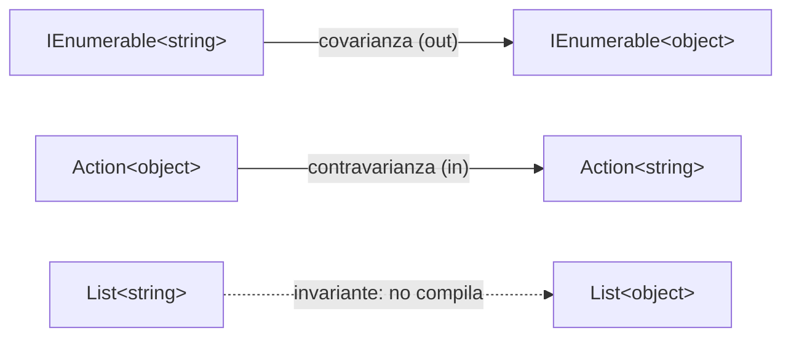

# Varianza (in y out) en genéricos

Parte de: [[03-CSharp-DotNet/03 Intermedio/_Índice Intermedio|Intermedio]]

> [!info] Cómo avanzar
> `progreso`: **pendiente** → **viendo** (estudiando) → **visto** (contestaste la autoevaluación sin abrir las respuestas) → **dominado** (hiciste el laboratorio o lo aplicaste de verdad).

## Contenido

### Qué es
La **varianza** dice cuándo un tipo genérico construido con un tipo puede usarse donde se espera el mismo genérico con otro tipo relacionado por herencia. Hay tres casos:
- **Covarianza (`out`)**: puedes usar un tipo *más derivado* donde se espera uno más general. `IEnumerable<string>` sirve como `IEnumerable<object>`.
- **Contravarianza (`in`)**: lo opuesto; puedes usar un tipo *más general* donde se espera uno más específico. Un `Action<object>` sirve como `Action<string>`.
- **Invarianza**: no hay conversión. Es lo que pasa con todas las **clases** genéricas, como `List<T>`.

En C# la varianza solo se declara en **interfaces y delegados genéricos**, y solo aplica a tipos de referencia.

### Cómo funciona
La regla viene de qué hace el tipo con `T`:
- Si `T` solo **sale** (valores de retorno, propiedades de solo lectura), es seguro tratar una fuente de `string` como fuente de `object`: todo lo que salga será un `object` válido. Por eso se marca `out T`. Ejemplos: `IEnumerable<out T>`, `IReadOnlyList<out T>`, `Func<out TResult>`.
- Si `T` solo **entra** (parámetros), es seguro tratar a quien acepta `object` como alguien que acepta `string`: cualquier `string` que le pases es un `object`. Se marca `in T`. Ejemplos: `Action<in T>`, `IComparer<in T>`, `IEqualityComparer<in T>`.
- Si `T` entra **y** sale, no puede ser variante. `List<T>` tiene `Add(T)` (entra) y el indexador (sale). Si `List<string>` pudiera tratarse como `List<object>`, alguien podría hacer `Add(42)` y romper la lista de strings. Por eso el compilador la prohíbe.



El compilador valida tus anotaciones: si marcas `out T` y luego usas `T` como parámetro, marca error.

### Ejemplo
```csharp
// Covarianza: una fuente de Cliente sirve como fuente de Persona
public class Persona { public required string Nombre { get; init; } }
public sealed class Cliente : Persona { public int Puntos { get; init; } }

IEnumerable<Cliente> clientes = [new Cliente { Nombre = "Ana", Puntos = 10 }];
IEnumerable<Persona> personas = clientes;          // OK por IEnumerable<out T>
IReadOnlyList<Persona> lista = new List<Cliente>(); // OK por IReadOnlyList<out T>

// List<Persona> mal = new List<Cliente>();        // CS0029: List<T> es invariante

// Contravarianza: un comparador general sirve para un tipo específico
IComparer<Persona> porNombre = Comparer<Persona>.Create(
    (a, b) => string.Compare(a.Nombre, b.Nombre, StringComparison.OrdinalIgnoreCase));
IComparer<Cliente> paraClientes = porNombre;       // OK por IComparer<in T>

Action<Persona> saludar = p => Console.WriteLine($"Hola {p.Nombre}");
Action<Cliente> saludarCliente = saludar;          // OK por Action<in T>

// Tu propia interfaz variante
public interface IFuente<out T> { T Obtener(); }          // T solo sale
public interface IDestino<in T> { void Enviar(T valor); }  // T solo entra

// El problema de los arrays: covarianza insegura heredada de Java/.NET 1.0
object[] objetos = new string[2];   // compila (covarianza de arrays)
objetos[0] = "ok";
// objetos[1] = 42;                 // ArrayTypeMismatchException en tiempo de ejecución
```

Los **arrays** de tipos de referencia son covariantes desde .NET 1.0, pero de forma **insegura**: el compilador acepta `object[] o = new string[2]` y luego cada escritura tiene que verificarse en ejecución. Si escribes un `int`, revienta con `ArrayTypeMismatchException`. Esa verificación además cuesta rendimiento en cada asignación. Por eso, para exponer datos de solo lectura, conviene `IReadOnlyList<T>` en lugar de arrays.

### Cuándo usarlo y cuándo no
- **Aprovéchala** al diseñar APIs: recibe `IEnumerable<T>` o `IReadOnlyList<T>` en lugar de `List<T>` y aceptarás colecciones de subtipos sin copiar.
- **Declara `out`/`in`** en tus interfaces cuando `T` solo sale o solo entra (fuentes, fábricas, manejadores, validadores).
- **No sirve** con tipos de valor: `IEnumerable<int>` no se convierte a `IEnumerable<object>` porque requeriría *boxing*.
- **Alternativa** cuando necesitas convertir una lista invariante: `lista.Cast<Persona>().ToList()` o `[.. lista]`, aceptando la copia.

### Errores comunes
1. **Esperar varianza en clases** (`List<T>`, `Task<T>`): solo interfaces y delegados la tienen.
2. **Confundir la dirección**: `out` = "más derivado hacia más general" en lo que produce; `in` = lo contrario en lo que consume.
3. **Confiar en arrays covariantes** y descubrir el `ArrayTypeMismatchException` en producción.
4. **Intentar varianza con `struct`**: no aplica; hay que copiar.

### Para profundizar
- [Covarianza y contravarianza en genéricos (Microsoft Learn)](https://learn.microsoft.com/dotnet/standard/generics/covariance-and-contravariance)
- [Varianza en interfaces genéricas (C#)](https://learn.microsoft.com/dotnet/csharp/programming-guide/concepts/covariance-contravariance/variance-in-generic-interfaces)
- [Modificador out para parámetros genéricos](https://learn.microsoft.com/dotnet/csharp/language-reference/keywords/out-generic-modifier)

## Autoevaluación

Contesta primero en voz alta o en papel; luego despliega la respuesta.

> [!question]- ¿Qué significa covarianza (`out`)?
> Que puedes usar un tipo más derivado donde se espera el base: `IEnumerable<string>` se asigna a `IEnumerable<object>` porque `IEnumerable<out T>` solo *produce* T.

> [!question]- ¿Qué significa contravarianza (`in`)?
> Lo contrario: `IComparer<object>` se puede usar como `IComparer<string>`, porque `IComparer<in T>` solo *consume* T.

> [!question]- ¿Por qué `List<string>` no se puede asignar a `List<object>`?
> `List<T>` produce y consume T; si se pudiera, alguien haría `Add(5)` en una lista de strings. Solo interfaces y delegados pueden ser variantes, y solo con tipos de referencia.

> [!question]- ¿Qué problema tienen los arrays con la covarianza?
> `object[] a = new string[1]; a[0] = 5;` compila pero lanza `ArrayTypeMismatchException` en ejecución.

